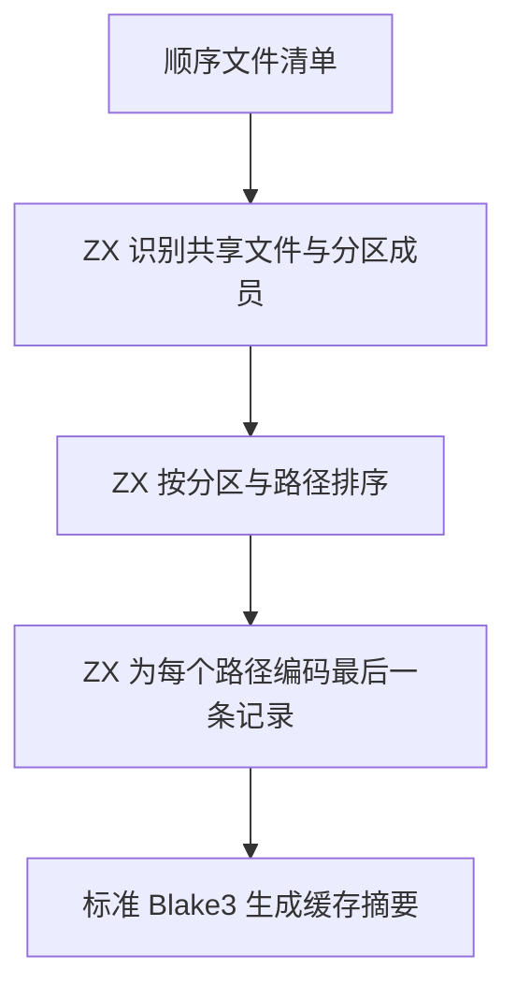
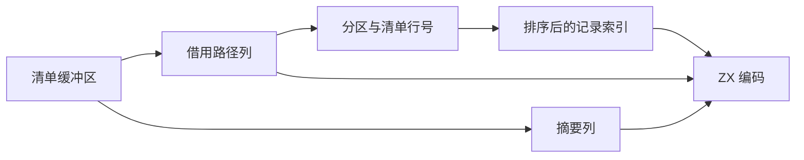

# 分区缓存成员选择自举

## Intent

把构建缓存键的共享摘要选择、分区成员识别、排序及重复消解迁入 RX/ZX，保持历史摘要字节，并避免在顺序清单和哈希表之间重新登记每个路径。

## Data

分区工具已经从清单获得路径与摘要列。此前它先将两列登记到 Zig 哈希表，再按分区复制成员，排序后逐批重新组织路径和摘要供 ZX 编码。本阶段从清单索引直接排序，编码时按同一路径的最后一个记录索引读取摘要。

## Edges

读取清单、文件遍历、进程和 Blake3 保持宿主平台接口。分区编号沿用 Zig 标准库的无符号十进制解析。成员以分区编号、路径字节、清单行号排序。Zig 为每个分区提供 Blake3 上下文，ZX 借用该分区的连续成员索引和清单列。普通批次和空分区均保持原有摘要。

## Answer

旧版和新版在共享输入变化、非规范分区名、重复路径、无效字节、定向重编和恢复旧输入时生成相同摘要，另对照了 21 份含重复路径的生成清单。缓存记录兼容性、失败恢复及中断后旧输入重建也已验证。解析缓存、RX 依赖图、安装版持久缓存和 watch 的 22 项回归通过。

三阶段分别通过 33、22、22 步。两代 Source 的 11,403 个文件逐字节一致。首次 Native seed 产物包含其既有生成差异。与上一已提交阶段相比，正式主树仅改变标准接口声明及其清单摘要，四个 LLVM 分区对象逐字节一致。

对 16 分区全部命中的同一生成树交替运行两版工具，去掉预热后各 10 次墙钟中位数从 7.26 ms 到 7.41 ms，峰值 RSS 中位数从 4.13 MB 降到 3.46 MB。状态文件和对象的时间戳保持不变。

整仓冷构建使用 Zig 0.17.0、ReleaseSmall、12 核、四个 LLVM 分区及独立空缓存。Native seed 引导安装版，安装版使用 Source 分析与生成。第一次因写满磁盘退出，清理旧测量缓存后重新运行，70 步全部通过。

| 样本     | 墙钟（秒） | CPU（秒） | 进程树峰值（MB） | 单进程峰值（MB） |
| -------- | ---------: | --------: | ---------------: | ---------------: |
| 固定基线 |     117.82 |    207.44 |          2328.74 |          2087.88 |
| 上一阶段 |     112.05 |    204.78 |          2372.52 |          2136.64 |
| 本阶段   |     112.00 |    204.89 |          2291.24 |          2129.95 |

较上一阶段，墙钟减少 0.05 秒，CPU 增加 0.11 秒，进程树峰值下降 81.28 MB，单进程峰值下降 6.69 MB。受改动的分区工具峰值从 4.55 MB 到 3.90 MB。较固定基线，墙钟和 CPU 分别少 5.82 秒和 2.55 秒，进程树峰值下降 37.50 MB，单进程峰值增加 42.07 MB。
