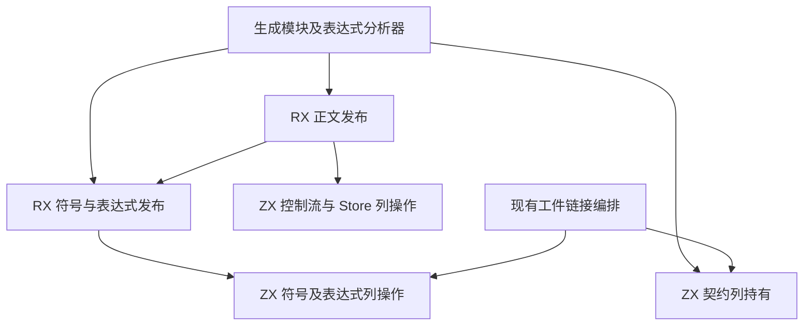

# 分析器正文与契约发布自举

## Intent

将 ZX 模块分析、表达式分析和 RX 表达式编译的 IR 正文发布迁入 RX/ZX。将跨 arena 的复制保持在实际所有权边界，并与工件链接共用已有列操作。

## Data

生成分析器在临时 arena 构造控制流、符号、表达式、Store 和契约。原发布层逐列复制这些表，独立表达式入口只复制符号与表达式。工件路径已有相同的 ZX 表操作。正文和表达式的 RX 编排现在复用这些操作，契约复用工件路径无重映射的分支。

宿主通过值入口取得已持有的列视图，直接将视图转成现有 IR 类型。完整正文的控制表描述符进入最终 IR。纯表达式入口用 `Body.Pick("symbols", "expressions")` 复用类型定义，只构造所需的两张表。

## Edges

- 输出继续拥有跨 arena 的字符串和列数据。类型增量、名义类型、导出与常量发布沿用各自的既有入口。
- 同一份列操作仍支持工件重映射；分析器发布保留原编号。Zig 保留 IR ABI 适配和 arena 生命周期管理。

## Answer

验收覆盖三阶段构建、相邻 Source 产物一致性、契约分配失败、原生共享上下文、工件生命周期及 RX 推导。冷构建核对墙钟、CPU、进程树和单进程峰值。

Native seed、后续两轮 Source 分别通过 33、22、22 步。两轮 Source 的 11,451 个生成文件逐字节一致。改用 `.Pick()` 前后，生成函数文件一致，类型表与生成文件清单有变化，四个最终 LLVM 分区对象的校验和一致。

最终版本通过 17 组 308 项回归，包含契约与错误捕获分配失败、工件脱离源 arena、编译库导入、RX 推导及 IR 校验。基础、共享上下文和 loop 场景的原始、链接与缓存恢复产物均运行通过，合计 9 个测试程序、78 项验证。

以下冷构建使用 Zig 0.17.0、ReleaseSmall、12 核、四个 LLVM 分区和独立空缓存。Native seed 引导安装版，安装版执行 Source 分析和生成。成功的四轮均完成 70 步。

| 样本               | 墙钟（秒） | CPU（秒） | 进程树峰值（MB） | 单进程峰值（MB） |
| ------------------ | ---------: | --------: | ---------------: | ---------------: |
| 固定基线           |     117.82 |    207.44 |          2328.74 |          2087.88 |
| 上一阶段           |     112.86 |    206.89 |          2424.55 |          2140.88 |
| 本阶段首次成功测量 |     123.07 |    218.02 |          2459.42 |          2135.69 |
| 同期旧版对照       |     128.50 |    233.95 |          2445.12 |          2145.75 |
| 本阶段最终隔离测量 |     113.86 |    207.48 |          2351.89 |          2149.79 |

首次冷构建因磁盘空间不足在链接时失败，计时未纳入表格。清理后的首次成功测量和同期旧版对照均偏慢。隔离测量较上一阶段墙钟增加 1.00 秒、CPU 增加 0.59 秒、进程树峰值降低 72.66 MB、单进程峰值增加 8.91 MB。较固定基线墙钟少 3.96 秒，CPU 多 0.04 秒，进程树峰值多 23.15 MB，单进程峰值多 61.91 MB。
