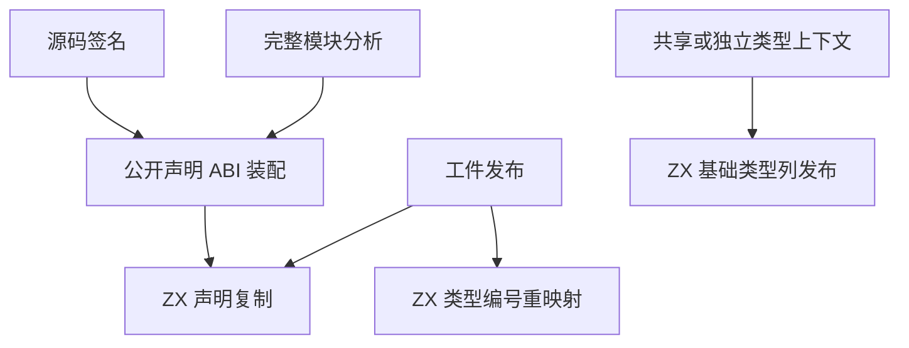

# 分析器类型与公开声明发布自举

## Intent

让模块分析、源码签名分析及工件发布共用 ZX 声明所有权处理。基础类型表的列复制也进入 ZX，共享类型表继续借用长生命周期文本，独立结果继续持有文本。

## Data

源码签名和完整模块各自遍历导出名称与类型编号，再从常量作用域的导出起点构建 IR。工件路径已经有 ZX 声明复制。本阶段提取共有逻辑，保留工件特有的类型重映射，宿主将生成的名称和可选字符串装入既有 IR 行。常量的整数、浮点数、布尔值与枚举保持现有 ABI 表示。

基础类型表的旧实现采用 Zig 反射逐列复制。ZX 明确列出的数值列和字符串描述符由 `.slice()` 直接分配结果存储，需要持有的三列字符串使用相同的名称复制能力。宿主接管独立分配的精确长度切片，保留后续追加能力。

## Edges

- Zig 保留公开 IR 行、常量 union、分配器和切片 ABI 适配。Native seed 的基础类型保存路径保留。名义类型来源表和类型增量提交继续沿用既有入口。
- 工件继续按原映射发布类型编号。完全分析和签名分析保持编号、顺序和常量作用域边界。

## Answer

核对生成代码的列分配与别名语义、三阶段引导、类型和库回归及可比冷构建性能。

Native seed 和后续两轮 Source 分别通过 33、22、22 步。两轮 Source 的 11,461 个生成文件逐字节一致。生成 Zig 对每个数值列使用一次精确长度分配和一次 `memcpy`，没有列表容量头。发布适配器接管列后释放临时表描述符。包含字符串导出、类型别名和负整数导出的源码构建与上一版本生成的 Zig 一致，独立可执行文件输出相同的字符串和负整数。

24 组 248 项回归通过，覆盖类型表追加与合并、名义类型、模块记录、工件生命周期、库装载与编码、IR 校验和 RX 推导。类型和声明源码通过安装版格式与 lint 检查。

隔离冷构建使用 Zig 0.17.0、ReleaseSmall、12 核和四个 LLVM 分区。Native seed 引导安装版，安装版走 Source 分析与生成，70 步全部通过。

| 样本     | 墙钟（秒） | CPU（秒） | 进程树峰值（MB） | 单进程峰值（MB） |
| -------- | ---------: | --------: | ---------------: | ---------------: |
| 固定基线 |     117.82 |    207.44 |          2328.74 |          2087.88 |
| 上一阶段 |     113.86 |    207.48 |          2351.89 |          2149.79 |
| 本阶段   |     112.91 |    206.16 |          2362.21 |          2143.60 |

较上一阶段，墙钟少 0.95 秒，CPU 少 1.32 秒，进程树峰值多 10.32 MB（0.44%），单进程峰值少 6.19 MB。较固定基线，墙钟少 4.91 秒，CPU 少 1.28 秒，进程树峰值多 33.47 MB，单进程峰值多 55.72 MB。
