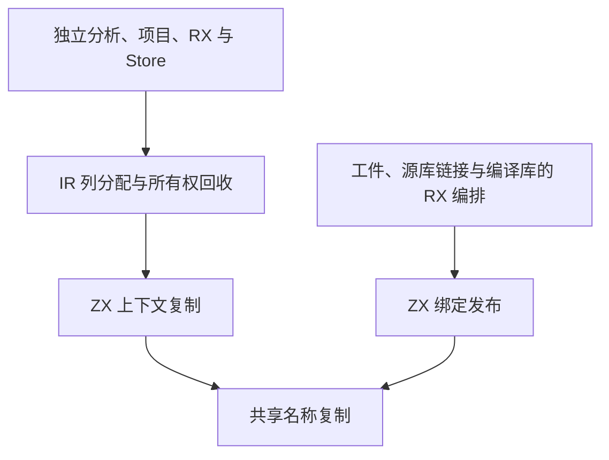
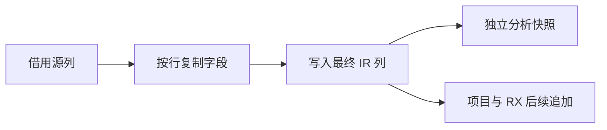

# 原生模块上下文发布自举

## Intent

将独立 ZX 分析、项目共享状态、RX 编译和 Store 表达式使用的原生模块上下文发布迁入 ZX。工件和编译库已有的绑定重映射继续由 RX 编排，并复用相同的名称所有权操作。

## Data

原实现逐行复制模块标识、导入名、来源名、类型命名空间、类型名称和 ID，再向六个可增长列追加。独立分析快照还会收紧这些列。跨分析生命周期的字符串和类型 ID 需要独立持有。

ZX 的 `map` 当前降为 `loop` 和追加。生成代码中的列表可能带有容量头，不能按 Zig `ArrayList` 的裸切片契约接管。宿主现在按已知行数分配最终列，并将独占视图交给 ZX。ZX 按原顺序复制绑定字段，通过 `std:memory` 写入列。`std:string.copyList` 直接构造精确长度的名称切片。写入失败时释放已经完成的正文和列。

## Edges

- 本阶段保留共享表原有的语义校验，以及工件和链接中的类型 ID 重映射。上下文复制保留输入行顺序和 ID。
- 原生适配器提供精确列容量、通用缓冲区读写和失败回收。Native seed 继续使用旧复制实现，Source 使用生成入口。项目 IR 状态本身仍有 Zig 容器，需和后续 IR 状态自举一起验收。

## Answer

验收覆盖生成的 ZX 发布入口及其调用链、两轮 Source 产物一致性、原生链接与编译库相关回归，以及可比配置下的冷构建 CPU、墙钟和峰值内存。

Native seed 和后续两轮 Source 自编分别通过 33、22、22 步。两轮 Source 的 11,436 个生成文件逐字节一致。生成入口借用输入列，直接写入宿主分配的目标列。检查生成 Zig，类型 ID 的 `.slice()` 只为最终切片分配并复制一次，发布入口没有按行追加形成的容量头或中间列表。

13 组 190 项回归通过，覆盖原生链接、编译库导入、工件与 RX 推导及 IR 校验。现有的原生运行用例覆盖基础、共享上下文和 loop 场景，初次分析、链接和缓存恢复三种产物都执行成功，共 9 个测试程序、78 项验证。

整仓冷构建使用 Zig 0.17.0、ReleaseSmall、12 核、四个 LLVM 分区和独立空缓存。Native seed 引导安装版本，安装版执行 Source 分析和生成。

| 样本             | 墙钟（秒） | CPU（秒） | 进程树峰值（MB） | 单进程峰值（MB） |
| ---------------- | ---------: | --------: | ---------------: | ---------------: |
| 固定基线         |     117.82 |    207.44 |          2328.74 |          2087.88 |
| 上一阶段         |     111.65 |    205.64 |          2422.92 |          2136.77 |
| 上一提交同期对照 |     112.87 |    206.10 |          2277.69 |          2133.80 |
| 本阶段首次测量   |     113.91 |    206.77 |          2360.44 |          2146.53 |
| 本阶段隔离复测   |     112.86 |    206.89 |          2424.55 |          2140.88 |

同期对照的四个 LLVM 对象与上一阶段一致。候选两次构建的四个对象一致，均通过 70 步。复测较同期对照墙钟少 0.01 秒，CPU 多 0.79 秒。较上一阶段记录，墙钟多 1.21 秒，CPU 多 1.25 秒，其中对照本身墙钟多 1.22 秒。较固定基线，墙钟和 CPU 分别少 4.96 秒和 0.55 秒。

进程树峰值复测较上一阶段高 1.63 MB，较同期对照高 146.86 MB。复测与上一阶段的树峰同时包含四个 LLVM 进程与 Zig 测试编译，对照的树峰只有三个 LLVM 进程。两次候选的纯 LLVM 分区合计峰值分别为 2337.57 和 2334.47 MB，上一阶段为 2279.21 MB，且本阶段单进程峰值较上一阶段高 4.11 MB。固定基线以来，树峰高 95.81 MB，单进程峰值高 53.00 MB。纯 LLVM 峰值仍有约 55 MB 增长，后续分区调整继续跟踪这一差异。
