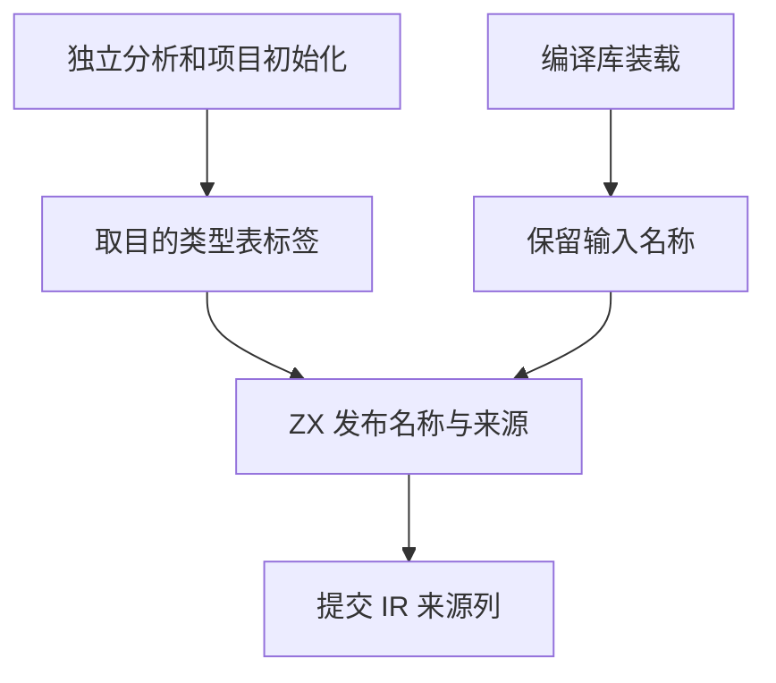
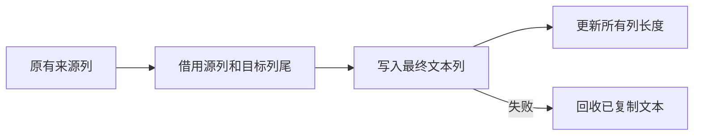

# 名义类型来源表发布自举

## Intent

统一项目初始化、独立分析、RX 混合项目和编译库装载的名义类型来源表发布。来源文本复制、名称选择和最终列写入由 ZX 执行。

## Data

独立分析和项目初始化从目的类型表的标签列取得规范名称，确保名称随结果类型存活。借用模式沿用原有的源码或原生模块来源文本。编译库装载保存输入名称与各列边界，后续入口仍负责校验原始内容。

ZX 直接写入宿主预留的列尾。ID 和来源标签等固定宽度数据批量提交。文本只在跨生命周期时复制。部分失败时，已发布的列长度保持原值，已复制的文本按完成进度回收。

## Edges

- Native seed 保留原有逐行发布。Zig 继续承担列分配、借用缓冲区的 ABI 以及失败回收。来源表的物理容器和类型增量提交仍属于后续自举工作。
- 来源发布与输入校验各自保留原入口。编译库装载保留源列的长度和值，交给已有逻辑解释目标来源表。

## Answer

验收检查三阶段引导、相邻 Source 产物、来源类型共享与生命周期、编译库和 RX 的回归，以及隔离冷构建的墙钟、CPU 与峰值 RSS。

Native seed 和后两轮 Source 分别通过 33、22、22 步。两轮 Source 的 11,466 个生成文件逐字节一致。检查生成 Zig，名称重绑直接读取借用的目标标签，过程不构造临时表或增长列表。

21 组 235 项回归通过，覆盖源码、原生和外部名义类型、分配失败和重试、编译库导入及 Store、模块记录、类型表合并和 RX 推导。安装版格式和 lint 检查通过。

独立冷构建使用 Zig 0.17.0、ReleaseSmall、12 核和四个 LLVM 分区。Native seed 引导安装版，安装版执行 Source 分析与生成。首次构建遇到磁盘空间不足，清理旧生成缓存后完成全部 70 步。失败测量未纳入性能对比。

| 样本     | 墙钟（秒） | CPU（秒） | 进程树峰值（MB） | 单进程峰值（MB） |
| -------- | ---------: | --------: | ---------------: | ---------------: |
| 固定基线 |     117.82 |    207.44 |          2328.74 |          2087.88 |
| 上一阶段 |     112.91 |    206.16 |          2362.21 |          2143.60 |
| 本阶段   |     112.79 |    205.77 |          2360.13 |          2146.45 |

较上一阶段，墙钟少 0.12 秒、CPU 少 0.39 秒、进程树峰值少 2.08 MB、单进程峰值多 2.85 MB。较固定基线，墙钟少 5.03 秒，CPU 少 1.67 秒，进程树峰值多 31.39 MB，单进程峰值多 58.57 MB。
