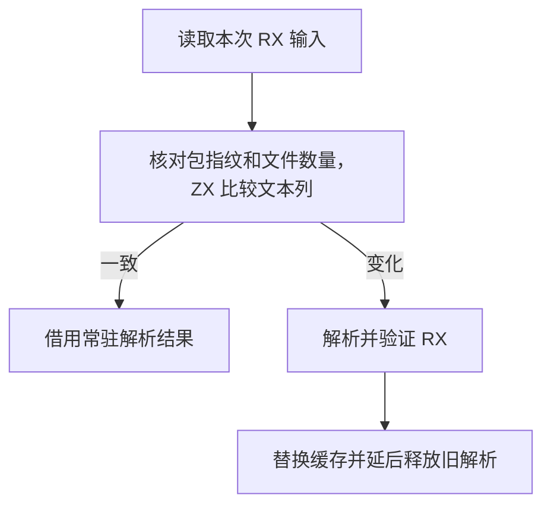

# 常驻 RX 解析缓存自举

## Intent

把常驻 RX 解析缓存的复用规则迁入 ZX，移除用于比较的额外源码副本，保持解析产物和共享分析借用的生命周期。

## Data

XML 解析结果已拥有源码字节。常驻缓存保留路径及对这些字节的引用，先核对包声明指纹和文件数量，再按顺序逐字节核对路径与源码。生成函数分批借用描述符。解析产物及其源码随同一个 arena 退役。

## Edges

保持精确比较、文件顺序与既有诊断。首次 Native seed 使用同样的借用数据形态和原生比较。出错批次保留自己的输入副本，以便解析提前退出时仍能精确复用原诊断。

## Answer

主构建的 273 份 RX 输入在成功解析后省掉 249,542 字节的比较用源码副本。常驻缓存对照通过正文变更、语法失败及恢复、入口和依赖变化。相同输入的增量结果与干净生成逐字节一致。两代 Source 工具通过八轮正文编辑，两版每轮都复用 4,769 个模块。编辑墙钟中位数从 362.25 ms 降至 360.05 ms，无修改请求从 20.25 ms 到 20.35 ms。第八轮常驻进程采样 RSS 为 1178.99 MB 和 1176.54 MB。

Native seed 和两代 Source 重编分别通过 33、22、22 步。两代 Source 的 11,415 个生成文件逐字节一致。整仓冷构建使用 Zig 0.17.0、ReleaseSmall、12 核、四个 LLVM 分区和独立空缓存。Native seed 引导安装版，安装版使用 Source 分析和生成。70 步全部通过，四个 LLVM 分区有两个与上一阶段逐字节一致。

解析缓存、RX 依赖图、RX 文本模块、安装版持久缓存和 watch 的 25 项回归通过。

| 样本     | 墙钟（秒） | CPU（秒） | 进程树峰值（MB） | 单进程峰值（MB） |
| -------- | ---------: | --------: | ---------------: | ---------------: |
| 固定基线 |     117.82 |    207.44 |          2328.74 |          2087.88 |
| 上一阶段 |     112.16 |    205.48 |          2371.39 |          2134.95 |
| 本阶段   |     112.42 |    205.75 |          2369.49 |          2131.92 |

较上一阶段，墙钟增加 0.26 秒，CPU 增加 0.27 秒，进程树峰值下降 1.90 MB，单进程峰值下降 3.03 MB。较固定基线，墙钟减少 5.40 秒，CPU 减少 1.69 秒，进程树峰值增加 40.75 MB，单进程峰值增加 44.04 MB。
