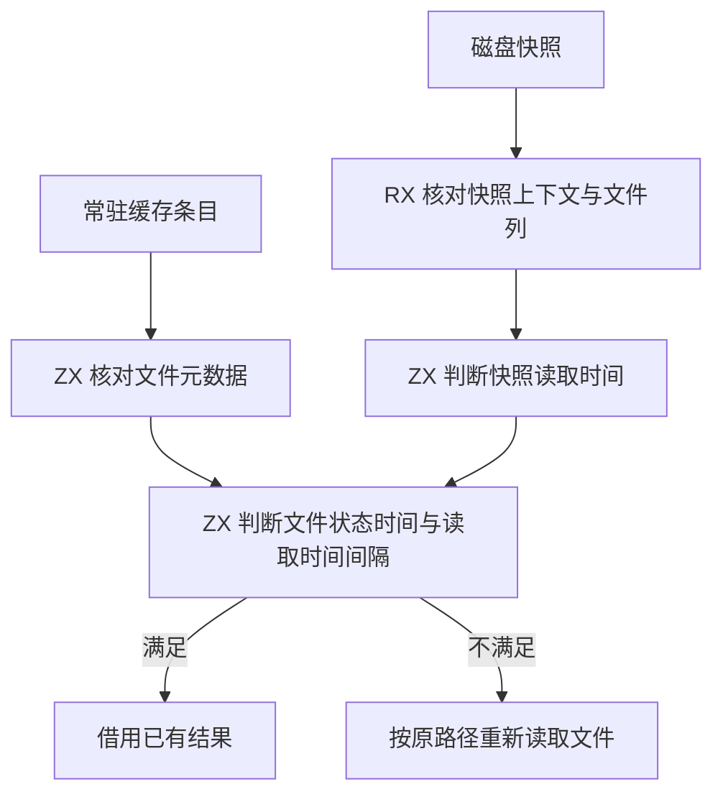
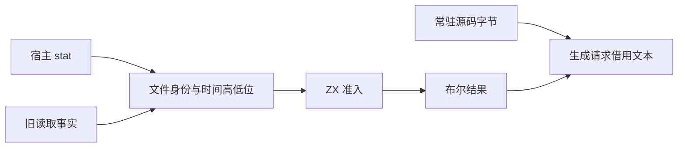

# 生成输入缓存准入自举

## Intent

把常驻生成器的源码复用判定迁入 ZX，和磁盘输入快照共享文件时间边界规则，保持文件读取和字节缓冲区的所有权。

## Data

常驻生成器复用原文本前核对 inode、长度、修改时间和状态时间。磁盘快照核对同样的元数据，还要求读取时间处于当前观测时刻以内。两条路径现在共享严格超过一秒的 ZX 判定，时间的高低位以值传入，源码继续由常驻宿主持有。

## Edges

首次 Native seed 保留原有判定作为引导。Source 通过正常的编译器绑定静态调用生成的 ZX 准入函数。继续使用同一快照格式、时间戳来源和重新读取路径。

## Answer

生成后的常驻准入函数通过 304 个与宽整数实现的对照，覆盖跨低位进位、恰好一秒、负时间戳、接近表示上限和文件身份变化。磁盘快照继续拒绝当前时间之后的读取。常驻生成器的文件编辑、恢复和依赖变化对照通过。

快照损坏恢复、过长输出标记恢复、外部接口变化和模板编辑恢复通过。解析缓存、RX 依赖图、安装版持久缓存和 watch 的 22 项回归通过。

Native seed 和两代 Source 重编分别通过 33、22、22 步。两代 Source 生成的 11,410 个文件逐字节一致。与上一阶段相比，变更发生在主生成树，冷构建四个 LLVM 分区中有两个对象保持一致。

两版 Source 自编译工具交替运行八次正文编辑，均复用 4,768 个模块，墙钟中位数从 361.35 ms 到 361.50 ms。无修改请求去掉首轮后，六次中位数从 20.20 ms 到 20.25 ms。两版工具的相同请求及独立干净生成的 10,643 个文件逐字节一致。

整仓冷构建使用 Zig 0.17.0、ReleaseSmall、12 核、四个 LLVM 分区及独立空缓存。Native seed 生成安装版，安装版采用 Source 分析和生成。旧版与新版同机配对重跑，各通过 70 步。

| 样本             | 墙钟（秒） | CPU（秒） | 进程树峰值（MB） | 单进程峰值（MB） |
| ---------------- | ---------: | --------: | ---------------: | ---------------: |
| 固定基线         |     117.82 |    207.44 |          2328.74 |          2087.88 |
| 上一阶段留存样本 |     112.00 |    204.89 |          2291.24 |          2129.95 |
| 上一阶段同期对照 |     112.48 |    205.87 |          2292.22 |          2137.60 |
| 本阶段           |     112.16 |    205.48 |          2371.39 |          2134.95 |

较同期对照，墙钟减少 0.32 秒，CPU 减少 0.39 秒，单进程峰值下降 2.65 MB。进程树峰值增加 79.17 MB，发生在 LLVM 分区并行编译期间。较固定基线，墙钟减少 5.66 秒，CPU 减少 1.96 秒，进程树峰值增加 42.65 MB，单进程峰值增加 47.07 MB。常驻生成器复用正文的第八轮 RSS 从 1191.33 MB 到 1189.35 MB。

首次候选构建为 116.72 秒，构建期间清理旧 Zig 缓存。该样本单独保留，以上采用清理完成后同机运行的对照。
