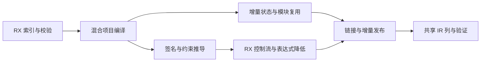
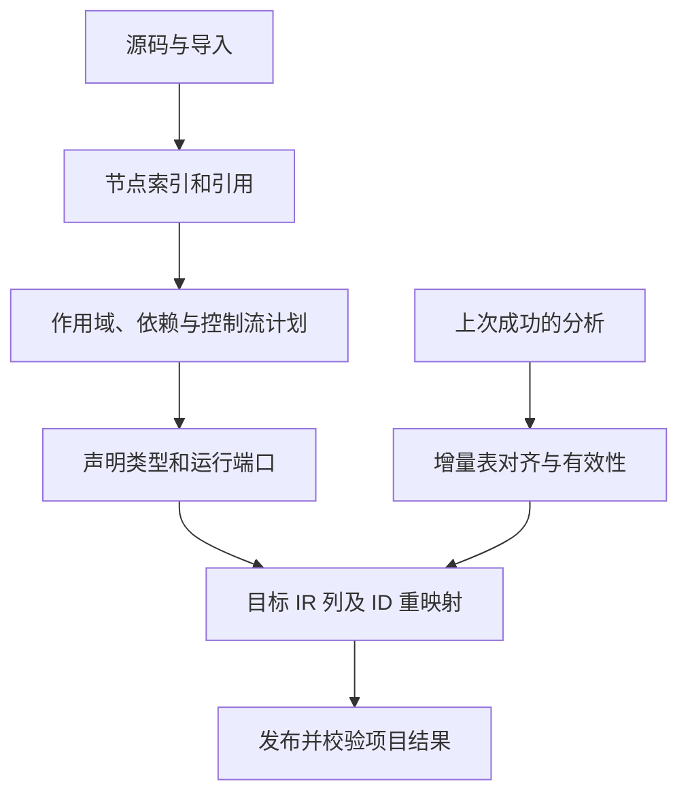

# 自举迁移计划

## Intent

每个阶段以约 3,000 行现存 Zig 所涵盖的相邻职责规划，边界以完整特性和正式调用链为准。完成实现后核对受影响的回归和性能，统一提交推送。原有 RX/ZX 实现在正式入口继续生效。

## Data

盘点基于 `aa2fcd40`。按 Git 已跟踪的生产 `packages/*/src` 统计，排除路径中含 seed 的 216 个文件后，剩余 Zig 源码为 1,211 个文件、111,341 行。这个数字覆盖正式算法、旧实现、未标记的过渡桥和平台边界。未按调用链核对的文件仍计入批次调度规模。

先处理 RX 编译链和共用 IR 状态。以下各行是自举范围索引，每个范围内按完整特性分阶段验收。

| 顺序 | 职责范围                                                         | 验收入口                                                     |
| ---- | ---------------------------------------------------------------- | ------------------------------------------------------------ |
| 1    | RX 执行计划、依赖与装载、约束求解、混合项目链接、IR 发布与共享表 | `rx_analysis` 正式模块和项目入口，统一库消费，缓存恢复与失效 |
| 2    | ZX 前端、类型及所有权、语义状态、衔接的依赖与装载                | 源码分析与校验入口                                           |
| 3    | ZX 项目、语义缓存与工件、库链接、IR 校验和后端入口               | 冷、热项目和库构建                                           |
| 4    | genz 唯一性与原地更新、函数事实、内联、优化与生成调度            | 正式 genz 入口的控制流和所有权用例                           |
| 5    | genz 目标节点、表达式降低、ABI 和打印                            | 结构化 Zig 产物与生成选项                                    |
| 6    | CLI、lint、pkgs、构建与引导的自有规则及全链路闭包核对            | 安装版命令、seed 到 stage3、传递依赖审计                     |

小组边界按实际依赖调整。stdlib 的业务无关平台代码及约 14,207 行 IDNA 数据单独核对。引导和构建的手写逻辑也按正式调用链处理，它们不在上述 `src` 盘点内。

### 当前阶段：语义缓存恢复与工件声明

以 `a88cc4a9` 盘点 3,031 行生产 Zig。语义缓存及入口有 26 个文件、1,929 行，持久工件解码适配有 2 个文件、89 行，缓存依赖的抽取、根登记、映射与物化有 11 个文件、1,013 行。该范围用于核对职责及依赖。

- 源码缓存将准入、重绑定、恢复正文、暂存递归入口和 IR 校验接入 RX 事务。失效或失败时恢复类型与名义来源列、函数尾和恢复载荷的 arena。原生缓存将校验和重映射直接接到工件的公开声明行。
- 工件抽取从原始声明、常量记录和依赖名称读取类型根及原生依赖。已知类型别名从借用行完成核对，函数绑定与依赖的异构字段暂由宿主投影。JSON 解析和物理内存分配继续使用既有宿主接口。
- 验收覆盖内存缓存命中、依赖编辑和诊断、分配失败、缓存编码、原生接口及工件抽取。对照相邻 Source 工具的同清单冷生成数据与产物，收口后提交推送。

### 上一阶段：混合项目链接与公开接口

以 `bc6e132f` 统计涉及的生产 Zig 职责，混合项目主体和其子目录 24 个文件、2,394 行，共享源码与工件链接和公开接口 8 个文件、819 行，IR 入口和校验适配 5 个文件、179 行。合计 37 个文件、3,392 行。该范围用于审计调用链和计划工作量。

- 正式入口从混合项目签名登记、正文链接和增量恢复，到入口及公开声明发布。工件入口从依赖及类型合并，到符号绑定、模块体写入和最终 IR 验证。
- 已接入的名称查重、类型别名选取和 Store 初始化器前缀规则复用原始列。函数描述符的实际分配、解析缓存访问和线程由宿主管理。
- 使用相邻 Source 工具在同一清单、工具链和空输出缓存上对照冷生成。复用已验证的应用清单及现有工件、初始化器和项目资源套件。对照全部相关产物及资源指标后收口提交。

### RX 编译链模块关系

### RX 编译链数据流

## Edges

- 逻辑、规则、状态和正式入口的调用闭包是迁移计量依据。共享列布局、作用域借用、静态分派以及出错后的行为按原语义保留。
- 同类职责直接沿用已经验收的 RX 编排、ZX 原子逻辑和借用列写入方式。优先完成一组相关职责的生产调用链，仅在现有接口无法保持原语义或成本时单独处理缺口。
- 实现期间连续迁移相邻职责。遇到确切的编译或语义问题时使用局部检查定位并继续。每个特性的调用链贯通后，集中运行对应回归和固定基线性能对照。
- 用相同工具链、阶段产物、Source 实现及配置测冷构建墙钟、CPU、进程树与单进程峰值。和固定可比基线及上一批同时核对。发现退化时修正生成、分配或算法的成因并保留已迁移路径。

### 第一批的实现状态

| 路径                        | 已接入的正式逻辑                                                                                                                                                                                                                                                                                                                                                                                                               | 仍待迁移或验证                                                                                                                            |
| --------------------------- | ------------------------------------------------------------------------------------------------------------------------------------------------------------------------------------------------------------------------------------------------------------------------------------------------------------------------------------------------------------------------------------------------------------------------------ | ----------------------------------------------------------------------------------------------------------------------------------------- |
| 类型增量与名义类型          | RX 依次写入标签文本、重定位偏移、绑定名称并搬移数值列。各步骤借用预留的最终列，全部成功后统一发布长度。初始化和增量共享名称绑定，名称借用原标签或增量标签的底层文本。链接与缓存恢复共用标量前缀，失败时按保存的列长度回退。RX 初建类型表和错误集构造复用共用的 ZX 列写入                                                                                                                                                       | 宿主负责容量预留、所有权回退和列长度发布                                                                                                  |
| RX 表达式链接               | ZX 计划返回值和有效行数，宿主一次预留表头。固定载荷和六类聚合载荷在重定位时直接写入最终列，聚合区间同步写入。ZX 按连续行发布类型、种类和跨度，作用域标记和对象字段编号直接落入最终列。公开 Call 参数与顶层 Return 共享文本，分支、Case、Task.out 和内部 Parallel Task 的中间 Program 随编译工作区释放。符号附加成批搬移列                                                                                                      | 宿主管理容量、载荷编号、标量载荷和列长度。临时 Program 与 Store 字段初始化器在链接后释放，最终 Program 持有实际使用的文本                 |
| RX 分支与绑定               | 推导阶段记录各分支的布尔收窄，降低阶段复用结果。Task.out 在准备阶段确定。推导、降低和表达式分析共用绑定的名称列与类型列。ZX 按短路顺序遍历条件，选择有非空证据的路径，分支从已解析的节点直接读取路径。表达式查找在同一次调用中取得词法候选、隐式输入和非空事实。歧义查找的后续候选由 ZX 批量写入已预留的最终列。跨空白的字段路径写入最终缓冲，连续路径借用源码                                                                 | 表达式约束的递归访问、任务体步进、歧义绑定登记、绑定列分配与回退、调用写入仍经宿主                                                        |
| RX Args 端口登记            | Args 校验后直接借用声明所属模块列和已解析类型列，ZX 按模块从稀疏声明中取出输入与输出。未声明端口按连续模块区间批量初始化两个约束图节点，再向端口列写入编号。声明与未声明区间保持原登记顺序                                                                                                                                                                                                                                     | 宿主预留图容量，填写诊断跨度并登记首次遇到的已声明类型                                                                                    |
| RX 枚举别名与成员           | 模块和 Store 准备阶段生成可用作值的别名名称列和类型列，推导、降低及初始化表达式直接借用。RX 从借用的类型列判定别名和成员是否合法，与 ZX 表达式共用保留声明顺序的成员查找。推导中的枚举遮蔽与条件事实可见性共用作用域判断                                                                                                                                                                                                       | 宿主管理导入源，登记推导节点并定位诊断                                                                                                    |
| RX 步骤计划                 | ZX 的 XML 索引扫描同时标定步骤区间、载荷容量和装载事件，给 Parallel Task 分配编号。扫描只为带 out 的 Task 生成退出检查，在任务子体之后执行，并复用输出属性存在性来布局隐式返回。带索引的模块逆序读取事件，按既定行号发布步骤和隐式返回。类型推导与降低读取同一份计划，由 ZX 划分连续 Call 和作用域边界                                                                                                                         | 宿主仍推进载荷绑定、执行带位置的 Task.out 诊断、装载 Call 目标和写入载荷。只提供 AST 的入口沿用逐块布局。模块简写仍需在签名确定后补全计划 |
| Parallel Task 捕获          | 捕获收窄借用父作用域的名称列、类型列和非空事实。ZX 直接写入子作用域的类型列，并按捕获位置选出传输类型和收窄后的参数类型。IR 降低按位置读取借用的名称列                                                                                                                                                                                                                                                                         | Zig 宿主分配绑定表、管理作用域并连接 IR。批次收口时验证类型收窄成本                                                                       |
| 表达式顺序与 RX 值校验      | RX 按表达式与语句两个阶段组织节点顺序索引，ZX 直接写入一次分配的索引列。带索引的 RX 属性在解析结果中保留一份顺序索引，校验、类型推导、非空事实收集及降低借用同一缓冲。ZX 从原语法列按词法顺序提取模板插值和 match 分支的操作数编号，写入固定栈缓冲                                                                                                                                                                             | 宿主仍执行递归推导和约束图写入。非 RX 调用保持按需建索引                                                                                  |
| 运算符与组合表达式推导      | RX 声明一元、二元、条件表达式、模板、match、下标和静态字段选取的约束顺序，引导时静态展开。保留布尔短路和分支非空事实的作用域。比较在完成操作数检查后登记布尔结果，空值合并在右侧之前确认负载，静态字段选取在接收者之前检查键                                                                                                                                                                                                   | 宿主仍登记类型节点、递归应用子表达式约束及恢复分支作用域                                                                                  |
| 模块、Call 与 Task 约束收集 | RX 声明模块简写的端口转发与绑定发布顺序，普通模块先推导步骤，再处理默认输出及输入使用状态。Call 声明端口、Store getter 作用域、入参分析和结果发布顺序。Task 与 Parallel Task 声明任务体分析、输出登记和作用域恢复顺序。引导时静态展开步骤                                                                                                                                                                                      | 宿主仍访问属性、递归执行任务体和分支，并更新约束图及诊断                                                                                  |
| Switch 与 Parallel 约束收集 | RX 声明 Case 和 Default 的标签推导、分支收窄、分支体分析和作用域恢复顺序。Parallel 在推导和降低中让 Call 与 Task 直接写入分组结果列。ZX 借用分组绑定列，在首个冲突或延迟约束处暂停，宿主成批发布已检查的连续绑定                                                                                                                                                                                                               | Zig 仍遍历标签、解析条件、登记延迟约束及更新约束图和诊断                                                                                  |
| 类型归并                    | RX 组织代表节点定位、递归检查、形状判定、归并操作数选取及提交。ZX 从借用的容器、元组和对象列中选取下一个归并对，决定缺失字段的诊断位置和父节点提交时机，并直接写回代表节点的形状列                                                                                                                                                                                                                                             | 宿主管理工作栈、已知类型登记和对象字段分配。递归实现留在初始 Zig seed                                                                     |
| 约束节点与等价类            | ZX 直接写入预留的父节点、形状、载荷和成员列。普通和已知节点、容器链、数字字面量及未声明端口共用形状写入规则。数字约束和节点初始化由一次 Source 调用完成。已知类型批量扫描确认缺失后直接登记。赋值校验、可空传播、对象闭包、输入默认值和类型解析共用 ZX 路径压缩。可空投影从已知类型索引取得目标编号，跳过代表节点已经相同的约束                                                                                                | 宿主预留容量、填写跨度与标量附属列、发布行数，仍执行表达式的递归推导                                                                      |
| 赋值等价类和可空深度        | ZX 在解析可空载荷时直接写入已预留的行。RX 按初始化、等价类合并和代表节点写入的顺序推进，ZX 写入最终父节点和代表节点列。可空深度的初始下界和迭代结果使用同一列。有未解析下标时，ZX 在每次赋值实例化前集中标记结果的代表节点，扫描候选时按位查询                                                                                                                                                                                 | 宿主仍为列分配内存、登记已声明的子类型并包装定位诊断                                                                                      |
| 赋值约束登记                | RX 按代表节点、去重和写入的顺序组织登记。规范化键与端点共用约束表，ZX 查询并写入借用的键、端点和桶列。列表和元组批量写入端点及诊断跨度。声明元组借用已知类型索引，遇到未登记的类型或需要扩容时，先提交已写行，再从原位置继续                                                                                                                                                                                                   | 宿主管理容量、提交行数和首次登记已知类型                                                                                                  |
| 下标与长度约束回放          | 即时推导和回放共用下标候选、字段准入和成员查找。ZX 扫描待处理列并复用已知类型索引，直接标记已经等价的下标结果，跳过已等价的列表或字符串长度和声明对象长度成员。声明对象字段从原类型列按区间读取。下标默认列表与长度歧义诊断共用待定目标的扫描                                                                                                                                                                                  | 宿主仍借出推导对象紧凑字段的名称列，执行有变化的类型合并、首次类型登记和诊断定位                                                          |
| 列表与元组约束回放          | 求解阶段由 ZX 依次定位代表节点并扫描待处理序列，直接借用约束和类型列。等待定型的序列以及没有元素的合法列表留在同一次扫描中处理，遇到需登记约束或诊断的行再返回                                                                                                                                                                                                                                                                 | 宿主仍登记列表成员的首次已知类型、提交赋值约束与定位诊断                                                                                  |
| 类型解析与签名发布          | ZX 在借用的工作栈和成员缓冲中逐层解析类型，只在容量不足时请求扩容。赋值检查和签名发布共用同一个工作区。对象与元组构造借用已经解析的成员区间，构造成功后写入最终类型表                                                                                                                                                                                                                                                          | 宿主分配工作区及类型列，并在出现诊断时转换源码位置                                                                                        |
| 推导对象字段写回            | 普通追加与归并只写入最终字段列的新增项。最近发布的字段视图有空余容量时原地扩展，旧视图仍以原长度读取；从旧视图分叉或扩容时才复制字段名描述符和节点 ID                                                                                                                                                                                                                                                                          | 对齐分配、缓冲区容量管理和扩容时的批量复制仍经宿主                                                                                        |
| 对象构造与选取              | ZX 在借用节点列上确定展开来源、对象形状和准入动作。显式键沿原词法顺序进入名称集合。字段选取共用闭合索引，批量跳过尚未闭合的来源。RX 组织闭合状态初始化与传播，两阶段共用就绪位和队列，闭合索引只保留就绪位。构造和选取共用字段匹配，连续跳过已经满足的字段操作；追加字段直接使用已确定的对象代表节点                                                                                                                           | 宿主管理名称集合和工作区，登记需新增的节点，应用赋值或合并，生成诊断                                                                      |
| 类型合并                    | RX 组织代表节点检查、递归检查、合并规则选择与结果提交。ZX 定位已声明元组和对象的成员区间，按字段对齐或位置选择下一对子节点。RX 调度子节点合并前查找已登记类型，命中直接使用节点编号                                                                                                                                                                                                                                            | Zig 管理可增长的合并栈和字段缓冲区、首次登记类型、定位诊断                                                                                |
| RX 控制流                   | 编译 Call、Task、Parallel 和分支时直接登记步骤、块与调用列。RX 按子块先于父块的顺序组织布局，ZX 计算各块区间，在原有布局列中记录内联单元之后的实际块。块完成时 ZX 核对游标与预期区间。RX 声明 Store getter 到 Call、Task 结果及 Case 标签到块发布的求值和作用域恢复顺序，引导时静态展开。Switch 由 RX 组织类型准入、标签查重与穷尽判定。ZX 直接写预留的表头和载荷列并同步推进游标，Parallel 按源顺序发布分支结果绑定           | 宿主保留动态表达式编译、递归块调用、诊断定位和工作区分配；种子沿用独立布局及写入实现                                                      |
| Store 初始化与作用域        | 字段按声明顺序编译并直接链接，随即释放临时 Program。ZX 直接写入最终对象列的字段位置。Store 与 Args 共用类型声明准入。RX 依次校验并登记命名空间，ZX 复用索引检查重复并生成合法 Object 限定名。模块作用域直接保存名称、路径和类型列，Call 授权按需取回绑定。应用与库发布共用 Store 身份、初始化器选取及借用 IR 列的函数比较。槽复用和初始化器选取共用路径查找，ZX 检查槽类型并合并读写授权                                       | XML 声明访问、字段表达式类型求解、槽列分配与发布仍有宿主路径                                                                              |
| Gateway 路径与服务          | RX 先校验路径段，再由 ZX 计算嵌套前缀和路由缓冲区大小。ZX 将每条路由写入最终缓冲区，并按声明顺序检查服务解析与 HTTP 方法重叠，登记首次出现的服务。装载、库分析和链接共用服务编号，解析完成后每个服务路径只保留一份                                                                                                                                                                                                             | 宿主读取已校验的 XML、解析服务模块路径、定位诊断并管理缓冲区生命周期                                                                      |
| 混合依赖图注册与排程        | 模块的规范路径和依赖边按列保存，ZX、RX 与 Store 来源由两个区间边界表示。依赖队列、签名转发、预分析、Store 检查和历史复用共用登记的区间。ZX 按登记顺序构建路径索引并给出首个重复位置，写入隐式 RX 和 Store 根编号，沿依赖顺序写入签名入口。RX 调度遍历、稳定排序及批次界限三步，ZX 将可达节点直接写入最终顺序列，仅在需要按拓扑深度重排时暂存原顺序                                                                             | 显式根的规范化、依赖边写入、循环诊断定位、解析缓存与扫描工作区仍有宿主路径                                                                |
| 签名和 Type 导入            | ZX 依同一份排序按来源区间选行，混合项目和 Store 检查按行装载签名，引导器用相同规则选择可达 RX 模块。路径解析已查到的登记行号直接交给 ZX 导入装载规则。历史复用从旧依赖顺序和新行号读取规范路径并核对顺序。签名发布保留源模块编号，RX 登记直接复用。ZX 从共用登记索引解析默认再导出，按已登记的 RX 区间检验目标。Type 展开时一次生成限定名并判断枚举值可见性，RX 模块和 Store 共用结果                                          | 签名装载栈、XML 声明访问、类型导出存储和诊断包装仍经宿主                                                                                  |
| 混合依赖边                  | 文件和目录入口命中共用索引后，依赖边复用已查出的行号。RX 依次发布已扫描模块的邻接区间、将新发现的依赖入队，再领出并分类下一个模块。ZX 在同一份预留队列和邻接列上操作，沿用原有遍历和诊断顺序。ZX 导入边只保留字节偏移，XML 边沿用解析器给出的坐标                                                                                                                                                                              | 平台路径处理、解析缓存访问、依赖目标分配和失败诊断抛出仍经宿主                                                                            |
| 解析缓存预取与签名交接      | 混合项目预取直接借用已登记的规范路径和源码。缓存命中由已有 RX 探测规则判定。每个输入只预留一个临时结果指针，工作线程只暂存未命中条目。线程汇合后按输入顺序发布条目并释放暂存区。签名加载按模块行号读取同一次扫描已验证的解析树与摘要，签名阶段结束释放指针列                                                                                                                                                                   | 工作线程、缓存条目的分配与接管、签名装载栈仍经宿主                                                                                        |
| 依赖遍历与调度发布          | RX 图验证、混合项目和工件链接共用 ZX 深度优先遍历。完成的节点从顺序列前端写入，活动栈从末端向前占用同一缓冲。混合项目按实际可达数预留该列。需要重排时暂存原顺序，稳定排序直接写回，批次划分读取最终列。三个入口都能在原生索引为 64 位时直接借用顺序列                                                                                                                                                                          | 宿主预留容量、准备邻接数据并定位诊断；深度、访问标记、边游标和批次端点仍使用调度工作区                                                    |
| Call 准备                   | ZX 选择输入、目标和 setter 属性并判断调用授权及本地预分析资格。推导与降低复用准备阶段借用的输入属性，混合项目复用预分析资格。独立调用与项目依赖共用包作用域和登记匹配                                                                                                                                                                                                                                                          | 目标装载、库绑定和表达式编译仍经宿主                                                                                                      |
| Call 和 Store 初始化器链接  | RX 依次校对共享函数的签名和 Store 授权。ZX 借用函数及 Store 列，校验路径、类型与读写权限，并计算新导入函数的编号区间。非入口串行降低和同一并行批次借用当前函数列，链接无新增函数的结果时重新取当前前缀。RX 和库链接复用 ZX 字节索引登记初始化器身份，先比较版本和函数编号，只有不同函数编号才借用 IR 列比较函数体。已校验的共享前缀直接复用。普通模块与 Parallel Task 均使用项目装载时已经联结的原生模块与函数前缀             | 新函数体与初始化器输出列写入、已链接共享表的结构检查仍经宿主                                                                              |
| 混合项目发布                | 静态发布策略确定可见函数范围和入口函数。历史复用由 RX 编排初始图匹配、来源、端口、依赖和链接增量校验。ZX 直接比较旧、新图的依赖调度和路径列，保留共享列的快速路径。重新分析后由 RX 按对齐、依赖变更和函数区间顺序决定能否继续复用。同一预分析窗口内的连续可复用模块合并恢复，类型、名义来源和函数三张表与类型增量共用 ZX 列写入。签名函数表初始化也调用该写入，借用历史或当前结果持有的载荷。ZX 选择预分析范围和可领取的结果行 | AST 对比、检查点和模块结果提交、历史内存回收、线程执行以及模块编译仍在宿主                                                                |
| IR 函数列与源码链接         | 工件链接与缓存重装路径使用共享 RX/ZX 校验规则核对 Store、符号、表达式与契约列。普通库链接、共享源码链接和 RX Call 导入共用 ZX 函数编号区间规则和函数表写入入口。混合 ZX 正式链接分别借用现有函数前缀与分析新增列。链接批量预留新增函数列，直接接管 ZX 生成的符号、表达式、契约与 Store 表描述符，空 Store 描述符共享静态值。源码链接由 ZX 重映射公开类型、常量和函数编号并判定默认成员                                         | 函数列的容量管理和最终发布、重复入口诊断与未共享初始化器写入仍经宿主。Debug 的完整 IR 校验在临时区拼接函数列                              |

类型增量独立改动已有三阶段生成产物逐字节核对。RX 控制流接入时，前一代 Source 与新宿主用同一份 623 入口主清单，16 分区的 10,830 份生成产物逐字节一致。Store 初始化和作用域接入后，Source 宿主构建成功，9 项初始化器链接、42 项 RX 值策略及 21 项 Store 作用域、生命周期和 setter 检查通过。统一 Store 身份和选取后，安装版通过 16 项路径检查、8 项应用状态检查和 2 项库发布回归。共用步骤计划接入后，安装版通过 9 项 RX 项目检查，覆盖缺失依赖、循环、失败保留原应用和编辑恢复。同批生成对象通过 105 项并行推导和 138 项 RX 推导用例，覆盖嵌套 Task、分支收窄、诊断顺序和分配失败。第一批整体仍在实现，完整回归、性能测量和提交推送待批次收口。

迁移共享顺序索引后，181 个现有 ZX 样例的格式化标准输出与上一版逐字节一致。安装版通过 37 项 RX CLI 拒绝检查和 3 项运行检查，同批生成对象通过 42 项值策略、105 项并行推导和 138 项 RX 推导检查。

类型归并接入后，安装版构建成功并通过 32 项 CLI Task 输出检查。同批生成对象通过 138 项 RX 推导、105 项并行推导和 36 项 Task 输出用例，初始 Zig seed 可生成常量求值规则快照。

归并改用显式工作栈后，同批 279 项推导与 Task 输出用例及 32 项 CLI 检查通过。禁用缓存重复编译原有 32 个 Task 样例，14 个成功样例的生成 Zig 和 18 个失败样例的完整诊断与上一版逐字节一致。初始 seed 快照中的 28 份生成 Zig 文件也与上一版一致。

对象字段写回接入后，安装版构建成功，279 项推导与 Task 输出用例和 8 项 Store 应用检查通过。同样的 32 个 Task 样例在禁用缓存时与上一版生成结果和诊断一致，初始 seed 的 28 份生成 Zig 文件也一致。该布局的 CPU 和峰值 RSS 纳入批次收口对照。

迁移对象构造规则后，安装版与 Source 引导工具构建成功，279 项现有推导和 Task 输出用例通过。使用同一份 638 入口主清单和 16 分区，旧、新两个 Source 引导工具各自生成的 10,935 个 Zig 文件逐字节一致。两次生成分别使用相对和绝对接口路径时，`zig:string.join` 的路径参与包装模块命名，导致包装文件名及其引用共 9 处变化。以复用目录原来的绝对路径清单重新生成后，复用目录与新目录的 10,935 个 Zig 文件逐字节一致。

捕获收窄按批接通后，Source 引导工具构建成功，对应生成对象通过 105 项并行推导和 36 项 Task 输出的现有用例。

Args 端口与名称查找接入后，Source 引导工具构建成功，对应生成对象通过 279 项现有 RX 推导、并行推导和 Task 输出用例。用前后两代 Source 引导工具、同一份 640 入口清单及 16 分区生成，10,943 个 Zig 文件逐字节一致。

控制流列统一后，Source 引导工具构建成功，对应生成对象再次通过 279 项现有用例。前后两代工具使用同一份 640 入口清单及 16 分区，10,945 个 Zig 文件逐字节一致。初始 Zig seed 的 28 份常量求值快照也与上次快照一致。列与临时表达式描述符随模块或 Parallel Task 的工作区释放。

固定表达式载荷从原列直接链接后，ZX 计划给出有效行数和目标返回 ID，宿主一次预留表头并保留原有文本所有权。循环初值、条件、循环体、参数与环境符号一次重定位。RX 与库链接共用借用 IR 列的初始化器比较，去掉函数体 JSON 序列化。Source 引导构建成功，279 项 RX 用例和 13 项 Store 初始化器链接与导入用例通过。同一份 641 入口清单、16 分区下，前后两代 Source 工具生成的 10,950 个 Zig 文件逐字节一致。

RX 语句表头、绑定、返回、并行和分支载荷直接由 ZX 写入宿主预留列。Store 槽与初始化器选取共用路径查找，ZX 决定类型冲突和读写授权。Source 引导构建及 292 项现有用例通过。同一份 647 入口清单及 16 分区下，前后两代工具输出的 10,985 个 Zig 文件逐字节一致。

依赖装载接入共用包归属和登记匹配后，安装版构建成功。9 项 RX 项目检查、16 项 Store 路径检查、30 项包导入检查及 17 项已编译 Store 库发布、消费和再发布检查通过。源码候选路径使用独立模块工作区，已编译库目标继续由结果分配器持有。

Call 准备接通后，以 Source 引导工具构建安装版成功，并以本机 Zig 0.17 通过 9 项 RX 项目检查。测试默认解包随附 Zig 时返回 `WriteFailed`，复用已安装的 Zig 完成项目验证。

Call 链接和函数表借用接通后，651 个入口的 Source 安装版构建成功，41 项 RX Store、105 项并行推导和 9 项安装版项目检查通过。共享函数的契约校验在发布前完成，预分析失败继续沿原有回退路径处理。快照的 CPU、墙钟和峰值内存成本随第一批完整冷构建统一对照。

模块注册与签名入口共享索引后，653 个入口的 Source 安装版构建成功。16 项 Store 路径、9 项 RX 项目和 1 项 watch 检查通过。watch 覆盖传递 ZX 依赖变更、RX 语法错误和删除依赖后的恢复。

Type 导入与签名登记接通后，Source 引导工具构建成功。旧、新两代工具使用同一份 655 入口清单与 16 分区构建，11,030 个 Zig 文件及输出文件清单逐字节一致。唯一有差异的 `.zxc-inputs` 包含生成器身份，两次运行分别使用各自的 Source 工具。

依赖边复用登记行号并延迟计算 ZX 行列后，以新一代 Source 引导工具构建安装版成功。9 项 RX 项目和 6 项安装包作用域检查通过，覆盖缺失依赖、循环、失败保留原应用以及包边界。磁盘空间不足曾中断编译，清理过期的本地 Zig 缓存后完成构建。

依赖调度改为直接发布重排结果后，Source 引导工具构建成功。前后两代工具使用相同的 655 入口清单与 16 分区，均分析了 4,850 个模块，11,029 个 Zig 文件及输出文件清单逐字节一致。差异仅为包含生成器身份的 `.zxc-inputs`。

Store 命名空间、限定名及作用域列接通后，657 入口的 Source 安装版构建成功。41 项 Store 推导用例及 8 项安装版应用内存检查通过。首次分配失败回归发现提前返回时重置工作区会吞掉预热分配失败，现于下一个模块开始前重置并传播失败。

Store 初始化器链接统一后，658 入口的 Source 安装版构建成功。13 项初始化器链接与导入用例和 17 项编译库发布、消费与再发布检查通过，覆盖共享实例、版本和初值冲突、调用授权及分配失败。索引的 CPU 和内存成本随第一批完整冷构建统一对照。

混合项目历史接入后，使用上一代 Source 引导器成功构建 658 入口的下一代 Source 引导器。常驻引导器运行原有 RX 项目样例和五个独立入口。无效 RX 编辑被拒绝并保留原生成 Zig，恢复后复用九个模块中的七个，三次 ZX 函数体编辑各复用五个模块。五次成功生成的各 25 个文件均与同版本非驻留生成逐字节一致。安装版打包曾因分区对象缓存空间不足失败，本次以直接使用历史逻辑的 Source 引导器完成局部验证。

并行准备接入后，由上述 658 入口的 Source 引导器成功构建安装版。首次打包磁盘空间不足，清理过期的分区对象和中间编译缓存后重试成功。9 项 RX 项目和 17 项已编译 Store 库检查通过。由现有 RX 项目样例扩展的 16 个同层模块包含 8 个 Parallel Task 模块，安装版与上一版生成的 Zig 逐字节一致，三个原生执行结果和两个无效分支下的首条诊断一致。

源码链接接入共用函数编号区间和公开声明重映射后，658 入口的 Source 安装版构建成功。13 项 Store 初始化器链接和导入检查、17 项已编译 Store 库检查以及菱形包闭包安装与离线恢复检查通过。原生执行确认 RX 能消费现有常量模块导出的整数和字符串。

索引步骤布局接入后，658 入口的 Source 安装版构建成功，32 项 Task 输出和 9 项 RX 项目检查通过。Task 输出用例的 14 份生成 Zig 和 18 份完整诊断与上一版逐字节一致。布局随语法索引保留每节点一个 u32 区间起点，准备阶段的行表按实际布局一次分配。内存和编译耗时纳入批次对照。

类型解析工作区接入后，658 入口的 Source 安装版构建成功。138 项推导、105 项并行推导及 36 项 Task 输出用例通过，覆盖诊断和分配失败。含 45 个字段及 14 层嵌套对象的 RX 程序与上一版生成的 Zig 逐字节一致，原生执行返回预期数据。

赋值约束直接写列后，658 入口的 Source 安装版构建成功。279 项推导、并行推导和 Task 输出回归通过。安装版用同一批 Task 样例重编得到逐字节一致的 14 份 Zig 产物和 18 份完整诊断。耗时和峰值内存随第一批统一复测。

绑定列接通后，由上一代 Source 引导工具构建 659 入口的 Source 安装版。138 项推导、105 项并行推导和 36 项 Task 输出回归通过。两代安装版对连续路径和带空白路径生成的 Zig 逐字节一致，Parallel Task 的三组原生执行保留了捕获值与局部绑定。

约束节点与等价类共用存储后，同一 Source 引导工具构建 659 入口的安装版成功。279 项现有推导、并行推导和 Task 输出用例通过。可空列表、空值合并和可空返回的三个已有样例在两代安装版中生成的 Zig 逐字节一致，10 组原生执行产生预期结果。生成的路径压缩和容器链写入直接读取或写入借用缓冲，入口没有复制或分配操作。

分支收窄接入解析节点后，Source 安装版通过 279 项现有回归。解析缓存探测和可空合并生成的 Zig 与上一版逐字节一致，解析缓存探测的五组原生执行结果一致。上一代 Source 工具构建新一代引导工具，两者以同一份 659 入口清单和 16 分区重生成，11,045 个 Zig 文件逐字节一致。工作栈深度以已解析的条件子树为界，连续绑定路径借用源码直到分支作用域退出。

枚举别名列由上一代 Source 引导工具构建为 660 入口安装版，279 项现有 RX 回归通过。ZX 枚举 match 和使用 RX Type 别名的解析缓存探测与上一版生成的 Zig 逐字节一致。枚举 match 的 27 组既有输入及 RX 缓存命中路径在安装版重新生成的原生程序中通过。

运算符与条件式顺序由 Source 引导工具构建为 661 入口安装版。279 项现有 RX 回归和 9 项条件短路及空值合并原生用例通过，包含越界分支的诊断。两个运行样例的生成 Zig 与上一版逐字节一致。宿主目标无对生成步骤表的运行时引用。

赋值约束登记与对象字段提示一起在 662 入口的 Source 安装版中验收。279 项推导、并行推导及 Task 输出回归通过，安装版 32 项 Task 输出用例全部通过。关闭缓存比较同一批用例，14 份 Zig 产物及 18 份完整诊断与上一版逐字节一致。赋值发布直接借用端点列，对象提示借用现有字段跨度及顺序索引。

规范化键并入约束表后，ZX 在借用缓冲中登记单条和成组约束并重建桶。列表元素的编号和跨度使用同一块精确预留的存储。Source 引导工具构建 662 入口安装版成功，279 项现有回归及 32 项安装版检查通过。关闭缓存对照 16 份生成 Zig 和 18 份完整诊断，结果逐字节一致。

声明元组接入同一个约束写入入口后，662 入口的 Source 安装版构建成功，279 项现有回归通过。RX 中构造声明元组并通过 Call 传递时，与上一版生成的 Zig 逐字节一致，现有元组 JSON 样例的五组运行结果通过，替换一个成员类型后的完整诊断一致。最后一组 Task 回归首次因磁盘空间不足中断，清理旧的宿主构建缓存后通过。

下标约束回放接入后，662 入口的 Source 安装版通过 279 项回归和七组可空列表原生运行。关闭缓存对照 17 份生成 Zig 和 18 份完整诊断，结果逐字节一致。旧版 Source 引导器构建的新版引导器对同一份 662 入口清单和 16 分区重新生成，11,075 个 Zig 文件逐字节一致。首次再生成遇到磁盘空间不足，清理过期索引缓存后通过。

Call 与 Task 约束顺序接入后，663 入口的 Source 安装版通过 279 项回归及 32 项安装版用例。关闭缓存的 17 份生成 Zig 和 18 份完整诊断与上一版逐字节一致，宿主目标无对步骤表的运行时调用。首次安装版编译在缓存写入时遇到磁盘空间不足，清理过期编译中间文件后通过。

Switch 与 Parallel 约束收集接入后，上一代 Source 引导工具构建 664 入口的安装版成功。279 项推导、并行推导与 Task 输出回归及 32 项安装版用例通过。关闭缓存重新编译后，17 份生成 Zig 和 18 份完整诊断与上一版逐字节一致。性能随第一批收口统一验证。

列表与元组约束回放接入后，同一个 Source 引导工具构建 664 入口的安装版成功。279 项 RX 回归及 32 项安装版用例通过。禁用缓存对照 18 份生成 Zig（含列表表达式）和 18 份完整诊断，结果逐字节一致。检查了生成的回放函数及其直接和间接 ZX 调用，扫描路径没有新增分配或底层缓冲复制。首次构建占满默认缓存所在磁盘，清理过期 ZIR 文件后在原有 Source 构建缓存上完成验收。

类型列发布合并后，Source 引导工具构建 665 入口的安装版成功。13 项错误捕获类型、12 项 Task 类型和 138 项 RX 推导回归通过。禁用缓存对照 17 份生成 Zig 与 18 份完整诊断，结果逐字节一致。失败回滚和冷构建的总体成本仍需在整批验收时检查。

Parallel 结果直接写入分组缓冲后，279 项 RX 回归通过。步骤行号交给 ZX 后，665 入口的安装版构建成功，32 项 Task 安装版用例通过，禁用缓存对照的 17 份 Zig 与 18 份完整诊断逐字节一致。XML 流程索引新增步骤数与步骤行号两列，共每节点 8 字节，和原列共用一次分配。额外索引列及遍历开销纳入大模块统一性能回测。

混合图推进与预分析结果领取接入后，9 项 RX 磁盘项目用例通过，覆盖依赖缺失、循环、诊断顺序和编辑恢复。安装版禁用缓存对照的 17 份生成 Zig 和 18 份诊断逐字节一致。新旧 Source 引导工具分别使用同一份 667 入口清单和 16 分区生成，11,107 份 Zig 文件逐字节一致。

源码链接借用分离的函数前缀与新增列后，5 项公开入口、1 项依赖闭包与离线恢复、17 项已编译 Store 回归通过。安装版禁用缓存对照的 17 份生成 Zig 和 18 份诊断逐字节一致。新旧 Source 引导工具使用同一份 668 入口清单和 16 分区，11,112 份生成 Zig 逐字节一致。Debug 全量校验仍在临时区拼接表，正式链接的内存与时间影响随第一批统一测量。

函数表接管 ZX 生成的描述符后，安装版构建成功。库链接相关的 5 项资源检查、RX 项目的 3 项分配失败回归与编译版 Store 的 17 项用例通过。禁用缓存对照的 17 份生成 Zig 和 18 份诊断仍逐字节一致。

词法查找、非空事实与枚举遮蔽共用规则后，Source 安装版构建成功，279 项推导、并行推导和 Task 输出回归通过。关闭缓存对照的 18 份生成 Zig 和 18 份完整诊断逐字节一致，其中包括使用 RX 枚举别名的解析缓存探测。

Parallel Task 的捕获布局与 RX Call 函数表接通后，Source 安装版通过 279 项现有回归。关闭缓存对照的 22 份生成 Zig 和 18 份完整诊断逐字节一致，覆盖普通捕获、借用、嵌套任务和所有权转移。正式 ZX 分析与 IR 校验的错误集合计算已使用共用 Source 实现，原生错误集合计算仍用于初始种子。

Switch 标签直接借用 IR 列后，Source 安装版通过 279 项现有回归。关闭缓存对照的四份 Switch 生成 Zig 逐字节一致，覆盖字符串、布尔和枚举。其中编译器自己的约束求解调度包含 17 个 Case，走哈希查重路径。非法标签和重复标签由现有回归覆盖。

声明成员的合并和登记改由 Source 选择后，安装版通过 279 项现有回归。关闭缓存对照的 17 份生成 Zig 和 18 份完整诊断逐字节一致。上一代 Source 引导器构建当前引导器，两者使用同一份 668 入口清单和 16 分区重新生成，11,121 份 Zig 逐字节一致。

对象闭合查询与展开字段来源接通后，Source 安装版通过 138 项现有 RX 推导回归。关闭缓存对照 26 份生成 Zig 和 18 份完整诊断，结果逐字节一致。生成对照包含产品传递的全部九种模式，其中 duplicate 展开已声明对象并覆盖既有字段。

Gateway 路径写入、服务去重与 CLI 链接接通后，669 入口的 Source 安装版通过 48 项路由、校验和分配失败回归，以及 86 项 HTTP 运行检查。应用用例包含嵌套 Group、多个方法共享服务、百分号编码路径、Store 状态和空 Gateway。

混合依赖图按列发布、索引借用路径列并接入初始历史匹配后，670 入口的 Source 安装版和引导器构建成功。26 项安装版项目、Store 路径及 watch 检查和 3 项分配失败回归通过。关闭缓存的 17 份生成 Zig 和 18 份完整诊断逐字节一致。常驻引导器的九模块工程在 ZX 函数体编辑后复用七个模块，RX 编辑重建依赖图后复用六个模块，五次成功发布各有 21 份 Zig 与同版本独立生成逐字节一致。无效 RX 编辑保留了原发布结果。

数值列发布与缓存回退接通后，21 项类型存储、合并及所有权检查和 7 项语义缓存检查通过。独立引导复现了对象闭合查询中由嵌套索引构造触发的分配，改为共用借用列查找后，原来崩溃的 18 入口清单、670 入口 Source 安装构建和 138 项 RX 推导检查均通过。修复后的安装版对照 17 份生成 Zig 和 18 份完整诊断，结果逐字节一致。

RX 步骤表预留、模块端口约束编排和历史区间恢复接通后，138 项推导检查及 26 项安装版项目、Store 路径和 watch 检查通过。670 入口清单由两版 Source 引导器分别生成，5,606 份 Zig 一致。常驻引导器在八模块工程中改动 ZX 函数体后复用四个模块，恢复无效 RX 编辑后复用七个模块，四次成功发布的 14 份 Zig 均与同版本独立生成一致。无效编辑保留上一次发布。

历史三表与类型增量共用列写入后，671 入口 Source 引导器与安装版构建通过。25 项类型合并和 7 项语义缓存检查通过，禁用缓存对照的 17 份生成 Zig 和 18 份完整诊断一致。常驻引导器在含名义枚举的九模块工程中改动 ZX 函数体后复用五个模块，恢复无效 RX 编辑后复用八个模块，四次成功发布的 17 份 Zig 均与独立生成一致。

控制流写入和游标推进接通后，138 项 RX 推导、105 项并行推导、55 项属性原生执行及 9 项并行调用、嵌套任务和借用捕获原生执行通过。禁用缓存对照的 17 份生成 Zig 和 18 份诊断一致。两版 Source 引导器分别处理同一份 671 入口清单，产出的 5,610 份 Zig 逐字节一致。语句写入入口及调用的 ZX 生成代码中未出现分配点。

块后继索引、完成检查和语句降低编排接通后，307 项推导和原生执行检查通过。禁用缓存对照的 17 份生成 Zig 和 18 份诊断一致。两版 Source 引导器分别处理同一份 673 入口清单，5,616 份 Zig 逐字节一致。

固定载荷、作用域借用标记与对象字段索引接入最终列后，279 项推导与资源检查和 32 项 Task 输出 CLI 用例通过。禁用缓存对照的 17 份生成 Zig 与 18 份诊断一致。两版 Source 引导器分别处理同一份 672 入口清单，5,614 份 Zig 逐字节一致。三条生成写入路径未出现分配点。

聚合区间与表头接通后，关闭缓存核对的 17 份 Zig 和 18 份完整诊断与上一版逐字节一致。表头及六类聚合生成写入路径均未发现分配点。将临时表达式 Program 迁入编译工作区后，Source 安装版通过 279 项推导、并行推导与 Task 输出检查，以及 55 项 RX 属性原生运行检查。

模块和 Parallel Task 的入口调用方均已提供共享函数前缀。收口时删除了无调用者的本地原生表合并支路，沿用项目链接阶段的原生绑定。

XML 扫描生成装载事件后，Source 安装版构建成功，32 项 Task CLI 和 36 项分析与分配失败用例通过。禁用缓存核对的 17 份生成 Zig 和 18 份完整诊断一致，另执行了 7 组既有列表样例。每条装载事件占 8 字节，索引扫描将写入区间收缩到实际事件数，额外保留量与整条编译链的 CPU 和 RSS 随批次回测。

约束派发和顺序索引复用接入后，675 入口 Source 安装版构建成功。138 项推导、55 项 RX 属性执行和 7 组既有列表输入通过。禁用缓存核对的 17 份 Zig 和 18 份完整诊断与前一版一致。match 成功路径未单独执行，顺序索引延长到属性生命周期所增加的保留量需要在整批回测中核对。

节点形状写入、未声明端口批量登记和歧义候选写回接入后，679 入口 Source 安装版构建成功。138 项推导、105 项并行推导和 36 项 Task 输出与分配失败检查全部通过。禁用缓存对照的 17 份生成 Zig 和 18 份完整诊断一致，另通过 7 组既有列表运行输入。节点写入使用调用方预留的列，单节点调用开销和端口批量写入收益留到同一批次对照。

对象展开、字段选取准入和可空投影接入后，680 入口 Source 安装版与引导器构建成功。279 项推导、并行推导和 Task 用例通过。禁用缓存核对的 17 份生成 Zig 和 18 份完整诊断一致，7 组列表输入通过。两版引导器在同一工作目录读取完全相同的绝对清单路径，分别生成的 11,216 份 Zig 逐字节一致。最初与 Zig 构建缓存目录比对的 9 处差异来自 zig:string 的包装文件名及引用。构建期间回收 394 MiB 已替代的宿主编译中间产物。

对象字段匹配和回放接入后，682 入口的 Source 安装版与引导器构建成功。279 项推导、并行推导及 Task 用例通过，关闭缓存核对的 17 份生成 Zig 和 18 份完整诊断一致，7 组列表输入通过。两版引导器使用同一份清单，生成的 11,230 份 Zig 文件逐字节一致。首次编译分区时遇到磁盘空间不足，回收约 960 MiB 旧 Zig 前端构建缓存后通过。

长度投影与赋值实例化接入后，684 入口的 Source 安装版构建成功。279 项推导、并行推导及 Task 用例通过。相对 682 入口的安装版，禁用缓存对照的 17 份生成 Zig 和 18 份诊断一致，7 组既有可空列表输入通过。有未解析下标时按每个节点一位预留临时空间；赋值实例化从小到大处理代表节点，归并保留当前节点为根，因此剩余根只可能消失，不会新接收待解析索引。额外内存和重复扫描减少的收益随批次回测。为完成安装版构建，回收了约 491 MiB 旧 Zig 前端构建缓存。

对象字段区间查找、绑定等价检查和对象闭合工作区接入后，685 入口的 Source 安装版与引导器构建成功。279 项推导、并行推导及 Task 用例、55 项 RX 属性执行和 7 组可空列表输入通过。关闭缓存时，17 份生成 Zig 和 18 份诊断与上一安装版一致。前后两个 Source 引导器使用同一清单生成的 11,244 份 Zig 文件逐字节一致。闭合传播沿用原有层级边界和入队顺序，每个节点最多入队一次。就绪位按快照生命周期保留，队列和待满足计数在传播结束后释放。工作区分配与生成的边界检查成本随批次回测。

项目排程直写与 Task 退出事件接入后，由上一轮 Source 引导器构建的 685 入口安装版通过 217 项现有回归，覆盖三节点图的 512 种组合、推导、Task 输出、项目失败与恢复、Store 路径、纯 ZX 链接边界和模块导入。关闭缓存核对的 17 份生成 Zig 和 18 份完整诊断一致，7 组可空列表输入通过。依赖遍历共用于纯 ZX 链接、RX 验证和混合排程，混合排程按可达节点数预留输出。已排序的顺序列直接交给下游，需要重排时才复制一次供稳定排序读取。常规 Task 的退出事件数下降，冷、热构建 CPU 和峰值内存随批次回测。

输出列复用为遍历栈后，685 入口的 Source 安装版与引导器构建成功。181 项现有回归通过，包含 RX 图的 512 种三节点组合、工件链接的缺失依赖与循环诊断、导入路径和混合项目恢复。关闭缓存核对的 17 份生成 Zig 和 18 份完整诊断一致，7 组可空列表输入通过。旧、新 Source 引导器用同一清单生成的 11,244 份 Zig 逐字节一致。已完成节点与活动节点互斥，数量之和不超过输出容量，栈顶在输出时可原位替换，其余活动节点仍位于尾部。构建与对照期间只清理了隔离构建目录的旧 Zig 前端缓存。遍历中的缓冲访问成本随批次回测。

模块来源区间接入后，685 入口的 Source 安装版构建成功，269 项现有回归通过，包含推导、并行推导、Store 路径、项目重建及 watch 的失败恢复。关闭缓存核对的 17 份生成 Zig 和 18 份完整诊断一致，7 组可空列表输入通过。来源区间随依赖图保留，历史摘要直接遍历相应路径切片，签名转发和依赖队列共用 ZX 来源分类函数。为恢复分区编译，清理了四份旧生成源码缓存及隔离目录中的 Zig 前端缓存。真实冷构建成本留待整批对照。

共享解析预取改用借用输入和按需暂存后，685 入口的 Source 安装版构建成功。153 项现有回归通过，覆盖缓存命中、失败缓存重用、依赖签名变化、分配失败、混合推导和 watch 恢复。关闭缓存核对的 17 份生成 Zig 和 18 份完整诊断一致，7 组可空列表输入通过。直接写入摘要缓冲的尝试遇到引导器嵌入的标准接口目录缺少对应定义，正式路径沿用现有摘要接口。预取工作区的实际成本留到批次回测。

依赖扫描向签名加载直接交接已验证的解析条目后，685 入口的 Source 安装版构建成功。169 项现有回归通过，覆盖缓存、分配失败、RX 推导、Store 路径和 watch 恢复。关闭缓存核对的 17 份生成 Zig 和 18 份诊断与上一版一致，7 组可空列表输入通过。交接沿用预取时的原指针列，签名分析只在同一注册表和未被修改的缓存中按模块行号借用。公开的独立签名分析继续执行原来的缓存查询和校验。减少的文本比较成本随整批回测。

签名装载直接消费依赖图行号后，685 入口的 Source 安装版和引导器构建成功。173 项现有回归通过。关闭缓存核对的 17 份生成 Zig 和 18 份完整诊断一致，7 组可空列表输入通过。引导器的两个既有 RX 入口在初次生成、有效 RX 编辑和恢复后各产出 20 份 Zig，与独立生成逐字节一致。有效编辑和恢复分别复用了四个模块中的三个，缺失依赖保留上一份产物。构建校验修复了引导器仍访问旧来源列的入口。为了完成链接，清理了隔离构建目录中两份旧生成源码和部分 Zig 前端缓存。

区间选行与导入行号复用接入后，685 入口的 Source 安装版及引导器构建成功。172 项现有回归通过。关闭缓存核对的 17 份生成 Zig 和 18 份诊断一致，7 组可空列表输入通过。新旧引导器为三个既有 RX 入口生成的 31 份 Zig 逐字节一致，输入包含多级依赖及不可达模块。三组检查初次因磁盘空间不足中断，清理了隔离 Zig 前端缓存及六份与已安装版本逐字节相同的构建缓存副本后，只补跑受影响的检查。宿主仍装载解析结果、执行栈推进和构造最终记录。

签名和正文装载共用 ZX 访问状态更新。RX 在查到依赖行号后调用准入规则，依赖首次入栈时更新借用状态列。分析和发布成功后，ZX 标记完成并返回父模块要恢复的依赖行号。子模块退出时释放签名合并暂存，装载单元和状态列随本次项目分析释放。由上一版 Source 引导器生成的安装版通过 32 项现有检查，覆盖纯 ZX 导入、循环诊断、混合项目重建和分配失败清理。构建首次因空间不足失败，清理隔离目录的旧构建缓存后通过。宿主仍管理解析结果、栈容器和最终记录，整批收口后统一回测。

混合项目预分析按依赖顺序从借用列选择候选。ZX 签名行号以带符号的一基索引表示，正负值分别用于普通模块和带 Store 的签名，原有缺失态由零表示。RX 局部调用标记从模块结构移到连续列。ZX 分批将候选位置写入宿主栈缓冲，宿主按原顺序准备候选和处理失败。历史复用在八行窗口内用同一个依赖变化谓词检查前缀，小窗口沿用逐项检查，保留摘要、签名和链接表边界校验。生成扫描借用 64 位顺序列，其他布局仍走旧宿主扫描，线程调度、历史表移植和最终发布继续由宿主处理。

688 入口的 Source 安装版及引导器构建成功，25 项安装版项目和 Store 路径检查通过。使用同一份 88 入口清单，前后两代 Source 引导器首次分析均处理 770 个模块。新版重新生成时复用 769 个模块，仅分析入口。三次生成的 1,515 个 Zig 文件逐字节一致。安装版构建前清理了隔离目录的旧对象文件和可再生成缓存。此处记录行为和产物验证，完整冷构建、CPU 和内存随第一批统一回测。

RX 表达式编译由 RX 安排 Call 的绑定和参数求值、Task 输出与发布、分支标签与收窄、Parallel Task 捕获和所有权检查。调度在 Zig 编译期展开。索引表达式的作用域由 RX 决定借用完整绑定列或调用 ZX 投影，子集的名称、类型和源行号按原顺序交给表达式编译器。689 入口的安装版构建成功，105 项并行推导和 36 项 Task 输出、分配失败检查通过。宿主仍执行表达式编译、递归块访问和最终发布。

混合项目复用由 ZX 扫描连续可复用的 ZX 模块，直接借用依赖、摘要和检查点列。预分析共用同一份摘要与链接边界规则。摘要值和存在标记占用一次分配，ZX 按连续行发布复用的模块记录，RX 接着发布检查点。宿主仍负责容量预留、底层 IR 列移植和 RX、Store 的复用签名视图。692 入口的 Source 引导器构建成功。前后两代引导器常驻处理同一个五入口项目，首次生成、ZX 正文编辑和恢复、RX 编辑、失败和恢复各轮的 33 份 Zig、诊断及复用数量一致。ZX 编辑复用 5 个模块，RX 编辑复用 4 个模块。完整回归及固定基线性能随第一批收口。

混合项目在复用区间之后调用 RX 分派。ZX 沿原顺序读取已注册来源和签名，RX 按可执行性选择是否认领先前并行分析的结果。保留历史时按原行登记检查点。已编译模块的记录与存在位共用一次分配，供复用发布和公开导出直接借用。发布复用记录时，ZX 只搬移存在的载荷，并按连续区间写回状态。公开导出按原申请顺序找到首个无效名称或未编译模块，宿主依序构造前缀中的导出记录。694 入口 Source 引导器构建成功，五入口项目的常驻初次生成、编辑、失败和恢复对照一致。正式分析入口验证了混合 RX/ZX 公开导出的顺序、入口函数和重名诊断。并行线程、动态编译和链接执行仍在宿主。

Call 的来源行号和入口种类直接存入调用计划列。ZX 按调用顺序读已编译标记和函数 ID，将本地调用直接写进最终函数 ID 列。遇到工件装载、授权 setter 或诊断时返回原位置，宿主保留可变链接上下文并从该位置继续。函数 ID、公共接口与已发布标记仍共用一次分配。RX、ZX 的正文链接共用前缀、后缀及类型边界计划。索引语法树的值导入索引由 ZX 按固定容量筛选，类型专用导入仍参与依赖图与签名分析。697 入口的 Source 引导器构建成功，105 项并行、Store 授权、编译库调用和分配失败回归通过。五入口常驻项目的六轮生成、编辑、失败和恢复与上一提交的 33 份 Zig、复用数量和诊断一致。宿主仍负责工件装载、setter 编译、IR 列分配与最终链接。

对象构造队列由 ZX 读取约束代表节点与形状，跳过没有字段及部件的合法空构造，并保留错误行。RX 先按原顺序登记结果字段与连续显式字段，再定位展开来源。ZX 直接写入展开字段的借用列，只初始化实际展开的行，并在约束回放时决定需登记或统一的节点。通用字符串集合接口继续使用相同的标准库哈希表，避免改变字段顺序。宿主保留闭合证明工作区、临时列分配、图节点登记和诊断。699 入口的 Source 引导器构建成功，138 项推导、所有权及分配失败用例通过。两版引导器对声明展开、覆盖字段、选取后展开和空对象分别生成 5 份相同的 Zig。缺失声明字段和开放展开两条诊断一致。

RX 组织闭合快照的归一化、反向依赖构建、计数器初始化、传播和结果发布。对象选取直接使用队列扫描得到的源形状，声明成员按原顺序登记，RX 决定缺失键和结果覆盖诊断。赋值代表节点扫描、类型提示和载荷列收集共用 ZX 可空路径遍历，已登记的类型直接使用索引，只有缺失类型才请求宿主登记。宿主仍提供工作区、借用列、图节点登记及统一操作。699 入口的 Source 引导器构建成功，138 项回归通过。六类有效对象案例的 30 份 Zig 与上次提交一致，三个无效案例的诊断一致。闭合、选取和赋值的同一份八入口清单由两代引导器生成，64 份 Zig 逐字节一致。

索引化 RX 模块的装载事件由 RX 组织读取与布局。ZX 借用 XML 已生成的事件、标记和位置列，跳过合法的 Task 退出检查，按原顺序判定第一条需要处理的步骤或诊断，并直接读取步骤写入行、子区间和并行 Task 编号。宿主继续绑定语法树的属性与调用目标并发布最终计划。700 入口的 Source 引导器构建成功，105 项已有并行回归通过。新旧引导器处理同一组 Switch、Task 和 Parallel 样例时，六个成功样例的 43 份 Zig 及 28 个失败样例的完整诊断逐字节一致。

RX 模块与 Store 的 Type 导入共用 ZX 发布逻辑。ZX 借用签名的名称和类型编号行，按原顺序生成限定名并直接写入最终类型行，同一个名称视图也用于可见枚举的绑定列。绑定列需要扩容时从原行续写。ZX 模块的类型匹配现在也直接借用已有导出行，省去每次导入时创建和填充名称、类型编号两份临时列。宿主负责容量预留、校验借用行的 ABI 布局和发布长度。699 入口的两代 Source 引导器生成的 5,743 份 Zig 逐字节一致，12 项路径、导入顺序及原生库枚举回归通过。Store 的正式项目分析验证了导入 12 个枚举后可用最后一个枚举成员初始化字段。

Call、Type 和 Store 共享 ZX 依赖边游标，直接扫描已登记的引用角色并保留边的原序号。Call 使用同一个派发结果处理授权、工件选择和本地预分析资格。Call 和 Type 共用 RX 签名查找；RX 先区分目标来源，ZX 只对 ZX 来源解码签名行，Call 随后复用同一行的转发记录。包规格、作用域归属和原生接口查找直接借用登记对象的字符串字段，取消宿主按批复制名称。更改登记查找前后的 Source 引导器处理同一份 701 入口清单，5,751 份 Zig 逐字节一致。105 项并行推导、7 项路径及包作用域和 9 项工件导入拒绝检查通过。

Store 对象绑定复用借用字符串字段和类型编号视图，由 ZX 写入预留的名称、身份和类型列。宿主在一组对象全部通过检查后发布列长度。701 入口的 Source 引导器构建成功，138 项推导回归通过。双对象的正式分析用例通过，后一个对象具有不同的字段类型，调用端使用其字符串字段，覆盖跨行读取身份和类型。

应用与库发布共用 Store 初始化器筛选。RX 处理无可达 Store 的结束条件，ZX 直接借用对象身份，依次检查入口和公开函数的 Store 路径，并返回下一项实际需要的初始化器。无效函数编号维持原有诊断顺序。Zig 后端直接消费源码初值及已链接函数的选取结果，只在实际生成时组装所需 Program 描述符，提前预留输出模块和元数据列。Store 字段计划由 RX 组织计数与连续区间选取，ZX 合并相邻的同对象片段，交错片段仍按原有字段顺序求值。Store 类型别名准入及字段诊断位置改由 ZX 从已有列读取，最终 XML 坐标继续由解析器换算。

705 入口的 Source 安装版使用固定 Zig 0.17.0 通过 27 项 Store 发布、应用执行、工件授权与缺失初始化器检查。验证样例将同一 Store Object 分成相邻及交错片段，保持原值经库发布、搬迁和类型再发布后仍可消费。未知类型和 void 字段的完整诊断及位置与上一安装版一致。整批完整回归和性能回测仍在第一批收口时统一进行。

类型归并的子节点扫描改由 ZX 在当前栈帧内推进。相同代表节点的子对在扫描内完成路径压缩并跳过；不同的代表节点由 RX 直接使用。未登记类型保持先登记再检查深度的顺序。宿主继续管理工作栈和未登记类型的分配。706 入口的 Source 引导器构建成功，138 项推导回归通过。两代引导器处理同一份 706 入口清单，5,772 份生成 Zig 逐字节一致。两项局部核对通过，覆盖同根跳过时的路径压缩以及深度检查与类型登记的先后顺序。

归并计划直接交付借用的子节点列。声明元组读取类型表的成员列，声明对象从同一区间借用字段名和值。宿主消费生成的计划类型，直接在栈中初始化工作帧，字段名只保留到字段对齐完成。归并入口的两组局部用例确认返回切片与原列指针一致，使用零容量分配器执行成功。706 入口的 Source 引导器构建成功，138 项推导回归通过。默认 Zig seed 将分组类型规则移到标识符之前，修复 `(u32?)[]` 的引导解析错误。默认 `bootstrap-stage` 生成完整清单并构建成功，其产物对三个归并入口生成的 37 份 Zig 与 Source 对照逐字节一致。

赋值物化由 RX 在可空深度求解成功后规划延迟下标的位图。ZX 找到首个未完成的下标，只从该处开始标记，并直接给出待物化的节点、载荷和层数。赋值校验使用同一个端点查找，ZX 决定解析顺序并从原约束行恢复。单条约束登记由 RX 组织查重、容量准入和发布，批量登记共用准入与写入原语。宿主仍负责预留列容量、解析或新增类型节点，以及提交实例化结果。706 入口的 Source 引导器构建成功，138 项推导回归通过。三项局部检查通过，覆盖位图跨字索引、校验恢复顺序和重复约束跳过。

绑定值、普通值、对象和列表接入共用的 RX 表达式编排。绑定先细化并检查值可用性，再施加目标类型；普通值先解析类型提示，再推导语法节点并细化。对象的覆盖提示、字段推导和发布，以及列表的节点预留、目标约束、元素推导和发布，按原顺序静态展开。二元运算分类直接返回 RX 使用的约束形式，在编译期选出类型提示和标量掩码。元组回放从推导成员或声明类型表直接借用目标列。宿主仍执行 AST 递归访问、新节点登记和诊断发布。706 入口的 Source 引导器构建成功，138 项推导回归通过。连续两代引导器对四个受影响入口生成的 24 份 Zig 逐字节一致。

Switch、Parallel、Return 和结果绑定的约束收集由 RX 静态编排。并行分支先在原作用域内完成推导，再发布合并后的结果。冲突扫描交付已经检查过的两个绑定编号。约束收集与降低直接借用同一段步骤索引；Call 属性与 Args 声明扫描直接访问解析器的名称列。RX 规划连续推导端口区间与显式声明的交接，保留声明优先级和节点登记次序。ZX 选定简写 Module 的步骤数、隐式返回位置与结果路径。宿主仍执行递归遍历、图节点分配、属性取值和作用域缓冲区的发布。708 入口的 Source 引导器构建成功，138 项推导和 105 项并行回归通过。两代引导器对九个受影响入口生成的 47 份 Zig 逐字节一致。

索引化流程由 RX 按顺序读取事件、规划步骤并调用 ZX 写入最终种类和载荷编号列。工作游标只保存在栈上，XML 索引复用原有事实列记录 Task.out 与 If 的 Else 状态。普通 Return 和 Parallel Task 的隐式 Return 共享结果编号顺序。宿主将解析得到的节点、属性和签名放入 Source 指定的预留位置。Args 类型解析与端口发布共用连续声明分组。709 入口的 Source 引导器构建成功，138 项推导、105 项并行和 36 项 Task 输出回归通过。两代引导器对四个受影响入口生成的 47 份 Zig 逐字节一致。自上次提交累计新增 1,003 行 RX/ZX，达到阶段内提交节点。冷构建、CPU 与内存仍在第一批收口时统一对照。

共享函数表的链接前缀、独立后缀及已验证前缀复用 Source 结构校验。工件链接由 RX 按顺序校验原生模块列、签名列的宽度和非原生行的元数据，函数体重映射前由 RX 根据已有校验结果决定是否检查原始列。批量链接直接借用原表的表达式、符号、合同及 Store 描述符，目标表只接收映射后的描述符、签名和控制流根，不再逐行创建完整函数结构。宿主仍负责容量、列发布、控制流的独立临时分配区和物理前缀身份检查。711 入口的 Source 引导器构建通过，两个连续阶段对三个受影响入口生成的 43 份 Zig 逐字节一致。工件、链接边界、语义缓存和原生链接共 32 项回归通过，包含分配失败回收检查。

RX 表达式链接把保留原顺序的字面量列成批写入最终存储。字符串列由 RX 按源文本生命周期决定借用切片还是复制文本。固定操作数由 ZX 按表达式种类区分表达式 ID、符号 ID 和原值，经固定宽度的栈缓冲交付，免去逐操作数构造视图。Call 的 Store 槽 ID 直接解析到已预留的最终列，RX 依次写入函数与实参编号、Store 区间和表达式行头，完整写入后由宿主发布列长度。713 入口的 Source 引导器构建通过，138 项推导、105 项并行和 36 项 Task 输出回归通过。两个连续阶段对三个受影响入口生成的 25 份 Zig 逐字节一致。生成代码中的固定操作数和 Call 写入均无堆分配，字符串仅在需要持有临时源文本时复制。

序列、列表操作、集合转换、作用域、Match 和对象迁入直接列读取路径。ZX 从原始列借用区间后重映射操作数，并同步写入目标区间。对象字段索引、对象求值顺序和作用域借用标记仍采用原有列布局。宿主预留容量并发布长度，正式路径省去完整表达式行的构造，初始 seed 保留旧路径。空实参与 Store 快照复用 Call 的预留行头，Store 槽编号与行头的写入顺序由 RX 编排。715 入口的 Source 引导器构建通过，推导、并行和 Task 输出共 279 项回归通过，两阶段的 40 份局部生成 Zig 逐字节一致。生成的操作数区间读取及写入无需临时堆分配。

RX 校验已有函数时直接借用签名列，从函数编号判断边界、核对端口与 Store 授权，再决定是否检查初始化器。新导入函数由 RX 排定追加函数体、链接初始化器和发布入口的顺序。源码链接与 RX 导入共用初始化器编号重映射，链接结果只在需要取得文本所有权时复制身份字符串。ReleaseSmall 的混合 RX 降低保留借用前缀和新增函数后缀，所有权分析按函数编号读取两段列，最终链接只追加后缀。ZX 递归入口复用相同查找规则，递归自身只提供一行后缀。Debug 的完整 IR 检查仍使用已合并的描述符表。716 入口的 Source 引导器构建通过，所有权、初始化器链接、并行和 Task 输出共 207 项回归通过，两个阶段的 124 份局部生成 Zig 逐字节一致。

嵌套 Parallel Task 也将共享函数前缀与新函数后缀分别传给并行安全检查、所有权分析和父级链接。RX 组织纯度摘要的两段求值，ZX 用绝对函数编号读取对应摘要并保留自递归与向前调用的原有规则。父级链接和源码链接共用后缀准入。Task 降低结束时已完成纯度检查，父级并行编排复用该结果。入口对外公开的 Call 元数据在发布时物化完整表，Debug 内部验证继续接收完整表。716 入口的 Source 引导器构建通过，40 项 IR 效果、105 项并行推导、36 项 Task 输出和 13 项嵌套运行检查通过。两代引导器对三个受影响入口生成的 16 份 Zig 逐字节一致。

混合项目的连续复用和并行预分析共用 ZX 的候选判定，先检查依赖变化和链接边界，再按需比较摘要或 RX 签名。RX 用借用的列比较初始检查点、模块路径和顺序。ZX 根据准备完成的位置确定批次跨度与参与者数量，宿主仍负责启动工作线程、合并结果和比较 Store AST。718 入口的 Source 引导器构建通过，138 项 RX 推导和 105 项并行检查通过。两代引导器对六个局部入口生成的 36 份 Zig 逐字节一致。五入口常驻核验保留同样的 33 份生成 Zig、ZX 与 RX 编辑的复用数量，以及错误诊断和修复行为。核验缓存使用短路径，避免 macOS 的 Unix socket 长度限制触发单次运行。完整性能对照随第一批收口。

混合项目的源码历史改由 ZX 沿借用的路径和文本列扫描，遇到正文编辑时才回到宿主查解析缓存和函数体起点，签名复用共用同一份扫描。RX 摘要由 ZX 在现有有序路径上查找，直接写入预留的摘要和存在标记。历史链接的 RX 依次比较端口、导出和 Store 初始化器，导出与初始化器批量读取原始行，只有比较成员或常量值时仍需要宿主投影。717 入口的 Source 引导器构建通过，138 项 RX 推导和 13 项 Store 初始化器链接及导入检查通过。三个相关入口在两代引导器下生成的 22 份 Zig 逐字节一致，相关逻辑没有生成临时堆分配。五入口常驻核验的六轮输出、诊断及复用数量与上一阶段一致。源码和签名对象的所有权仍由宿主管理，完整性能对照随批次收口。

模块准备与 Call 授权由 RX 声明阶段顺序，引导时展开为静态 Zig 调用。模块依次装载 Store 作用域、绑定步骤、导入类型并发布准备结果。Call 先扫描属性并解析参数，再确认授权、解析目标与发布绑定。索引化的 If 和 Switch 由 ZX 将分支种类和体区间直接写入预留行，标签与判定属性借用原 AST，推导及降低继续共享分支计划。模块简写的 RX 先判定端口，再按需构造返回式，void 输入直接借用原函数属性。718 入口的 Source 引导器构建通过，138 项推导和 36 项 Task 输出回归通过。两代引导器在三个新入口、四个已有简写入口和四个实际 Switch 文本入口上分别生成 25、18、18 份逐字节一致的 Zig。宿主仍负责 AST 属性绑定、容量与诊断，完整性能对照随批次收口。

Args、Type、Store 声明和 Store 字段属性共用 ZX 扫描，宿主保留对原 AST 的借用和诊断位置。Type 准入的 RX 复用 ZX 签名索引，Store 的 RX 按顺序选择、校验和登记命名空间。Store 初始化类型校验、字段求值、链接和最终发布的顺序由 RX 声明，在引导时静态展开。宿主仍负责解析缓存、表达式编译、Store 状态更新和 IR 写入。721 入口的 Source 引导器构建通过，138 项 RX 推导和 13 项 Store 初始化器链接及导入回归通过。前后引导器对五个受影响入口生成的 60 份 Zig，以及现有 Type/Args 应用入口的 10 份 Zig 均逐字节一致。完整性能对照随批次收口。

混合项目的签名登记在 64 位正式 Source 路径上由 ZX 批量执行，借用签名的来源行、Store 标记与转发路径，直接写入最早匹配的签名编号。仅遇到首条待转发签名才由宿主分配转发表，随后从原行继续，保留缺失目标与无转发的区别。入口后缀判定和 RX 注册行查找由 ZX 完成。延迟的模块简写由 ZX 扫描已登记标记，宿主在端口推导后补全。Store 发布只复制仍由历史分析持有的描述符，新分析就地更新完成类型表与原生模块视图。724 入口的 Source 引导器构建通过，138 项 RX 推导和 13 项 Store 初始化器回归通过。四个相关入口的 26 份生成 Zig 在相邻引导器之间逐字节一致。此次核验覆盖索引生成及现有回归，仍需在大批次收口时核对完整性能和 RX 默认重导出的端到端行为。

混合项目的复用窗口、模块体链接与入口发布顺序已接入 RX，生成器在编译期展开阶段。导入绑定按原顺序借用函数、常量和签名名称列，默认导出占用逻辑首行，免去为每次绑定构造临时名称数组。未附加绑定时复用原签名切片。宿主仍管理解析缓存、线程、容量及类型和函数表的实际写入。725 入口的 Source 引导器构建通过。RX 推导、导入拒绝、原生库导入、命名空间及成员形状共 163 项现有回归通过。两代引导器针对绑定、调度和现有 RX 应用清单生成的 48 份 Zig 逐字节一致。批次性能与 RX 默认重导出的端到端验收仍待完成。

正文链接和公开接口发布由 RX 组织，按照原顺序校验共享列、选择新增函数、合并类型、追加函数并发布入口、声明和 Store 初始化器。临时类型映射放在本次模块链接的临时区，入口与依赖模块都从可复用的工作区取内存。混合 ZX 模块在签名持有名称且类型编号仍在共享前缀内时直接借用公开类型和常量。公开名称查重读取原始名称列，保留首个重名与默认导出的顺序。常驻生成在 ZX 中按连续未变区间复用源码摘要，遇到正文改动才向宿主查询解析缓存。宿主仍负责分配、IR 验证和物理写入。728 入口的 Source 引导器构建通过，四个相关入口的 27 份生成 Zig 在相邻阶段一致。正文链接和公开接口接入后，163 项现有回归通过，控制流和 Type/Args 应用的 28 份产物一致。链接临时区和结果区分离后，项目资源套件的 3 项分配失败回归通过，控制流样例的 18 份产物仍一致。常驻生成使用同一个四入口样例，初次生成、正文编辑、非法正文、从错误恢复及撤销编辑的模块复用数和诊断一致，各轮的 18 份 Zig 逐字节一致。批次性能与 RX 默认重导出的端到端验收仍待完成。

IR 与工件链接共用公开类型名称和编号校验。内存中的声明借用原始行，缓存的分列表示保持原有宽度检查。工件依赖的类型别名直接从声明行向前回查。公开类型导出经 ZX 写入最终行，所持有的名称在失败时按已写行回收。Store 初始化器链接和常驻回放共用 ZX 前缀扫描，前者保留存储身份条件，后者比较内容。工件图与单模块的链接顺序由 RX 编排。依赖模块的函数直接写入最终函数列，保留入口递归包装和原有错误顺序。分配、调试模式的函数前缀合并与物理描述符仍由 Zig 宿主处理。

本阶段使用相邻 Source 引导器和同一 732 入口清单，在 Zig 0.17.0、ReleaseSmall、16 分区、关闭常驻、独立空生成缓存下各测三轮。冷生成墙钟中位数 2.706 → 2.785 秒，CPU 12.16 → 12.31 秒，生成器单进程峰值 RSS 834.44 → 807.57 MB。首轮墙钟多 1.03 秒，同时 CPU 都是 12.35 秒，推导阶段都是 1,082 毫秒。交替顺序复测后，墙钟与 CPU 的中位数分别增加 0.079 秒和 0.15 秒。此次指标覆盖 Source 清单生成。整仓冷构建的历史固定基线继续保留，用于同场景对照。

本阶段前保留的 721 入口引导器用同一 732 入口清单补测一轮，墙钟 3.057 秒、CPU 12.29 秒、单进程峰值 RSS 971.11 MB。该轮用于核对相较阶段起点的变化，样本为单次运行。

同一清单的 11,679 份产物中有 11,677 份逐字节一致。另两份是 `types.zig` 中新增的 `sameStorage` 接口元数据及其 `.zxc-files` 哈希。生成器身份指纹另行核对。732 入口 Source 引导构建成功。工件校验、别名映射、发布生命周期、分配失败、原生链接、编译库导入、Store 初始化器和语义缓存回归共 60 项通过。

累计 RX/ZX 行数以 `aa2fcd40` 为统计起点并使用 Git 重命名检测。混合项目链接阶段 `a88cc4a9` 累计新增 14,034 行、删除 1,628 行、净增 12,406 行。迁移完成量沿正式入口核对退出的原始 Zig 职责。

### 语义缓存恢复与工件声明验收

源码缓存恢复的 RX 事务接通准入、重绑定、物化、暂存递归入口和 IR 校验。失败在宿主按原顺序撤销新增函数、恢复类型与名义来源列并回卷载荷。缓存类型别名直接借用原始行，一次核对全部别名。原生接口从同一组声明行校验类型和计算重映射，省去初次恢复的名称列及源编号列投影。工件抽取从原始导出、导入别名、常量值和源依赖记录登记类型根，常量 ABI 描述符共用连续分配。函数绑定和依赖的异构字段、JSON 解码和表分配仍经宿主。

相邻 Source 引导器在同一 733 入口清单上用 Zig 0.17.0、ReleaseSmall、16 分区及独立空生成缓存各跑三轮，关闭常驻。冷生成墙钟中位数 2.706 → 2.738 秒，CPU 12.22 → 12.19 秒，单进程峰值 RSS 828.96 → 807.19 MB。保留的 721 入口引导器用同一输入补测一轮为 2.712 秒墙钟、12.21 秒 CPU、929.07 MB 峰值 RSS。与这份单次参考相比，候选中位数墙钟增加 0.026 秒、CPU 减少 0.02 秒。

现有的语义缓存项目和分配失败测试分别用两版 Source 生成的测试可执行文件运行，每个样本交替执行两套测试 25 次。三轮墙钟中位数 0.5969 → 0.5975 秒，累计 CPU 都为 0.57 秒。该时长包含测试进程启动和测试数据准备。

733 入口的 Source 引导构建成功。除生成器身份指纹外，11,689 份产物逐字节一致。缓存命中、修复与分配失败、持久工件编解码、类型列和原生依赖抽取共通过 73 项回归。原生混合样例的原始程序、重新链接程序和缓存解码后链接程序各通过 7 项原生执行测试。本阶段工作区累计新增 RX/ZX 14,235 行、删除 1,696 行、净增 12,539 行。相对 `a88cc4a9` 新增 205 行、删除 72 行。

截至 11 月 15 日 07:11，第一批留下 91 份构建日志、262 份测试日志、58 份产物及常驻生成对照日志。按日志创建至最后写入估算，合并重叠区间约 129 分钟。138 项推导、105 项并行和 36 项 Task 套件分别完整通过 51、43、38 轮。16 份日志含磁盘空间不足，其中 5 份是构建日志。后续实现阶段复用已有 Source 引导器，在明确的语义或能力缺口处限定清单检查，将安装打包、完整回归、全清单产物对照和固定基线性能对照留到完整职责收口。性能回测与验收失败只补受影响的入口。

此次盘点按现存生产 Zig 文件计入未跟踪源码，排除 seed 和忽略的构建产物。RX 有 194 个文件、16,961 行，其中约束推导目录有 44 个文件、4,253 行。RX 与 core 合计 257 个文件、22,233 行。存量包含已迁移职责的 Zig 适配层，传递依赖审计还须核定剩余源码职责。

## Answer

每阶段交付实际变更、正式入口与剩余原生依赖清单、受影响入口的回归结果、自举产物对照及必要性能证据。验收后统一提交与推送，核对已跟踪和未跟踪的工作区状态以及远端提交。最终执行完整传递依赖审计和三阶段自编译，核对 seed 仅参与初次引导。
