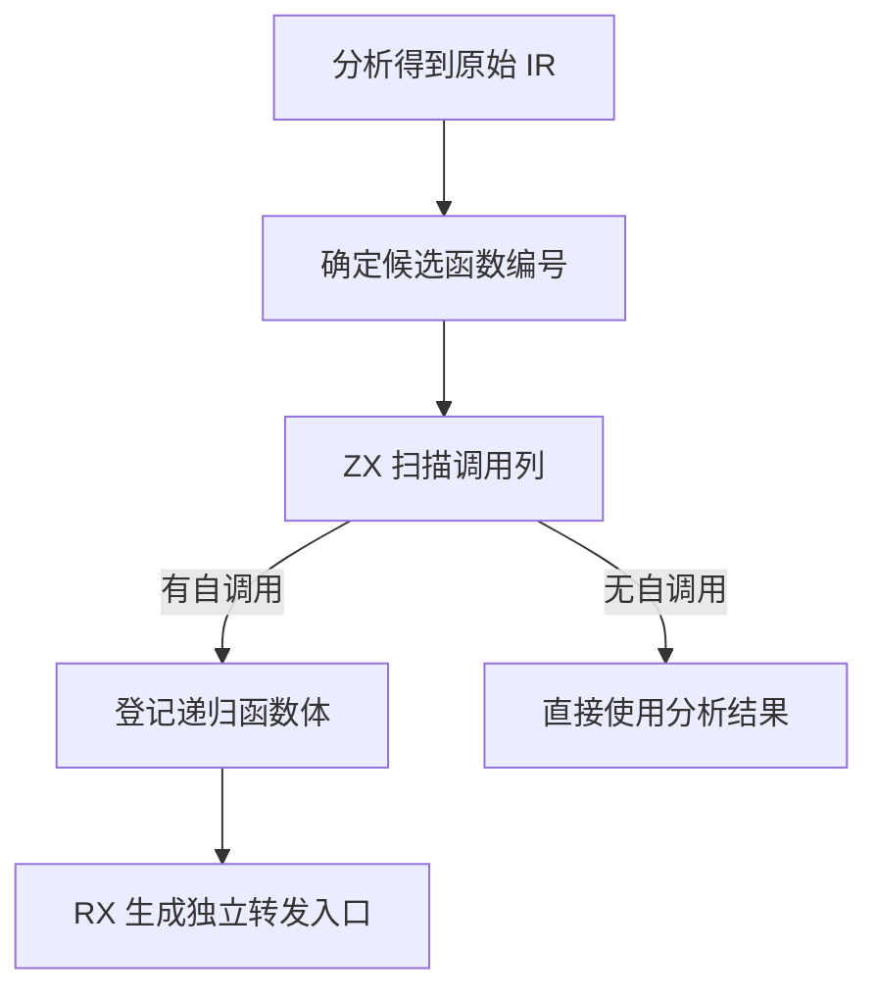

# 递归入口发布自举

## Intent

统一独立分析、项目发布和工件重映射的递归调用判定。让独立 ZX 入口直接使用登记递归函数时取得的编号发布转发入口。

## Data

原独立分析先逐行扫描全部表达式以决定是否登记递归函数，随后再扫描表达式并比较函数体视图，才决定生成转发入口。项目和工件已经使用 ZX 扫描调用列。三条 Source 路径现在共用同一份 ZX。独立分析沿用首次登记结果，链接已有程序时仍核对函数体身份。

旧版发布的递归 ZX 库在被导入时会报 `ConflictingFunction`。原因是项目分析返回了转发入口，却丢失了被转发的递归函数编号，库链接随后又把转发入口当作新函数体登记。项目和独立分析现在把已有编号交给库链接器。

## Edges

正式 Source 分析的所有权已在生成分析器中完成。首次 Native seed 的所有权会在登记后更新，继续沿用原先的函数体身份比较。外部 IR 先经结构验证，调用列表与调用表达式一一对应。

## Answer

Native seed 和两代 Source 重编分别通过 33、22、22 步。两代 Source 的 11,418 个生成文件逐字节一致。变更集中在主生成树，四个 LLVM 分区中有两个对象保持一致。

独立递归与非递归样例生成的 Zig 与上一版逐字节一致。独立 ZX、源码导入、RX 调用和已编译库导入四条递归路径通过执行检查。IR 校验、库导入与工件导入的 33 项回归通过。

整仓冷构建使用 Zig 0.17.0、ReleaseSmall、12 核、四个 LLVM 分区和独立空缓存。Native seed 引导安装版，安装版使用 Source 分析和生成。70 步全部通过。

| 样本           | 墙钟（秒） | CPU（秒） | 进程树峰值（MB） | 单进程峰值（MB） |
| -------------- | ---------: | --------: | ---------------: | ---------------: |
| 固定基线       |     117.82 |    207.44 |          2328.74 |          2087.88 |
| 上一阶段       |     112.42 |    205.75 |          2369.49 |          2131.92 |
| 最终版首次测量 |     113.02 |    207.95 |          2433.06 |          2135.21 |
| 最终版隔离复测 |     111.65 |    205.64 |          2422.92 |          2136.77 |

最终版首次测量期间清理了旧的构建缓存。隔离复测的四个 LLVM 对象与首次测量逐字节一致。复测较上一阶段，墙钟减少 0.77 秒，CPU 减少 0.11 秒，进程树峰值增加 53.43 MB，单进程峰值增加 4.85 MB。树峰值发生在 LLVM 分区编译期间。较固定基线，墙钟减少 6.17 秒，CPU 减少 1.80 秒，进程树峰值增加 94.18 MB，单进程峰值增加 48.89 MB。
