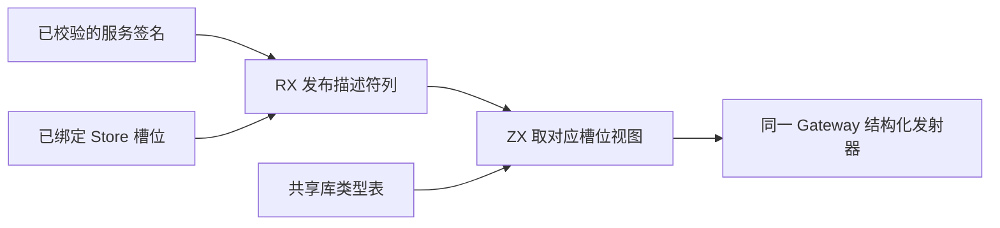
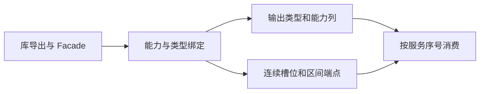

# Gateway 服务描述符自举

## Intent

让 Gateway 的绑定结果直接驱动入口生成，复用库的唯一类型表和已绑定槽位区间，去掉每个服务的完整类型表描述符及二次组装。

## Data

从 `dfe8f47a` 追踪 `zig.gateway.create → bindings/build.rx → genz.gateway.entry.render`。相关的库入口、状态绑定、Gateway 适配器与 JSON 发射涉及约三千行 Zig。验证后的签名目前还在 Zig 再取一次，反复构造服务类型表视图与槽位头。

## Edges

服务、模块导入及声明顺序保持对应。签名引用校验、Store 错误、能力检查按既有顺序执行。公开的 genz 渲染接口继续接受独立类型表的服务，正式编译器的共享表路径复用同一发射逻辑。

## Answer

## 实现与边界

- 签名、引用和 Store 检查通过后，RX 调用 ZX 将输出类型和能力标记写到预留列。能力缺失仍返回原有错误。正式路径免去原生服务结构体数组、逐服务的类型表转换和对已验证签名的二次读取。
- Gateway 发射器借用同一类型表和连续槽位表。生成 Zig 按区间取槽位切片，组装发射参数时无需为服务描述符单独分配对象。服务导入从既有 facade 文件读取，顺序保持一致。
- Zig 仍负责按导出和 facade 借出绑定输入、预留输出列，以及将槽位列适配为生成 ABI。原有 genz 入口继续支持调用者为各服务传入独立类型表。上述适配、库 facade 与后端文件发布仍在正式依赖链中。

## 验收

- 上一阶段的 Source 工具生成了三个受影响入口。候选 Source 引导器和分 16 区的安装版构建通过，默认 seed 也成功构建新引导器。改动的 ZX/RX 格式与 lint 检查通过。
- 空 Gateway、零请求体限制 Gateway 和含 18 个路由、14 项服务的主 Gateway 共产生 42 份 Zig 模块，均与上一阶段逐字节一致。
- `test-gateway` 通过 48 项 Zig 回归和 86 项 Gateway 运行检查。`test-application-json-gateway` 通过 52 项 HTTP JSON 用例。实测平台为 macOS arm64。

## 性能

主 Gateway 禁用生成缓存，使用同一个 Zig 后端缓存交替重建五对。端到端墙钟中位数为 1.310 → 1.312 秒，CPU 为 1.419 → 1.415 秒。

相邻的两版引导器均由 Source 生成，运行时使用 Source 分析和生成。在 Zig 0.17.0、ReleaseSmall、16 分区和禁用常驻的配置下，对同一份 735 入口清单交替运行三轮。11,770 个生成文件和 v17 缓存载荷相同，同目录无改动重跑保留快照和生成清单的时间戳。

| 指标                   | 上一阶段中位数 | 当前阶段中位数 |
| ---------------------- | -------------: | -------------: |
| 冷生成墙钟             |        2.80 秒 |        2.77 秒 |
| 冷生成 CPU             |       12.38 秒 |       12.44 秒 |
| 冷生成单进程峰值 RSS   |       824.9 MB |       817.9 MB |
| 冷生成进程树采样峰值   |       765.5 MB |       765.1 MB |
| 磁盘缓存墙钟           |        2.17 秒 |        2.21 秒 |
| 磁盘缓存 CPU           |        8.56 秒 |        8.53 秒 |
| 磁盘缓存单进程峰值 RSS |       801.6 MB |       802.1 MB |
| 无改动重跑墙钟         |        0.03 秒 |        0.03 秒 |

固定 721 入口 Source 工具和候选工具在 `0e7ff384` 冻结源码上采用相同的 735 入口及参数。冷生成墙钟 2.89 → 2.82 秒，CPU 12.43 → 12.50 秒，单进程峰值 RSS 962.1 → 797.1 MB，进程树采样峰值 885.1 → 763.0 MB。磁盘缓存墙钟 2.22 → 2.20 秒，CPU 8.57 → 8.56 秒。跨固定基线的 22 处产物差异与上一阶段相同。这里的生成器计时覆盖 Source 生成和缓存复用。

测试包的默认单编译单元构建报告 `zxc` 编译峰值约 4 GB。这次未对完整冷安装构建做配对测量。
