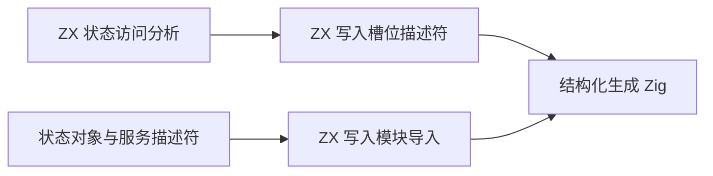

# Gateway 路由与服务发布自举

## Intent

沿 Gateway 路由分析、服务链接、状态访问和入口发射统一服务编号，直接发布后端槽位和模块导入，保持源声明顺序、HTTP 方法和持久状态绑定。

## Data

从 `19bf4a28` 追踪 `gateway.analyze → library.analyze → library.link → zig.gateway.create`。相关路由、库入口、状态映射和 genz 发射涉及约三千行 Zig。Gateway 请求按首次出现顺序生成导出配置，库链接按输入位置发布导出。CLI 仍逐服务扫描导出表，后端分别拼装槽位和导入。

## Edges

仅在核对每项服务名及总数后复用位置关系。原生槽位的索引宽度随目标平台，写入预留行时保留现有 ABI。生成文件使用原来的模块名、导入顺序及普通 Zig 发射器。

## Answer

## 实现与边界

- 路由分析的首次出现顺序贯穿导出配置、逐模块分析及库链接。ZX 核对链接导出的数量与逐项名称，之后直接使用已有服务号。CLI 的逐服务线性查找和中间映射数组已移除。Zig 仍将路由的 HTTP 方法枚举转换为原生发射器接受的名称。
- 槽位发布由 ZX 写入预留结构体。索引保持宿主原生宽度，访问标记保持原来的只读或可写值。Zig 仍负责将服务的槽位切片和 JSON 输出类型视图接到发射器。
- 状态模块和存储契约共用同一份导入数组，存储契约使用后缀切片。服务模块导入也由 ZX 写入。最终文件列表精确预留，保留原来的模块名和发射顺序。

## 验收

- 三个新 Source 入口通过上一阶段引导器生成。当前 Source 引导器和安装版构建通过，改动的 Source 通过 lint。
- 空 Gateway、零请求体限制 Gateway，以及含 18 个路由、14 项服务的主 Gateway，共 42 份生成 Zig 模块与上一阶段逐字节一致。覆盖了重复服务引用、方法路由、Store 状态与入口导入。
- 初始 seed 构建成功。`test-gateway` 的 48 项 Zig 回归和 86 项 HTTP 运行检查通过。实际运行验收在 macOS arm64 完成。

## 性能

主 Gateway 禁用生成缓存，保持相同的 Zig 后端缓存和输出位置，交替重建五对。墙钟中位数为 1.338 → 1.339 秒，CPU 为 1.450 → 1.442 秒。计时包含生成和原生后端重建。

相邻引导器均由 Source 生成，运行时使用 Source 分析和生成。Zig 0.17.0、ReleaseSmall、16 分区、关闭常驻，对同一份 735 入口清单交替运行三轮。11,766 份生成产物和 v17 缓存载荷相同，同目录无改动重跑保留快照及文件时间戳。

| 指标                 | 上一阶段中位数 | 当前阶段中位数 |
| -------------------- | -------------: | -------------: |
| 冷生成墙钟           |        2.80 秒 |        2.76 秒 |
| 冷生成 CPU           |       12.53 秒 |       12.45 秒 |
| 冷生成单进程峰值 RSS |       849.9 MB |       842.7 MB |
| 冷生成进程树采样峰值 |       760.8 MB |       760.7 MB |
| 磁盘缓存墙钟         |        2.18 秒 |        2.18 秒 |
| 磁盘缓存 CPU         |        8.56 秒 |        8.57 秒 |
| 磁盘缓存峰值 RSS     |       801.3 MB |       801.3 MB |
| 无改动重跑墙钟       |        0.03 秒 |        0.03 秒 |

固定 721 入口 Source 工具和当前工具在 `0e7ff384` 冻结源码上采用相同的 735 入口及参数。冷生成墙钟 2.85 → 2.79 秒，CPU 12.48 → 12.44 秒，单进程峰值 RSS 933.2 → 803.5 MB，进程树采样峰值 892.7 → 763.1 MB。磁盘缓存墙钟 2.22 → 2.20 秒，CPU 8.50 → 8.59 秒。固定基线的 22 处产物差异与此前一致。计时覆盖引导生成和缓存复用。
