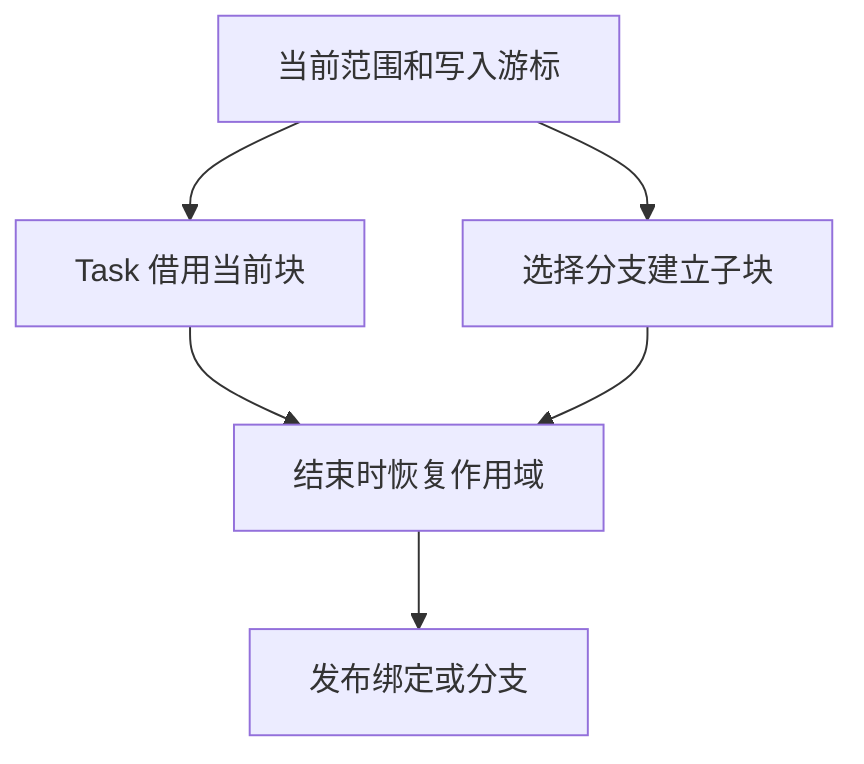

# RX 控制结构发布自举

## Intent

沿 RX 程序和独立 Parallel Task 的正式入口迁移从已检查流程到 IR 控制结构的发布，保持语句顺序、分支块编号和作用域边界。

## Data

`09d57a94` 已将推导和流程编译的控制遍历迁入 RX/ZX。接下来的 `program.lower` 涉及约 2,600 行程序布局、控制写入、表达式重映射和链接 Zig。布局统计和单列写入已有 Source 实现，`program/statements.zig` 仍递归进入 Task 和选择分支，控制何时解释表达式及发布语句。

## Edges

复用流程列和布局准备好的写入位置，维持原来的表达式、符号、调用和块编号。Task 内联到同一 IR 块，选择分支持有自己的写入游标。解析、表达式重映射、Store 与函数链接继续使用现有原子入口。保留初始 seed 的等价入口。

## Answer

正式发布入口由 RX 根据正在处理的范围选择下一事件。Task 通过栈索引借用所在块的游标，选择分支使用布局预留的独立游标。每次发布后仍由原写入器核对列计数和边界。宿主保留表达式处理、符号和函数链接以及在途作用域资源。初始 seed 共用同一事件协议，原有的递归发布函数已移除。

固定操作数重映射借用原始列，与预留的一行目标列一同传给 ZX。ZX 保持表达式、符号和原样索引的映射顺序，将结果直接写入目标列，宿主统一提交列长。种子路径继续使用原映射。

对照覆盖 12 层嵌套分支、嵌套 Parallel Task 和 Default 在前且包含 Task.out 的选择。三个场景的 52 份引导生成文件逐字节一致，安装版的生成文件和两种越作用域诊断也一致。

初始 seed 和上一代 Source 均构建出 752 入口的引导器。新引导器继续构建独立安装版。39 项 RX 校验及 1,162 项混合推导、顺序和并行执行与库链接回归全部通过。

相邻工具由 Source 引导生成，运行时使用 Source 分析和生成。使用 Zig 0.17.0、ReleaseSmall、16 分区，关闭常驻，在相同 735 入口上交替各三轮。11,763 份生成文件与 v17 缓存载荷逐字节一致，同目录无改动时保留原快照和文件时间戳。

| 指标             | 上一阶段中位数 | 当前阶段中位数 |
| ---------------- | -------------: | -------------: |
| 冷生成墙钟       |        2.84 秒 |        2.84 秒 |
| 冷生成 CPU       |       12.51 秒 |       12.60 秒 |
| 冷生成峰值 RSS   |      842.96 MB |      798.39 MB |
| 磁盘缓存墙钟     |        2.19 秒 |        2.22 秒 |
| 磁盘缓存 CPU     |        8.51 秒 |        8.62 秒 |
| 磁盘缓存峰值 RSS |      802.28 MB |      799.21 MB |
| 同目录无改动墙钟 |        0.03 秒 |        0.03 秒 |

冷生成的进程树采样峰值中位数为 764.10 → 771.96 MB。固定 721 入口 Source 工具与当前工具在 `0e7ff384` 冻结源码上采用相同 735 入口和配置各三轮。冷生成墙钟为 2.85 → 2.84 秒，CPU 为 12.47 → 12.52 秒，峰值 RSS 为 960.12 → 824.67 MB。磁盘缓存墙钟为 2.26 → 2.24 秒，CPU 为 8.55 → 8.62 秒。固定基线的 22 处产物差异与前期记录一致。计时覆盖生成和缓存复用。

以 `aa2fcd40` 为起点，累计 RX/ZX 新增 18,880 行、删除 2,074 行、净增 16,806 行。

