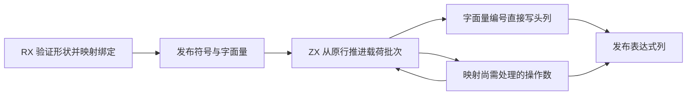
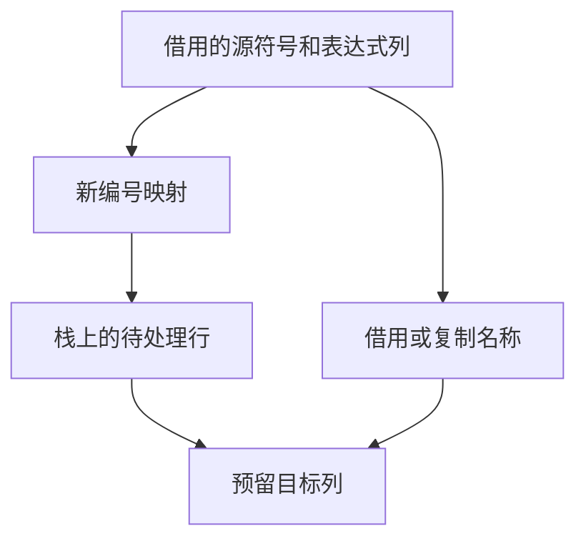

# RX 表达式链接发布自举

## Intent

迁移表达式内联的剩余发布规则。按原表达式顺序映射操作数，保持文本所有权、符号编号及表达式编号，避免引入整张复制的工作表。

## Data

从 `1920875e` 的 `program/expression.zig` 追踪 `inlineValue`，所在的 RX 程序布局、发布和链接目录涉及约 2,700 行 Zig。前置链接已在 RX 中验证表达式形状并映射输入绑定，固定和复合操作数已经使用 ZX 写列。正式路径仍由 Zig 扫描映射行、决定每种载荷的分派，并更新新符号和载荷头。

## Edges

链接计划继续借用表达式列，跳过输入环境和已折叠投影。表达式依赖只能引用此前出现的值。原有文字借用契约决定共享名称或复制字节。符号及表达式的最终列长由宿主在成功后提交，分配和错误边界同既有接口。

## Answer

ZX 借用原表达式列和行映射，直接发布字面量编号。固定操作数、序列、集合、转换、作用域、匹配和对象的待处理行按源码顺序写入定长栈缓冲。宿主按此顺序预留目标列并调用已有的映射操作，依赖仍只能引用在当前行之前出现的值。原来的 Zig 复合载荷分派已移除。

RX 编排新局部符号的列写入、Copy 标记和名称所有权，复用字面量发布的批量写入和文本复制操作。借用时只写名称描述符，拥有时复制文本并使用现有失败清理。所有列写完后提交统一长度。初始 seed 保留等价的 Zig 路径。

对照覆盖单个表达式的 47 次加法、数组索引、UTF-8 字面量、嵌套分支、嵌套 Parallel Task 和包含 Task.out 的选择。六个成功场景的 94 份引导生成文件逐字节一致，两种越作用域诊断一致。

初始 seed 和上一代 Source 均构建出 754 入口的引导器，新引导器构建安装版。39 项 RX 校验和 306 项混合推导、值迁移、并行执行与库链接回归通过。相邻安装版的四份生成文件和一项诊断一致，跨批次算术样例在安装版构建的程序中通过三组输入。

相邻工具由 Source 引导生成，运行时使用 Source 分析和生成。采用 Zig 0.17.0、ReleaseSmall、16 分区，关闭常驻，对同一 735 入口各交替三轮。11,763 份生成文件和 v17 缓存载荷逐字节一致，同目录无改动时保留快照及文件时间戳。

| 指标             | 上一阶段中位数 | 当前阶段中位数 |
| ---------------- | -------------: | -------------: |
| 冷生成墙钟       |        2.88 秒 |        2.79 秒 |
| 冷生成 CPU       |       12.51 秒 |       12.43 秒 |
| 冷生成峰值 RSS   |      819.25 MB |      798.21 MB |
| 磁盘缓存墙钟     |        2.20 秒 |        2.20 秒 |
| 磁盘缓存 CPU     |        8.55 秒 |        8.54 秒 |
| 磁盘缓存峰值 RSS |      800.93 MB |      799.54 MB |
| 同目录无改动墙钟 |        0.03 秒 |        0.03 秒 |

冷生成进程树采样峰值中位数从 764.31 MB 到 765.95 MB。固定 721 入口 Source 工具与当前工具在 `0e7ff384` 冻结源码上采用相同 735 入口和配置各三轮。冷生成墙钟均为 2.85 秒，CPU 均为 12.51 秒，峰值 RSS 为 928.81 → 813.65 MB。磁盘缓存墙钟为 2.23 → 2.24 秒，CPU 为 8.52 → 8.60 秒。固定基线的 22 处产物差异与前期记录一致。计时覆盖生成和缓存复用。

以 `aa2fcd40` 为起点，累计 RX/ZX 新增 19,069 行、删除 2,074 行、净增 16,995 行。

