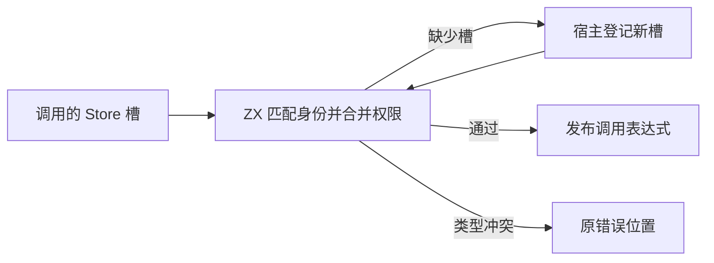

# RX 调用与 Store 链接自举

## Intent

把调用产生的 Store 槽映射迁入 RX/ZX，保持身份、权限、冲突顺序及索引编号。沿 RX 和 ZX 共用的函数表链接入口复用已证明的前缀。

## Data

从 `478fa917` 追踪 RX 程序构造、调用发布、Store 初始化器以及函数表入库。相关的 RX 程序目录、公共函数表链接和依赖的 IR 校验涉及约三千行 Zig。调用列已由 Source 发布，Store 槽的逐行登记以及权限更新仍由宿主逐条驱动。

## Edges

已登记槽位在目标列中就地合并。需要保留的新路径交由宿主分配，再从中断位置继续。函数列的相等性检查保持原契约，只有前缀相等且已通过结构校验时才能复用验证事实。

## Answer

## 实现与边界

- `lowerCall` 的 `ResolveStores` 把被调模块的列视图和已预留的调用映射交给 `store/bind.zx`。ZX 依照身份、类型和登记顺序扫描，直接写入权限列与目标映射。遇到缺少的槽，由宿主复制需要长期持有的路径并追加，再从该槽的下一行恢复。遇到类型冲突，保留原有错误及其出现顺序。单个 getter 已有槽的情况也使用同一实现。
- 共有函数前缀在链接前经过结构检查。核对所有列的区间关系和元素相等性后，Source 校验器仍检查完整列长度，只跳过已检查的行。已登记的初始化器区间按同起点、长度不增的条件复用，所有其他来源走原有检查。
- Zig 宿主仍持有 Store 动态分配和函数表追加。初始 seed 仍能用原有逐槽实现生成后续阶段，正式 Source 编译走列式绑定。

## 验收

- 用上一阶段的 Source 引导器构建本阶段引导器，再用本阶段引导器构建安装版。安装版的 Store 路径与应用内存状态共 24 项通过。
- 隔离、读写权限合并、嵌套槽位换序和深层嵌套四个现有 Store 场景使用相同输入和输出路径分别生成，四份 Zig 输出均逐字节一致。
- 默认 seed 能构建本阶段引导器。用 Source 引导器运行 RX 推导与 Store 执行、库链接、初始化器、混合库、Store 重发布及 RX 库边界检查，148 个构建步骤与 249 项 Zig 测试全部通过。新增与改动的 ZX 通过 lint，改动的 Zig 通过格式检查。

## 性能

相邻引导器均由 Source 生成，运行时使用 Source 分析和生成。Zig 0.17.0、ReleaseSmall、16 分区、关闭常驻生成器，对同一份 735 入口清单交替三轮。11,763 份生成文件与 v17 缓存载荷一致，无改动重跑保留快照及文件时间戳。

| 指标                   | 上一阶段中位数 | 当前阶段中位数 |
| ---------------------- | -------------: | -------------: |
| 冷生成墙钟             |        2.88 秒 |        2.79 秒 |
| 冷生成 CPU             |       12.49 秒 |       12.45 秒 |
| 冷生成单进程峰值 RSS   |       812.3 MB |       839.5 MB |
| 冷生成进程树采样峰值   |       761.4 MB |       761.2 MB |
| 磁盘缓存墙钟           |        2.21 秒 |        2.19 秒 |
| 磁盘缓存 CPU           |        8.62 秒 |        8.63 秒 |
| 磁盘缓存单进程峰值 RSS |       799.8 MB |       801.9 MB |
| 同目录无改动墙钟       |        0.03 秒 |        0.03 秒 |

固定 721 入口 Source 工具与当前工具使用 `0e7ff384` 冻结源码的同一份 735 入口清单。冷生成墙钟为 2.89 → 2.81 秒，CPU 为 12.52 → 12.48 秒，单进程峰值 RSS 为 927.0 → 848.4 MB，进程树采样峰值为 896.5 → 763.2 MB。磁盘缓存墙钟为 2.23 → 2.21 秒，CPU 为 8.56 → 8.59 秒。固定基线的 22 处生成差异与上阶段一致。计时范围覆盖引导生成和缓存复用。

相邻对照的三轮单进程 RSS 中位数增加 27.2 MB。为核对增长是否能复现，关闭进程树采样，复用同一输出和缓存路径并在每次冷生成前重置，交替运行五对。单进程峰值 RSS 中位数为 850.3 → 806.3 MB，配对差值中位数为 −52.1 MB。三轮对照中的增长未复现。引导清单覆盖共享函数表的链接成本；带 Store 的调用行为由独立执行和产物对照覆盖。
