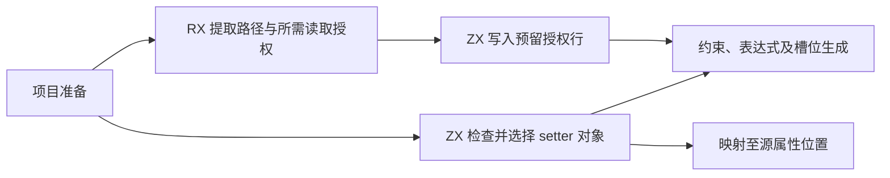
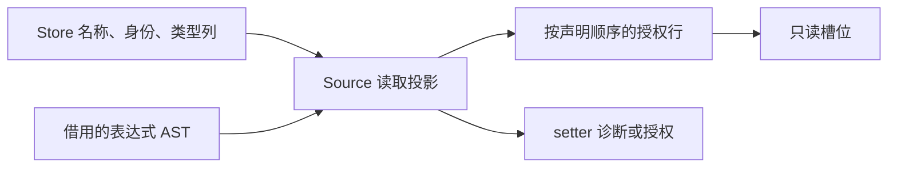

# Store 调用授权自举

## Intent

让正式 Source 路径发布 Call 的读取授权和 setter 授权。保留对象路径的匹配规则、授权顺序、错误位置和只读槽位语义。

## Data

从 `e974d4de` 沿项目准备、`StoreCall.analyze`、表达式约束、流程编译和程序链接追踪。Store 分析与调用准备、约束及生成合计涉及约三千行 Zig。现有 ZX 找出读取位置及 setter 索引，Zig 仍逐条拼装读取授权，并解释 setter 匹配结果。

## Edges

读取授权保持声明顺序，同一个访问名称重复出现时只发布一次。setter 必须是含单个已声明完整对象的列表，原形状错误及对象错误使用不同位置。路径和名字借用已拥有的文本，读取结果的结构紧凑且由项目持有，临时位置不会逸出。

## Answer

## 实现与边界

- 既有 RX 路径发现流程继续按声明顺序选择 getter。ZX 通过标准库把所选名称、路径和类型描述符写入已预留的行，Zig 的逐项拼装退出正式索引路径。授权行保存三项有效数据，从它生成 Store 槽位时才补齐只读权限。
- setter 直接返回已选择对象的名称、路径和类型，或者对应的拒绝消息与表达式内偏移。宿主将拒绝位置映射回 RX 属性，解析时借用原属性文本。
- 表达式树在最早的完整 Store 对象路径之前结束时，ZX 直接返回空读取集合。原有表达式求值、登记顺序和去重规则保留。原生 seed 仍使用原 AST 匹配，宿主仍负责解析生命周期、分配授权行并连接调用图。

## 验收

- 相邻安装版本对七个现有 setter 用例进行对照。空列表、非列表、命名空间、字段、未知对象和重复对象的拒绝诊断逐字节相同，合法对象的生成 Zig 一致。
- 五个 Store 输出逐字节一致，覆盖隔离、权限合并、调换槽位、深层嵌套及跨片段对象。安装版编译的跨片段示例通过读取和写入。新增与修改的 ZX 通过 lint。
- Source 引导器、初始 seed 和安装版构建成功。RX 推导、Store 执行、库边界及 Store 重发布通过 177 项回归，安装版另通过 24 项 Store 路径和应用状态检查。输入释放、诊断持有和分配失败用例均通过。

## 性能

两代安装版关闭编译缓存，对同一个跨片段深层嵌套项目交替生成 15 对。墙钟中位数为 9.357 → 9.165 毫秒，CPU 为 9.934 → 9.927 毫秒，输出哈希一致。计时包含启动、分析、生成和写出。

相邻引导器由 Source 生成，运行时使用 Source 分析和生成。采用 Zig 0.17.0、ReleaseSmall、16 分区，关闭常驻，对同一 735 入口清单交替运行三轮。11,763 份生成文件和 v17 缓存载荷一致，同目录无改动时保留快照及文件时间戳。

| 指标                   | 上一阶段中位数 | 当前阶段中位数 |
| ---------------------- | -------------: | -------------: |
| 冷生成墙钟             |        2.86 秒 |        2.83 秒 |
| 冷生成 CPU             |       12.56 秒 |       12.53 秒 |
| 冷生成单进程峰值 RSS   |       799.7 MB |       820.1 MB |
| 冷生成进程树采样峰值   |       767.6 MB |       769.8 MB |
| 磁盘缓存墙钟           |        2.21 秒 |        2.22 秒 |
| 磁盘缓存 CPU           |        8.61 秒 |        8.62 秒 |
| 磁盘缓存单进程峰值 RSS |       802.1 MB |       801.9 MB |
| 同目录无改动墙钟       |        0.03 秒 |        0.03 秒 |

固定 721 入口 Source 工具与当前工具在 `0e7ff384` 冻结源码上使用相同的 735 入口清单和参数。冷生成墙钟为 2.90 → 2.87 秒，CPU 为 12.65 → 12.69 秒，单进程峰值 RSS 为 932.5 → 796.9 MB，进程树采样峰值为 884.6 → 763.3 MB。当前冻结场景单进程峰值与上阶段记录的 797.1 MB 接近。磁盘缓存墙钟为 2.25 → 2.23 秒，CPU 为 8.61 → 8.63 秒。固定基线的 22 处生成差异与此前一致。计时覆盖引导生成和缓存复用。
