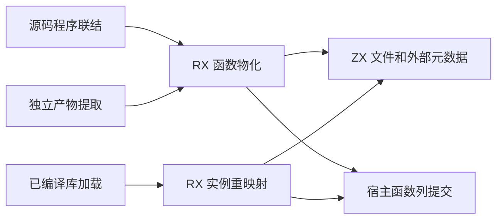

# 函数体联结与物化自举

## Intent

让源码联结、独立产物提取和已编译库加载共用函数物化逻辑。先贯通列检查、引用重映射、Store 与控制流载荷、文件身份及原生扩展签名，再迁移宿主持有的函数表列追加状态。

## Data

源码和独立产物联结通过 `artifact/nodes.zig` 追加函数。旧路径在 Zig 中分别调用函数体重映射、Store 列复制、控制列复制和外部签名复制。独立产物提取的 `content.rx` 已负责一部分载荷写入，文件名和外部 ABI 仍由宿主收尾。已编译库加载用 Source 重映射程序编号、给文件和 Store 标记实例作用域，也需要相同的外部元数据物化。

## Edges

保留公开函数 ID、递归入口判断和本地控制流索引。控制树预检沿用宿主的短生命周期工作区。最终的符号、表达式、合约、Store 和控制列各构造一次，已有列描述符直接交给函数表。库实例的文件和 Store 作用域继续按原规则计算。

## Answer

用既有模块产物、独立重联结、带 Store 和原生 ABI 的统一库回归验收。对照同输入生成产物、缓存、CLI 发布以及 Source 生成性能。

## 实现与边界

- `own_function.rx` 承接原来的宿主串联。它调用已有的列检查和引用重映射，构造 Store 与控制列并物化元数据。空 Store 表直接复用宿主标准空表，控制树检查仍用独立的临时工作区。
- 独立产物提取和源码联结共享同一借用描述及同一个物化入口。独立产物同时有入口 Store 和函数 Store 时，入口表保持单独重映射。原来的三个独立生成入口退出宿主路径。
- 已编译库加载保留库实例特有的引用编号和 Store 作用域规则，文件身份及外部 ABI 文本和参数由共享的 `metadata.zx` 构造。
- Zig 仍负责借用底层列、逐函数遍历、容量预留和将完成的描述符写入 `FunctionStorage`。缓存恢复保留已有的入口描述符复用路径。

## 验收

- 4 个定向生成入口通过，覆盖共享函数物化、独立产物提取、编译库函数及缓存恢复发布。Source 引导器通过 22 个构建步骤。
- 独立重联结、模块产物、库联结、原生库发布、Store 发布和 RX 编译库共通过 142 个构建步骤、155 项 Zig 测试及 20 项 CLI 检查。覆盖失败分配回收、来源 arena 释放后重联结、Store 作用域与原生 ABI 元数据。
- 相邻 Source 工具使用同一份 734 入口清单，11,790 个文件逐字节一致，5,364 条生成缓存键及负载摘要一致。清单去掉两个退出宿主调用路径的独立入口。所有权缓存摘要为 `01b60d21d4db1cece38d5f05b8be6a65488abed2f0baf0ade2d24195dc76cb3b`。

## 性能

两个相邻工具由各自的上一阶段 Source 引导器生成，并运行 Source 分析和生成。使用 Zig 0.17.0、ReleaseSmall、16 分区，关闭常驻，交替三轮取中位数。

| 指标                     | 上一阶段 | 当前阶段 |
| ------------------------ | -------: | -------: |
| 冷生成墙钟               |  2.78 秒 |  2.82 秒 |
| 冷生成 CPU               | 12.40 秒 | 12.46 秒 |
| 冷生成进程树采样峰值 RSS | 770.4 MB | 769.9 MB |
| 冷生成单进程峰值 RSS     | 849.8 MB | 871.7 MB |
| 磁盘缓存墙钟             |  2.14 秒 |  2.14 秒 |
| 磁盘缓存 CPU             |  8.41 秒 |  8.38 秒 |
| 磁盘缓存单进程峰值 RSS   | 777.8 MB | 778.4 MB |

相邻冷生成的单进程峰值样本分布为 805.8–868.3 MB 和 864.4–875.0 MB。固定基线和候选使用 `0e7ff384` 冻结源码与同一份 735 入口清单。冷生成墙钟 2.88 → 2.83 秒，CPU 12.53 → 12.52 秒，单进程峰值 RSS 922.2 → 798.6 MB，进程树采样峰值 RSS 892.6 → 774.4 MB。21 份既有 Zig 差异的双侧摘要与上一阶段相符，文件清单随冻结路径变化。

相邻 CLI 在同目录禁用语义缓存，以既有原生库夹具测量首次发布与重新发布，预热后交替六轮。两个用例分别有 20 和 21 个发布文件，均逐字节一致。首次发布的墙钟和 CPU 中位数均为 0.01 秒，RSS 约 12.65 MB。重新发布两版 CPU 均为 0.01 秒，墙钟中位数为 0.015 → 0.020 秒，RSS 约 13.03 MB。计时分辨率为 0.01 秒。
