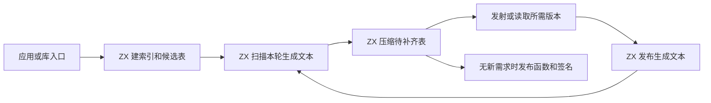

# 函数版本补齐自举

## Intent

让应用和库共用的常规函数版本补齐由 Source 管理候选集、每轮需求和生成文本发布。每个需要指针 ABI 的值函数按原有顺序补齐，生成和缓存继续共用相同的版本单位。

## Data

从 `fef2b786` 的 `createCached` 与库 `create` 追踪 `functionFilesFrom → regular_calls.complete → function_sources.create`。现有 ZX 已能从生成文本提取指针调用并按名字选择候选。宿主维护已完成状态，逐轮遍历全部单位，重新对同一名字做哈希查询，再逐项更新发布文本。初轮还会复制入口和函数的切片描述符。

## Edges

保留同名函数的统一需求、首次待补齐的单位顺序、每轮只扫描新增版本、调用链闭包、缓存键和签名发布。已生成文本由 Bundle 持有，候选表由同步的补齐调用借出。Zig 暂时管理分配、工作线程、版本标签布局适配以及发射和缓存调用，最后一轮仍在这一边界返回。

## Answer

## 实现与边界

- ZX 用定长名字索引生成按单位位置排序的候选表。同名组使用首次出现的函数作为共享需求位。该代表只用于补齐内部的标记，同组单位仍分别按原顺序发射。
- 候选表保存每个未补齐单位的位置和组。每轮一次遍历输出需补齐的位置，同时原地压缩剩余项。下一轮无须遍历已完成项或重新查询候选名。
- 工作线程初轮直接借用入口和函数的两段切片，后续只借用本轮新增源码。生成完成后由 ZX 把借用文本写入目标位置。原文本及替换文本的底层字节由 Bundle 持有。
- Zig 继续负责工作线程、资源生命周期及发射和缓存请求之间的循环。它把待补齐的位置转换成现有 `Unit` 标签，供缓存键、发射和签名共用。初始 seed 保留原实现。

## 功能验收

- 上一代 Source 引导器成功生成并构建 763 入口的新工具。
- 用实际生成的四个入口核验同名组、预先排除的版本、稳定压缩、忽略纯值调用和无关名字，以及由第一轮新增文本触发的第二轮补齐。使用空容量分配器通过，发布后的文本指针保持与输入一致。
- 使用新工具构建 16 分区安装版成功。安装版通过 4 项增量运行检查，覆盖应用及缓存修改、缓存损坏和原生对象 ABI。具名导出库的 15 份文件和 Store 库的 14 份文件与相邻上一版逐字节一致。
- 模块生成与库链接的 69 项 Zig 回归通过。

## 性能

相邻两版工具均由 Source 生成，并运行 Source 分析和生成。用 Zig 0.17.0、ReleaseSmall、16 分区、关闭常驻，在当前源码与同一份 734 入口清单上交替测量三轮。11,760 份生成文件与 v17 缓存载荷逐字节一致。无改动重跑保持输入快照和产物时间戳。

| 指标                   | 上一阶段中位数 | 当前阶段中位数 |
| ---------------------- | -------------: | -------------: |
| 冷生成墙钟             |        2.82 秒 |        2.84 秒 |
| 冷生成 CPU             |       12.50 秒 |       12.51 秒 |
| 冷生成单进程峰值 RSS   |       837.5 MB |       795.4 MB |
| 冷生成进程树采样峰值   |       759.3 MB |       759.6 MB |
| 磁盘缓存墙钟           |        2.20 秒 |        2.19 秒 |
| 磁盘缓存 CPU           |        8.57 秒 |        8.60 秒 |
| 磁盘缓存单进程峰值 RSS |       805.7 MB |       806.8 MB |
| 无改动重跑墙钟         |        0.03 秒 |        0.03 秒 |

沿用固定 721 入口 Source 引导器、735 入口清单和 `0e7ff384` 冻结源码。两边采用相同的旧私有内存导入和配置。冷生成墙钟 2.87 → 2.79 秒，CPU 12.58 → 12.48 秒，单进程峰值 RSS 939.0 → 857.5 MB，进程树采样峰值 891.7 → 773.8 MB。磁盘缓存墙钟 2.23 → 2.21 秒，CPU 8.60 → 8.59 秒。11,758 份生成文件中 11,736 份一致，其余仍为先前记录的 22 份。以上测量覆盖引导生成和缓存复用，完整冷安装构建只做了功能验收。
