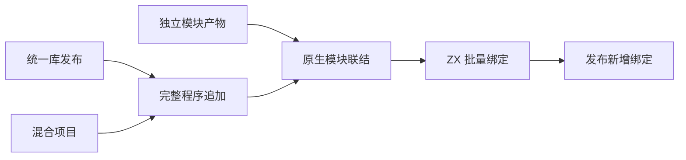
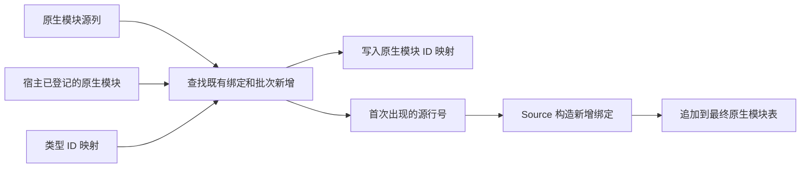

# 原生模块批量联结自举

## Intent

继续迁移模块联结。先贯通统一库发布、混合项目的完整程序追加和独立产物重联结共用的原生模块联结。由 Source 按输入顺序分配原生模块 ID，借用输入和已有绑定，复用已有绑定的兼容性检查与新绑定的所有权构造。

## Data

`library/link.zig` 和 `link/source.zig` 都进入 `link/program.zig`，独立模块产物进入 `link/build.zig`。两条路径均由 Zig 逐行调用 Source 做单条原生绑定判定，每次获取最新宿主表。已编译库加载使用自己的 Source 循环，并在其中为原生绑定增加实例作用域。

## Edges

保留首个绑定的 ID、同键冲突报告、源类型 ID 边界和诊断顺序。批次内候选只保存新绑定的源行号，类型名称、命名空间和值均从原列借用。验证成功后由宿主追加新列，复用现有 Source 构造函数取得独立存储。Seed 仍按现有路径引导。

## Answer

通过既有原生模块兼容性、库联结和资源回归，同输入对照生成产物与性能。宿主表的通用可增长存储、函数体追加和跨阶段错误处理另行迁移。

## 实现与边界

Source 先验证源类型 ID，再按键查找宿主已登记的绑定和本批次的首次声明。宿主表中的类型 ID 已经重映射。批次内比较使用同一份类型映射，避免为比较而构造临时类型列。通过现有的 `OptionalU32Buffer` 写入联结调用方的缓冲。

两条 Zig 逐行绑定循环和单条绑定入口已退出 Source 路径。宿主只遍历待发布行。新绑定的类型 ID 重映射和所有权构造由 `materialize.rx` 组织，已编译库加载也复用这一实现。已编译库的实例命名、宿主存储和后续函数追加保留原路径。

## 验收

- 原生批量联结、所有权构造、缓存恢复和产物签名的 4 个定向生成入口通过。候选引导构建 22 个步骤通过，变更的 ZX/RX 文件通过格式与 lint 检查。
- 5 个既有回归目标全部通过，共 104 个构建步骤、56 项 Zig 测试及 6 项 CLI 检查。覆盖原生库发布与重发布、ABI 冲突、分配失败清理和跨进程持久化缓存。
- 相邻 Source 工具在同一份 736 入口清单上生成的 11,790 个文件一致。5,363 条生成缓存的键和负载摘要一致，所有权缓存摘要为 `d15de1d9734d5f7f2fc165bc95983d7bcd8a91a22e23b56ff7cd8cb4399d0758`。

## 性能

引导工具均由各自的上一阶段 Source 工具生成，并使用 Source 分析和生成。Zig 0.17.0、ReleaseSmall、16 分区并关闭常驻。相邻阶段在同一份清单上交替测三轮，下表为中位数。

| 指标                     | 上一阶段 | 当前阶段 |
| ------------------------ | -------: | -------: |
| 冷生成墙钟               |  2.82 秒 |  2.79 秒 |
| 冷生成 CPU               | 12.59 秒 | 12.48 秒 |
| 冷生成单进程峰值 RSS     | 813.8 MB | 859.6 MB |
| 冷生成进程树采样峰值 RSS | 762.9 MB | 764.5 MB |
| 磁盘缓存墙钟             |  2.19 秒 |  2.19 秒 |
| 磁盘缓存 CPU             |  8.57 秒 |  8.56 秒 |
| 磁盘缓存单进程峰值 RSS   | 777.1 MB | 777.6 MB |
| 无改动重跑墙钟           |  0.03 秒 |  0.03 秒 |

单进程冷峰值首轮相邻对照升高 45.8 MB。复用同一清单独立交替测五轮，上一阶段的中位数为 865.5 MB，范围 802.3–870.6 MB。当前阶段的中位数为 841.2 MB，范围 805.2–880.1 MB。首轮差异未稳定复现。

固定基线和候选使用 `0e7ff384` 的冻结源码和同一份 735 入口清单。冷生成墙钟 2.86 → 2.82 秒，CPU 12.56 → 12.54 秒，单进程峰值 RSS 924.9 → 850.1 MB，进程树采样峰值 RSS 885.5 → 760.7 MB。磁盘缓存墙钟 2.25 → 2.19 秒，CPU 8.65 → 8.53 秒。21 份既有 Zig 差异的双侧摘要与前一轮一致，文件清单随冻结路径变化。

CLI 对照复用 `e083bffa` 的已验收 Source CLI。中间提交 `45079997` 改动独立产物重联结路径。两版在同一目录对既有原生库执行 `build pkg.yaml --mode lib --no-cache`，预热后交替测六轮。发布的 20 个文件逐字节一致。两版墙钟均在 0.01–0.02 秒区间，CPU 中位数 0.01 秒，RSS 中位数 12.7 → 12.6 MB。该用例验证实际发布路径，计时精度为 0.01 秒。
