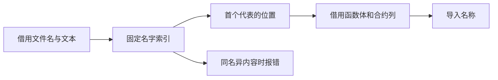

# 后端函数文件发布自举

## Intent

让函数文件的去重、冲突判定及导入选择由 RX/ZX 完成，应用和库共用发布路径。

## Data

从 `3d63f3ee` 的应用和库发射入口追到 `functionFilesFrom`、常规调用补齐、函数文件登记、依赖收集和分区消费。原路径在 Zig 循环中逐份构造导入，再逐次调用 Source 登记。重复文件仍会生成一份临时导入列表。

## Edges

保留生成顺序、同名等字节文件的首个代表、同名异内容错误、原生模块引用与普通函数导入的既有行为。返回文件继续拥有生成文本和需要持有的导入文本。宿主只在同步调用期间借出索引和函数表。

## Answer

## 实现与边界

- 应用和库先补齐常规函数版本，再将同一顺序的文件名和生成文本借给 `function_files/register.rx`。ZX 使用定长名字索引，按首次出现的顺序写入代表位置。重复文件只比较字节，遇到同名异内容即停止并报告冲突。登记过程使用宿主预留的索引和结果空间。
- RX 按是否来自原生模块选择导入计算。普通函数继续收集、排序其 IR 依赖。原生函数共享 Bundle 已拥有的导入名称。两种路径都只对保留下来的文件执行，结果和导入文本的生命周期覆盖 Bundle 的使用期。
- Zig 继续承担常规版本生成和补齐、宿主列适配、文件组装及分区发布。初始 seed 保留原兼容路径。

## 功能验收

- 前一版 Source 引导器与初始 seed 各自生成并构建新版引导器。使用新版 Source 引导器构建 16 分区安装版。
- 使用实际生成的登记函数验证空输入、等内容重复保留首项和不同内容冲突。以空容量分配器执行，登记没有额外分配。
- 安装版通过 4 项增量运行检查，覆盖切分应用、修改与禁用缓存、损坏或错放的缓存记录以及原生对象 ABI 与声明重新排序。具名 barrel 库的 15 份发布文件和 Store 库的 14 份发布文件分别与上一阶段逐字节一致。
- 模块生成和库链接的 69 项 Zig 回归通过。
- 安装版拒绝应用导入 `std:memory` 和 `zig:compiler_memory`。由同一安装版编译的普通 ZX 生命周期用例通过 8 项 Zig 测试，另有 6 项借用模型检查通过。直接操作、读取短生命周期视图和仅使用视图元数据的场景均为一次分配、80 字节。

## 性能

相邻两版工具均由 Source 生成，运行时执行 Source 分析和生成。用 Zig 0.17.0、ReleaseSmall、16 分区、关闭常驻，在同一份 734 入口清单上交替测量三轮。两边清单均省去已退出正式调用路径的登记初始化入口。11,763 个生成文件与 v17 缓存载荷逐字节一致。同目录无改动重跑保持快照和产物时间戳。

| 指标                   | 上一阶段中位数 | 当前阶段中位数 |
| ---------------------- | -------------: | -------------: |
| 冷生成墙钟             |        2.86 秒 |        2.82 秒 |
| 冷生成 CPU             |       12.47 秒 |       12.45 秒 |
| 冷生成单进程峰值 RSS   |       804.4 MB |       860.7 MB |
| 冷生成进程树采样峰值   |       758.5 MB |       766.9 MB |
| 磁盘缓存墙钟           |        2.21 秒 |        2.21 秒 |
| 磁盘缓存 CPU           |        8.61 秒 |        8.59 秒 |
| 磁盘缓存单进程峰值 RSS |       802.0 MB |       802.6 MB |
| 无改动重跑墙钟         |        0.03 秒 |        0.03 秒 |

为核对单进程峰值波动，在同一配置下仅用系统计时器补测五对冷生成。两侧中位数为 794.3 MB 和 819.9 MB，配对变化分别为 +0.6、+25.9、+2.1、−3.6 和 +25.6 MB，配对变化的中位数为 +2.1 MB。

沿用固定 721 入口 Source 引导器和 `0e7ff384` 冻结源码。两版工具都用同一份历史 735 入口清单，冻结源码沿用相同的私有内存导入更名。冷生成墙钟 2.86 → 2.83 秒，CPU 12.51 → 12.53 秒，单进程峰值 RSS 976.0 → 794.9 MB，进程树采样峰值 884.9 → 769.5 MB。磁盘缓存墙钟均为 2.23 秒，CPU 均为 8.58 秒。固定基线的 11,758 份生成文件中 11,736 份一致，差异仍是此前记录的 22 份。以上计时覆盖引导生成与缓存复用，完整冷安装构建只做了功能验收。
