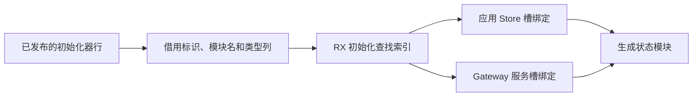
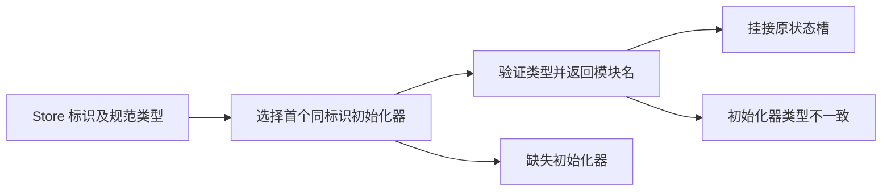

# 应用与网关 Store 状态绑定自举

## Intent

统一应用及 Gateway 后端的 Store 初始化器查找和类型校验。借用现有发布行，保证同标识选择首项、状态槽位顺序和错误优先级。

## Data

从 `7bc6df72` 追踪 `zig.state.append` 和 `zig.gateway.create` 两个入口，涵盖 Store 初始化器发布、后端绑定和状态发射中约三千行 Zig。正式绑定已由 RX/ZX 执行，但两个入口都构造临时指针数组，且每个新状态槽都线性扫描全部初始化器。

## Edges

借用列在发射完毕前有效，哈希桶使用临时内存。未引用的初始化器不会触发类型错误。重复标识仍以第一行匹配，不调整类型冲突与缺失诊断的出现顺序。生成 Zig 仍经结构化发射。

## Answer

## 实现与边界

- 两个后端输入直接借用初始化器的标识、模块名和类型名列。RX 在绑定前建立短期索引，ZX 只把行号写入桶，保留重复标识的首项。零项或单项直接判定。多项的绑定从逐槽线性扫描改为一次建设和逐槽探测。
- 共享 ZX 查找同时校验规范类型并返回模块名。应用与 Gateway 各自保留原错误类型和绑定顺序。两条路径的状态对象字段通过同一个 ZX 函数写入预留行。
- 应用状态缓存仍按原 JSON 内容计算键，指纹使用结束后随即释放该缓冲。Zig 负责分配临时桶、构造 ABI 视图，以及 Gateway 服务描述符和最终生成文件的发布。

## 验收

- 新旧安装版对同一 41 对象应用和既有 Gateway 样例生成的 43 份和 36 份 Zig 模块均逐字节一致，覆盖 `zxc_state` 与 `zxc_gateway_state`。大样例的原生应用运行返回 `123`。
- 四个受影响的 Source 入口通过上一阶段引导器生成，当前 Source 引导器及安装版构建通过，改动的 Source 通过 lint。
- 初始 seed 构建成功。Gateway、Store 运行和状态回收通过 87 项 Zig 回归，Gateway HTTP 应用通过 86 项运行检查，安装版 Store 应用通过 8 项检查。

## 性能

同一 41 对象应用禁用生成缓存，保持相同的 Zig 后端缓存和输出位置，交替重建五对。墙钟中位数为 0.781 → 0.780 秒，CPU 为 0.857 → 0.853 秒。计时包含生成和原生后端重建。

相邻引导器均由 Source 生成，运行时使用 Source 分析和生成。采用 Zig 0.17.0、ReleaseSmall、16 分区、关闭常驻。同一份 735 入口清单登记本阶段的列索引，两代工具交替运行三轮，11,766 份生成产物和 v17 缓存载荷一致。同目录无改动重跑保留快照和产物时间戳。

| 指标                   | 上一阶段中位数 | 当前阶段中位数 |
| ---------------------- | -------------: | -------------: |
| 冷生成墙钟             |        2.79 秒 |        2.83 秒 |
| 冷生成 CPU             |       12.52 秒 |       12.56 秒 |
| 冷生成单进程峰值 RSS   |       806.2 MB |       839.4 MB |
| 冷生成进程树采样峰值   |       760.8 MB |       760.6 MB |
| 磁盘缓存墙钟           |        2.25 秒 |        2.22 秒 |
| 磁盘缓存 CPU           |        8.62 秒 |        8.63 秒 |
| 磁盘缓存单进程峰值 RSS |       801.5 MB |       801.5 MB |
| 无改动重跑墙钟         |        0.03 秒 |        0.03 秒 |

固定 721 入口 Source 工具和当前工具在 `0e7ff384` 冻结源码上使用相同的 735 入口及缓存配置。冷生成墙钟 2.84 → 2.78 秒，CPU 12.45 → 12.48 秒，单进程峰值 RSS 964.7 → 839.1 MB，进程树采样峰值 884.6 → 763.7 MB。磁盘缓存墙钟 2.23 → 2.21 秒，CPU 8.53 → 8.59 秒。固定基线的 22 处产物差异与此前一致。计时覆盖引导生成和缓存复用。

相邻对照的单进程峰值中位数增加 33.2 MB。关闭进程树采样，在同一个输出和缓存路径交替运行五对，每次冷生成前重置派生产物。两代工具的单进程峰值中位数为 851.57 → 809.71 MB，配对差值中位数为 −0.18 MB。初测的增长未复现。
