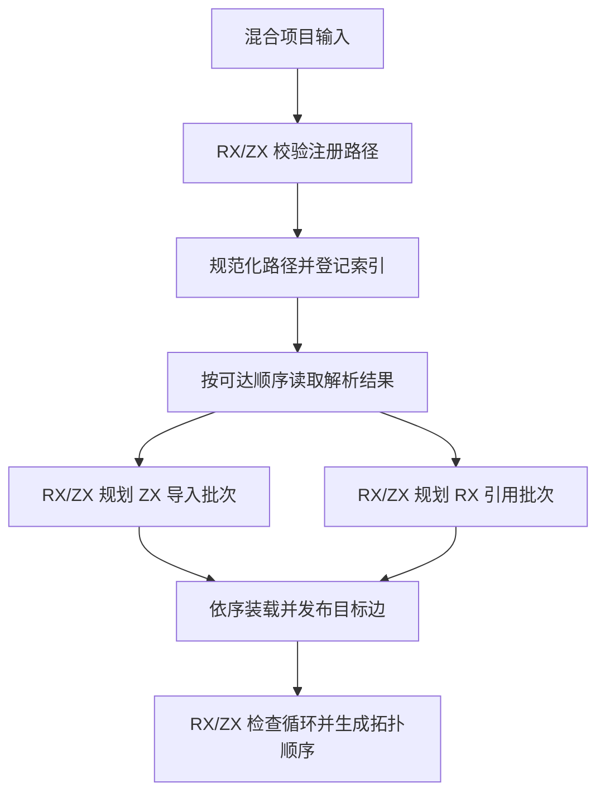
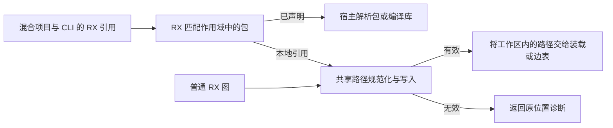

# 混合项目依赖图自举

## Intent

将正式混合项目和 CLI 源码装载路径上的 RX 引用规则迁入 RX/ZX，保持包作用域、引用顺序、诊断和文件身份。

## Data

`49cee7fb` 中，普通 RX 依赖图已经由 Source 解析和登记边表。混合项目和 CLI 共用的 `source_graph.references.collect` 仍由 Zig 按目标类型调用三套路径入口，并为每条本地依赖分配规范化路径。

## Edges

Source 路径和旧 seed 保持同一接口契约。包匹配应保留重复声明信息，规范化后的函数目录仍按已有规则查找 `index.zx`。绝对路径、文件边界、编译库装载、边表发布和 AST 的定位信息仍由各自宿主接口承接。

## Answer

### ZX 导入与混合项目登记

从混合项目 `source_graph.build` 迁移已索引 ZX 导入的遍历、分类与依赖包匹配，以及图入口的注册校验。导入计划借用解析器的源文本与导入行，按源码顺序写出定长批次，由宿主依序发布边和处理加载失败。注册阶段在第一条无效 RX 或 Store 路径停止，复用已有索引检查有效前缀的第一处重复。

ZX 项目与混合图共用 RX 的包目标准入流程，先检查源码入口或编译库标识，再报告重复包。平台绝对路径解析、图边分配和编译库装载仍在宿主侧。初始 seed 和原生 AST 输入沿用原有遍历入口。

上一代 Source 构建出 750 入口的引导器，再由新引导器生成安装版。39 项 RX 校验、184 项混合推导与库链接回归、38 项安装版回归通过。25 条 ZX 导入跨越两个批次，16 份生成文件与上一代逐字节一致，未声明依赖与重复包的错误位置和消息相同。

相邻工具均由 Source 引导生成并使用 Source 分析与生成。使用 Zig 0.17.0、ReleaseSmall、16 分区，关闭常驻，在相同 735 入口上交替各三轮。11,763 份生成文件与 v17 缓存载荷逐字节一致。同目录无改动时保留快照和产物时间戳。

| 指标             | 上一阶段中位数 | 当前阶段中位数 |
| ---------------- | -------------: | -------------: |
| 冷生成墙钟       |        2.85 秒 |        2.81 秒 |
| 冷生成 CPU       |       12.50 秒 |       12.47 秒 |
| 磁盘缓存墙钟     |        2.20 秒 |        2.20 秒 |
| 磁盘缓存 CPU     |        8.57 秒 |        8.57 秒 |
| 磁盘缓存峰值 RSS |      801.33 MB |      800.80 MB |
| 同目录无改动墙钟 |        0.03 秒 |        0.03 秒 |

首组冷生成峰值 RSS 中位数为 802.68 → 856.88 MB，进程树采样峰值中位数为 765.08 → 764.22 MB。隔离冷生成各重跑三轮，当前源码峰值为 848.84 → 833.57 MB，冻结源码为 840.86 → 844.27 MB。两组附加测量的原始峰值区间有重叠，未观察到稳定增长。生成的导入计划直接读取借用的导入行和源码切片，在定长栈缓冲区中写出结果。

固定 721 入口 Source 工具与当前工具在 `0e7ff384` 冻结源码上使用同一 735 入口及配置各三轮。冷生成墙钟为 2.89 → 2.81 秒，CPU 为 12.49 → 12.44 秒，峰值 RSS 为 966.56 → 805.70 MB。磁盘缓存墙钟均为 2.22 秒，CPU 为 8.57 → 8.55 秒。固定基线的 22 处产物差异与前期记录一致。计时覆盖生成和缓存复用。

以 `aa2fcd40` 为起点，累计 RX/ZX 新增 18,655 行、删除 2,074 行、净增 16,581 行。

### 已登记目标的选择与准入

沿 `56794623` 的 ZX 项目导入和混合项目 RX 装载入口迁移。RX 先探测原始文件键，仅在未命中时尝试目录入口。混合图复用已知索引行，在 Source 中确定 Store 类型及包边界，再发布目标行或诊断。作用域检查使用同一份最长根匹配规则。保持直接文件优先以及 Store 缺失优先于包边界的诊断顺序。

Linux、macOS 与 Windows 的路径组装继续走现有平台接口。CLI 的磁盘探测、编译库装载、边表分配和诊断位置仍在宿主侧。

默认 seed 和上一代 Source 构建出 748 入口的引导器，新引导器构建安装版。安装版通过 16 项 Store 路径、11 项 RX CLI 和 2 项包边界回归。相邻安装版的目录回退、直接文件优先和 RX 目录目标产物逐字节一致，跨包 Store 和未登记目录入口保留相同诊断。引导器的引用对照覆盖长路径、转义、包引用和跨批次缺失诊断。

相邻工具均由 Source 引导生成，运行时使用 Source 分析与生成。同一 735 入口清单采用 Zig 0.17.0、ReleaseSmall、16 分区，关闭常驻并交替各三轮。11,763 份生成文件和 v17 缓存载荷逐字节一致，工具身份文件单独排除。同目录无改动时保留快照和产物时间戳。

| 指标             | 上一阶段中位数 | 当前阶段中位数 |
| ---------------- | -------------: | -------------: |
| 冷生成墙钟       |        2.82 秒 |        2.78 秒 |
| 冷生成 CPU       |       12.45 秒 |       12.39 秒 |
| 冷生成峰值 RSS   |      799.77 MB |      803.32 MB |
| 磁盘缓存墙钟     |        2.22 秒 |        2.20 秒 |
| 磁盘缓存 CPU     |        8.53 秒 |        8.54 秒 |
| 磁盘缓存峰值 RSS |      801.05 MB |      801.11 MB |
| 同目录无改动墙钟 |        0.03 秒 |        0.03 秒 |

固定 721 入口 Source 工具和当前工具在 `0e7ff384` 冻结源码上用同一 735 入口及配置各三轮。冷生成墙钟均为 2.84 秒，CPU 为 12.40 → 12.49 秒，峰值 RSS 为 950.45 → 832.82 MB。磁盘缓存墙钟为 2.20 → 2.21 秒，CPU 为 8.52 → 8.46 秒。固定基线与当前产物保留上阶段已记录的 22 处差异。计时覆盖生成和缓存复用。

以 `aa2fcd40` 为起点，累计 RX/ZX 新增 18,477 行、删除 2,073 行、净增 16,404 行。

### RX 引用路由与共享路径工作区

RX 显式编排包匹配、目标种类选择、规范化和最终路由。混合项目与普通 RX 图共用规范化及缓冲区写入流程。混合项目与 CLI 的本地引用在同一个工作区上顺序解析，借用结果直到本次装载结束。工作区不足时按所需长度扩容。初始 seed 保留原实现。

安装版通过 9 项 RX 项目检查和 16 项 Store 路径检查，覆盖重建、失败恢复、路径别名及文件边界。目录函数及类型入口的生成文件与旧安装版逐字节一致，带结尾斜杠的简写保留原名称诊断。引导器的实文件对照覆盖包引用、XML 属性转义、长路径和跨批次缺失诊断。

默认 seed 与上一代 Source 都构建出 744 入口的引导器，再由新引导器构建安装版。39 项 RX 校验、138 项混合推导和 46 项库链接回归通过。

相邻两版均由 Source 引导生成并执行 Source 分析与生成。同一 735 入口清单使用 Zig 0.17.0、ReleaseSmall、16 分区，关闭常驻并交替各三轮。11,763 份生成文件与 v17 缓存载荷逐字节一致。生成器身份文件单独排除，同目录无改动保留快照和产物时间戳。

| 指标             | 上一阶段中位数 | 当前阶段中位数 |
| ---------------- | -------------: | -------------: |
| 冷生成墙钟       |        2.76 秒 |        2.77 秒 |
| 冷生成 CPU       |       12.33 秒 |       12.33 秒 |
| 冷生成峰值 RSS   |      805.21 MB |      798.47 MB |
| 磁盘缓存墙钟     |        2.18 秒 |        2.16 秒 |
| 磁盘缓存 CPU     |        8.51 秒 |        8.42 秒 |
| 磁盘缓存峰值 RSS |      801.01 MB |      800.98 MB |
| 同目录无改动墙钟 |        0.03 秒 |        0.03 秒 |

固定 721 入口 Source 工具与当前工具在 `0e7ff384` 冻结源码上使用同一 735 入口清单和配置各三轮。冷生成墙钟为 2.85 → 2.79 秒，CPU 均为 12.46 秒，峰值 RSS 为 943.93 → 796.69 MB。磁盘缓存墙钟均为 2.23 秒，CPU 为 8.56 → 8.58 秒。计时覆盖生成和缓存复用。

以 `aa2fcd40` 为起点，累计 RX/ZX 新增 18,117 行、删除 2,071 行、净增 16,046 行。

### 混合图按批读取 XML 引用

沿 `4911ca40` 的 `source_graph.references.collect` 继续迁移。ZX 逆序借用 XML 引用行，调用已有 RX 路由流程，再把各条本地路径写进同一缓冲区。Zig 依序执行已规划的文件查找和库装载。前一条引用的宿主失败优先于后一条在规划时发现的问题。缓冲区满时先处理已规划的前缀，剩余引用从原行继续。

手工 AST 及旧 seed 保留逐条装载接口。路径规范化、物理身份校验、包作用域和库生命周期契约沿用既有接口。

默认 seed 和 Source 引导均构建出 745 入口的新引导器，安装版构建成功。39 项 RX 校验、11 项安装版 RX 检查和 16 项 Store 路径检查通过。实文件对照覆盖 XML 实体、包引用、长路径增容、缓冲区写满后原容量续跑及跨批次诊断。较早的函数缺失优先于后续路径越界，两版都报告在 `main.rx:4:15`。缓冲区写满后续跑的 14 份生成文件逐字节一致。

两版均由 Source 引导生成并执行 Source 分析与生成。Zig 0.17.0、ReleaseSmall、16 分区和当前 735 入口清单，关闭常驻并交替各三轮。11,763 份产物中有 11,761 份逐字节一致。`types.zig` 增加可空间接文本读取接口，生成清单哈希随之变化。生成器身份文件单独排除。各版冷热输出一致，无改动重跑保留快照和产物时间戳。v17 缓存记录数相同，去除缓存键、内部函数编号并按内容排序后的记录一致。

| 指标             | 上一阶段中位数 | 当前阶段中位数 |
| ---------------- | -------------: | -------------: |
| 冷生成墙钟       |        2.80 秒 |        2.80 秒 |
| 冷生成 CPU       |       12.44 秒 |       12.43 秒 |
| 冷生成峰值 RSS   |      817.32 MB |      814.22 MB |
| 磁盘缓存墙钟     |        2.18 秒 |        2.17 秒 |
| 磁盘缓存 CPU     |        8.55 秒 |        8.57 秒 |
| 磁盘缓存峰值 RSS |      800.47 MB |      799.47 MB |
| 同目录无改动墙钟 |        0.03 秒 |        0.03 秒 |

固定 721 入口 Source 工具与当前工具在 `0e7ff384` 冻结源码上使用同一清单与配置各三轮。冷生成墙钟为 2.83 → 2.81 秒，CPU 为 12.42 → 12.45 秒，峰值 RSS 为 920.32 → 803.86 MB。磁盘缓存墙钟为 2.20 → 2.21 秒，CPU 为 8.54 → 8.58 秒。计时覆盖生成和缓存复用。

以 `aa2fcd40` 为起点，累计 RX/ZX 新增 18,267 行、删除 2,071 行、净增 16,196 行。

