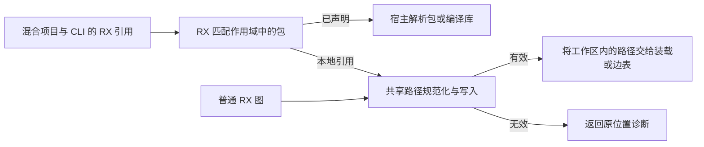

# 混合项目依赖图自举

## Intent

将正式混合项目和 CLI 源码装载路径上的 RX 引用规则迁入 RX/ZX，保持包作用域、引用顺序、诊断和文件身份。

## Data

`49cee7fb` 中，普通 RX 依赖图已经由 Source 解析和登记边表。混合项目和 CLI 共用的 `source_graph.references.collect` 仍由 Zig 按目标类型调用三套路径入口，并为每条本地依赖分配规范化路径。

## Edges

Source 路径和旧 seed 保持同一接口契约。包匹配应保留重复声明信息，规范化后的函数目录仍按已有规则查找 `index.zx`。绝对路径、文件边界、编译库装载、边表发布和 AST 的定位信息仍由各自宿主接口承接。

## Answer

### RX 引用路由与共享路径工作区

RX 显式编排包匹配、目标种类选择、规范化和最终路由。混合项目与普通 RX 图共用规范化及缓冲区写入流程。混合项目与 CLI 的本地引用在同一个工作区上顺序解析，借用结果直到本次装载结束。工作区不足时按所需长度扩容。初始 seed 保留原实现。

安装版通过 9 项 RX 项目检查和 16 项 Store 路径检查，覆盖重建、失败恢复、路径别名及文件边界。目录函数及类型入口的生成文件与旧安装版逐字节一致，带结尾斜杠的简写保留原名称诊断。引导器的实文件对照覆盖包引用、XML 属性转义、长路径和跨批次缺失诊断。

默认 seed 与上一代 Source 都构建出 744 入口的引导器，再由新引导器构建安装版。39 项 RX 校验、138 项混合推导和 46 项库链接回归通过。

相邻两版均由 Source 引导生成并执行 Source 分析与生成。同一 735 入口清单使用 Zig 0.17.0、ReleaseSmall、16 分区，关闭常驻并交替各三轮。11,763 份生成文件与 v17 缓存载荷逐字节一致。生成器身份文件单独排除，同目录无改动保留快照和产物时间戳。

| 指标             | 上一阶段中位数 | 当前阶段中位数 |
| ---------------- | -------------: | -------------: |
| 冷生成墙钟       |        2.76 秒 |        2.77 秒 |
| 冷生成 CPU       |       12.33 秒 |       12.33 秒 |
| 冷生成峰值 RSS   |      805.21 MB |      798.47 MB |
| 磁盘缓存墙钟     |        2.18 秒 |        2.16 秒 |
| 磁盘缓存 CPU     |        8.51 秒 |        8.42 秒 |
| 磁盘缓存峰值 RSS |      801.01 MB |      800.98 MB |
| 同目录无改动墙钟 |        0.03 秒 |        0.03 秒 |

固定 721 入口 Source 工具与当前工具在 `0e7ff384` 冻结源码上使用同一 735 入口清单和配置各三轮。冷生成墙钟为 2.85 → 2.79 秒，CPU 均为 12.46 秒，峰值 RSS 为 943.93 → 796.69 MB。磁盘缓存墙钟均为 2.23 秒，CPU 为 8.56 → 8.58 秒。计时覆盖生成和缓存复用。

以 `aa2fcd40` 为起点，累计 RX/ZX 新增 18,117 行、删除 2,071 行、净增 16,046 行。

