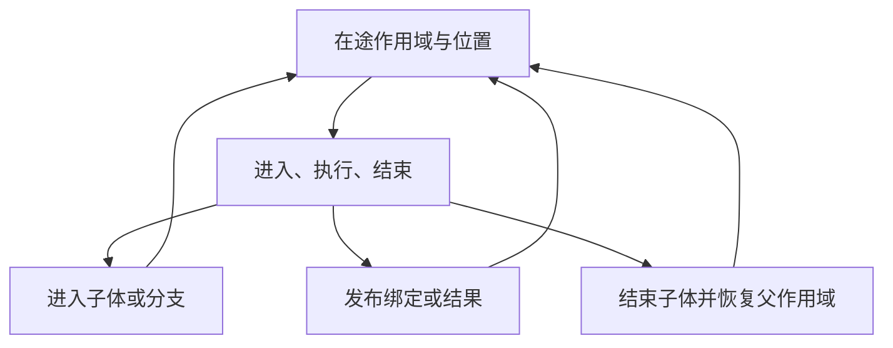

# 混合项目约束遍历自举

## Intent

沿混合项目的类型推导与模块体编译入口迁移控制流遍历。保持 Call、Task、Parallel、If、Switch 和 Return 的执行次序与诊断位置，同时保留原有作用域和内存生命周期。

## Data

以 `ba7fca1a` 为起点。模块准备、约束收集、表达式推导、求解与签名发布合计涉及约三千行相邻 Zig。两处正式遍历入口分别是 `project/constraints.zig` 和 `flow_compile.zig`，现有 RX 阶段表已经描述局部顺序，进入子体、推进分支、结束作用域的选择仍在 Zig。

## Edges

复用已准备好的流程行，不展开第二棵树。暂存打开的作用域和解析结果，随对应分支结束释放。约束图、表达式解析及 IR 写入沿用现有原子入口；有诊断立即结束，保证遍历不同分支时的首错顺序。收口时核对缓存载荷、生成产物、作用域回归与固定性能基线。

## Answer

推导与模块体编译复用 RX 的结构遍历。RX 按当前区域决定进入 Task、Parallel 或选择分支，ZX 从原流程行借用连续调用。宿主执行相应的约束或 IR 写入，分支结束时恢复绑定、可空事实和返回上下文。独立 Parallel Task 仍单独构造捕获环境。

原来的两套递归遍历已移除。初始 seed 和正式引导器共用同一事件契约，正式路径的事件由 RX/ZX 计算。宿主仍持有待处理作用域、解析对象和 IR 容量。常见嵌套深度使用内联缓冲，超出后按需扩展；执行中不会构造第二份流程。

初始 seed 和上一代 Source 均生成 751 入口的引导器，新引导器构建安装版。39 项 RX 校验和 1,116 项混合推导、顺序运行及并行运行回归通过。最终 Source 在 12 层嵌套分支与嵌套 Parallel Task 上生成 36 份逐字节一致的文件；分支外引用与深层失败的错误位置及消息一致。

相邻两代工具由 Source 引导生成，执行 Source 分析与生成。在 Zig 0.17.0、ReleaseSmall、16 分区下关闭常驻，对相同 735 入口各交替三轮。11,763 份生成文件与 v17 缓存载荷逐字节一致，同目录无改动时保留快照和产物时间戳。

| 指标             | 上一阶段中位数 | 当前阶段中位数 |
| ---------------- | -------------: | -------------: |
| 冷生成墙钟       |        2.82 秒 |        2.81 秒 |
| 冷生成 CPU       |       12.45 秒 |       12.49 秒 |
| 冷生成峰值 RSS   |      811.02 MB |      806.47 MB |
| 磁盘缓存墙钟     |        2.19 秒 |        2.19 秒 |
| 磁盘缓存 CPU     |        8.58 秒 |        8.56 秒 |
| 磁盘缓存峰值 RSS |      801.49 MB |      801.13 MB |
| 同目录无改动墙钟 |        0.03 秒 |        0.03 秒 |

固定 721 入口 Source 工具与当前工具在 `0e7ff384` 冻结源码上用同一 735 入口及配置各三轮。冷生成墙钟为 2.84 → 2.79 秒，CPU 为 12.46 → 12.47 秒，峰值 RSS 为 920.81 → 816.89 MB。磁盘缓存墙钟均为 2.21 秒，CPU 为 8.50 → 8.55 秒。固定基线的 22 处产物差异与前期记录一致。计时覆盖生成和缓存复用。

以 `aa2fcd40` 为起点，累计 RX/ZX 新增 18,766 行、删除 2,074 行、净增 16,692 行。

