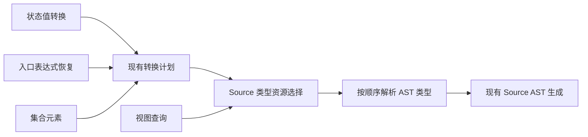

# 状态值资源选择自举

## Intent

让 genz 的状态值转换、视图和集合元素降低使用同一套类型资源选择。沿状态值降低约 3,100 行 Zig 的实际调用闭包核对正式路径，集中迁移仍由宿主执行的选择规则与重复的转换准备。

## Data

在 64e73853 中，状态类型布局分析和转换 AST 生成已有 Source 实现。正式 conversion_emission.prepare 仍逐行决定 ABI、状态或视图类型表，选择可空和指针目标、列表元素资源及 origin。entry 和 element 各自重复组装转换输入。view 和 element 还有独立的类型表枚举与索引分派。

## Edges

保持生成 AST、类型资源首次解析顺序、借用语义、字段存储和错误传播。原数组继续由简短的宿主适配借用。分配及向 Zig AST 容器导入留在宿主，seed 仍能独立运行。

## Answer

## 实现与边界

- ZX 按转换方向、类型类别、借用和子节点事实，选择布局、目标、元素与 origin 资源。普通转换、入口恢复和集合元素用同一准备路径。视图查询和元素类型共用资源枚举。宿主按原顺序从现有类型表获取表达式 ID，表的惰性构造仍在 Zig。
- 状态值转换和列表记录直接追加至共享 AST 字段列。对象构造直接追加子字段和来源字段。列表记录、集合元素和 pop 共用同一构造规则，并按各自原有绝对字段位置生成。写回借用字段文本，复用现有字段列导入。
- 迁移后仍由 Zig 管理 AST 存储、按顺序解析资源、转换写回与 seed 分派。视图资源缺失时的迭代控制仍跨宿主边界。

## 功能验收

- 7 入口定向清单中，153 份生成文件以及 145 条生成和所有权缓存记录相同。上一阶段的 Source 工具构建了候选的 771 个正式入口。
- `test-value-return`、`test-iterate-calls` 和 `test-array-pop` 共 243 项回归全部通过，涵盖类型视图、列表及嵌套值借用、原生返回、失败路径、源库与归档后运行，并包含 CLI 迭代库重新发布。
- 同一份 734 入口清单生成的 11,742 份文件和 5,341 条缓存记录逐一一致。v17 所有权缓存快照摘要均为 `8c87319938e9b3ebb4d1875dae536356d27497f544cfc922dc6b59f99ac9612b`。无改动重跑保留输入快照和产物时间戳。
- 本阶段 ZX/RX 新增 212 行、删除 169 行、净增 43 行。Zig 新增 81 行、删除 153 行、净减 72 行。

## 性能

两版均由 Source 生成，并运行 Source 分析和生成。使用 Zig 0.17.0、ReleaseSmall、16 分区并关闭常驻。相邻工具在同一份 734 入口清单上交替测三轮，以下为中位数。

| 指标                   | 上一阶段 | 当前阶段 |
| ---------------------- | -------: | -------: |
| 冷生成墙钟             |  2.80 秒 |  2.77 秒 |
| 冷生成 CPU             | 12.44 秒 | 12.43 秒 |
| 冷生成单进程峰值 RSS   | 804.8 MB | 785.9 MB |
| 冷生成进程树采样峰值   | 757.6 MB | 759.1 MB |
| 磁盘缓存墙钟           |  2.15 秒 |  2.17 秒 |
| 磁盘缓存 CPU           |  8.41 秒 |  8.41 秒 |
| 磁盘缓存单进程峰值 RSS | 778.0 MB | 778.1 MB |
| 无改动重跑墙钟         |  0.03 秒 |  0.03 秒 |

固定 721 入口 Source 引导器和候选使用同一份 735 入口清单和 `0e7ff384` 冻结源码。冷生成墙钟 2.84 → 2.77 秒，CPU 12.45 → 12.39 秒，单进程峰值 RSS 963.8 → 793.6 MB，进程树采样峰值 886.1 → 757.5 MB。磁盘缓存墙钟 2.22 → 2.18 秒，CPU 8.54 → 8.44 秒。固定对照中的 21 份 Zig 文件差异及两侧所有权快照与上一阶段一致，文件清单受冻结路径影响。计时覆盖引导生成和缓存复用。
