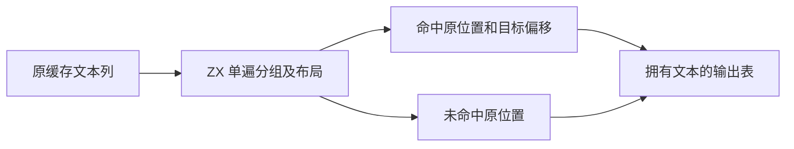

# 生成任务与缓存结果发布自举

## Intent

将生成批次的缓存分组、缓存文本布局以及待生成任务的顺序交给 RX/ZX。减少自举冷生成复制的任务描述符和热生成的中间切片。

## Data

从 `fe42c953` 的应用及库生成入口追到 `function_sources.createJobs`，再到并行查找、Source 计划、缓存结果提交及发射器。原路径把缓存查询结果转成独立的行表，并在复制或生成前再次组装任务数组。

## Edges

保持原任务顺序、缓存计数、磁盘缓存格式、生成失败顺序和结果的独立所有权。缓存命中的文本在缓存表可能覆盖旧值之前读完。宿主借用仅覆盖整个批次的同步调用。

## Answer

## 实现与边界

- 查询结果把可复用文本直接保存在可选字段中。生成计划借用这列，一遍产生原任务编号、复用文本的累计字节偏移和目标缓冲区大小。生成的 Zig 使用字节长度，计划通过无可用空间的分配器运行。
- 命中任务直接写各自的目标区间和输出位置。待生成任务按计划读取原始任务表。复制与发射阶段省去两份命中切片列表和整份待生成任务副本。
- 复用文本复制完成并等待各工作线程结束后，宿主才记账并更新缓存。生成的新文本仍按原任务顺序提交。Zig 保留缓存存储、工作线程调度、发射器调用和对外返回内存的所有权交接。

## 验收

- 既有 Source 引导器与初始 seed 各自成功构建 760 入口的新引导器。新引导器构建 16 分区安装版成功。
- 23 项模块生成测试通过，覆盖内存命中及分配失败。安装版的 4 项运行检查通过，覆盖磁盘命中、禁用缓存、损坏记录、记录错配与原生 ABI。
- 复用应用夹具做一次源码改动和恢复。每次发射前清空生成目录，保留磁盘缓存。三种输入的增量生成与禁用缓存生成分别逐字节一致，恢复后再次得到原始文件。对应生成与命中数为 3/0、1/2、0/3。
- 具名 barrel 库和 Store 库的 29 份发布文件与上一版逐字节一致。

## 性能

关闭生成缓存并交替发布九对。具名 barrel 库墙钟中位数为 120.44 → 120.23 毫秒，CPU 为 127.01 → 126.80 毫秒。Store 库墙钟从 36.97 降到 36.34 毫秒，CPU 从 40.37 降到 39.79 毫秒。

相邻两版引导器均由 Source 生成，运行时执行 Source 分析和生成。Zig 0.17.0、ReleaseSmall、16 分区，关闭常驻，对同一份 735 入口清单交替测三轮。11,770 份生成文件及 v17 缓存载荷逐字节一致。无改动重跑保持快照和产物时间戳。

| 指标                   | 上一阶段中位数 | 当前阶段中位数 |
| ---------------------- | -------------: | -------------: |
| 冷生成墙钟             |        2.81 秒 |        2.79 秒 |
| 冷生成 CPU             |       12.50 秒 |       12.49 秒 |
| 冷生成单进程峰值 RSS   |       831.0 MB |       796.5 MB |
| 冷生成进程树采样峰值   |       759.2 MB |       767.2 MB |
| 磁盘缓存墙钟           |        2.20 秒 |        2.18 秒 |
| 磁盘缓存 CPU           |        8.64 秒 |        8.56 秒 |
| 磁盘缓存单进程峰值 RSS |       799.6 MB |       801.0 MB |
| 无改动重跑墙钟         |        0.03 秒 |        0.03 秒 |

固定 721 入口 Source 工具和当前工具在 `0e7ff384` 冻结源码上用同一份 735 入口清单及上述工具链配置。冻结源码复用上一阶段的私有内存导入更名。冷生成墙钟 2.83 → 2.82 秒，CPU 12.38 → 12.42 秒，单进程峰值 RSS 931.8 → 793.7 MB，进程树采样峰值 884.6 → 762.0 MB。磁盘缓存墙钟 2.19 → 2.18 秒，CPU 均为 8.46 秒。跨固定基线仍为同样的 22 个产物有差异。此处计时覆盖引导生成和库发布，完整冷安装构建未做配对测量。
