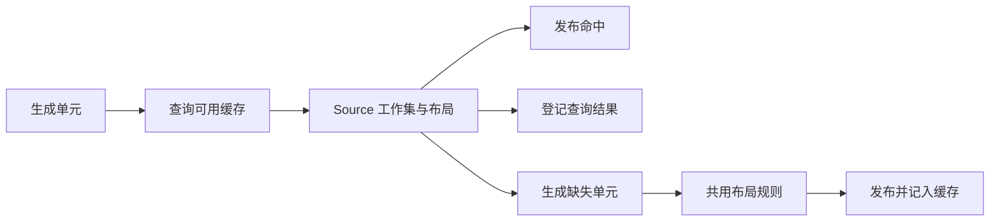

# 生成批次工作集自举

## Intent

把缓存命中、待生成任务和结果写入区间的选择收口到 RX/ZX。让关闭缓存的生成单元直接进入生成阶段。

## Data

从 28acedcb 的应用与库编排追踪 function_sources、Cache 和共享 worker。查询先计算所有单元的名字与哈希，随后才判断缓存是否存在。缓存登记扫描整批结果。命中和发射后的布局分别实现了源缓冲长度累加。

## Edges

维持原输出顺序、缓存键、命中计数和 I/O 失败的处理。保留资源的 Zig 分配和并行执行边界。调用方结果仍独立持有内存，在登记可能释放旧缓存数据前完成命中发布。

## Answer

## 实现与边界

- Source 工作集同时写出命中、缺失及命中缓冲偏移，并返回含实际查询事件的最小登记区间。磁盘损坏和 I/O 失败即使没有源码，也进入该区间。中间的纯缺失项仍由原登记接口按顺序处理。
- 生成成功后的连续结果复用相同布局计算，移除独立的偏移入口。缓存关闭的整批任务无需建立查找表、查询结果或筛选索引，发布时直接使用输入位置。混合批次中，关闭缓存的单元也跳过缓存键和查询。
- 搜索、记录移交和并行 worker 的实际调用仍由 Zig 资源边界执行。旧 seed 保留缓存布局分类回退。未新增应用接口。

## 功能验收

- 定向清单的 17 份生成产物以及 14 条生成和所有权缓存记录逐一一致。上一版 Source 工具构建新版的 771 个正式入口，候选工具生成并构建了 16 分区安装版。
- 23 项模块生成缓存回归及 4 项安装版运行检查全部通过。具名导出、Store 和两组常量库的 27 条缓存记录一致。具名导出编辑重生成 1 个单元并复用 10 个，与禁用缓存的结果一致，恢复后 11 个单元全部命中。
- 相邻工具的 11,740 份产物和 5,340 条缓存记录逐一相同。v17 所有权快照摘要均为 `76f7c23ee784020ecf89b31630f21828f21262116a4a7fd4e2f36f701ea802b6`。无改动重跑保留输入快照与产物时间戳。
- 本阶段 ZX/RX 新增 53 行、删除 44 行、净增 9 行。Zig 新增 93 行、删除 47 行、净增 46 行。

## 性能

两版均由 Source 生成并运行 Source 分析和生成。工具链与前一阶段相同，使用 Zig 0.17.0、ReleaseSmall、16 分区并关闭常驻。相邻版本在同一份 734 入口清单上交替测三轮，以下为中位数。

| 指标                   | 上一阶段 | 当前阶段 |
| ---------------------- | -------: | -------: |
| 冷生成墙钟             |  3.09 秒 |  2.83 秒 |
| 冷生成 CPU             | 12.44 秒 | 12.53 秒 |
| 冷生成单进程峰值 RSS   | 843.4 MB | 810.5 MB |
| 冷生成进程树采样峰值   | 762.4 MB | 763.0 MB |
| 磁盘缓存墙钟           |  2.22 秒 |  2.20 秒 |
| 磁盘缓存 CPU           |  8.58 秒 |  8.57 秒 |
| 磁盘缓存单进程峰值 RSS | 782.4 MB | 782.4 MB |
| 无改动重跑墙钟         |  0.03 秒 |  0.03 秒 |

固定 721 入口 Source 引导器和候选在 `0e7ff384` 冻结源码上使用同一份 735 入口清单。冷生成墙钟 3.33 → 2.85 秒，CPU 12.42 → 12.48 秒，单进程峰值 RSS 921.9 → 796.9 MB，进程树峰值 897.4 → 757.9 MB。磁盘缓存墙钟 2.19 → 2.18 秒，CPU 8.50 → 8.46 秒。固定基线和候选之间仍为已记录的 21 份 Zig 文件差异，文件清单受冻结路径影响，两侧的所有权快照各自与上一阶段一致。

禁用缓存的安装版库发布交替测九组。具名导出、Store、常量和有符号常量四组结果逐字节一致，墙钟中位数分别为 123.67 → 123.85、37.14 → 37.81、6.41 → 6.19 和 4.98 → 4.83 毫秒。省去的查找和指纹工作已由执行路径确认，小型用例的端到端差异很小。完整安装构建用于功能验收。
