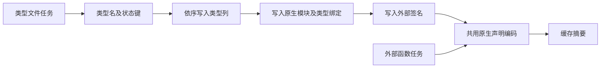
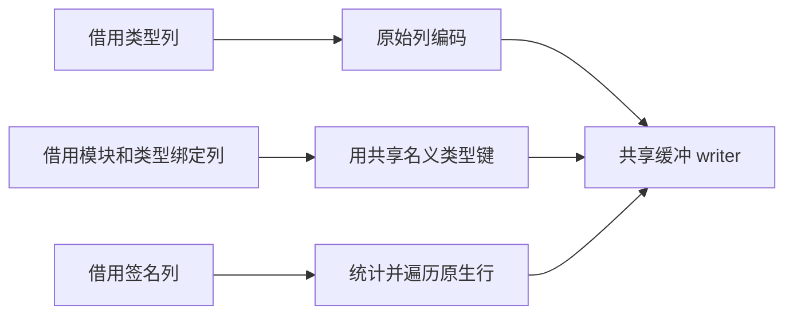

# 生成类型与原生签名缓存键自举

## Intent

让类型文件的完整生成缓存键由 RX/ZX 编码。复用同一份原生声明编码来计算类型文件与单个外部函数文件的缓存键。

## Data

从 `85e78373` 生成缓存键的 `.types` 分支追踪类型列、原生模块和外部函数签名。宿主目前仍按旧 IR 结构遍历类型表，逐个还原原生模块及绑定行，两次还原完整函数记录以计数并写入外部签名。列模型与类型名字已经存在。

## Edges

维持 v88 缓存协议。类型列顺序、原生模块的声明记录和引用记录顺序不同，全部沿用旧格式。外部签名仍按函数 ID 顺序保留可空字段与真实的名义类型键。沿用旧的 Zig seed 编码及 SHA-256 writer。相邻工具需比较完整产物和缓存键，并验证增量编辑与恢复。

## Answer

## 实现与边界

- RX 依序连接类型名和状态键、类型列、原生模块与外部签名。列和绑定按原格式编码，原生类名和类型摘要通过已有名字和键查找。外部签名直接借用签名列，计数与写入均只需读取相关列。
- 类型文件与单个外部函数的缓存键共用原生声明编码。先前单独的原生模块引用生成入口已退役，其规则仍由共享编码调用。整条路径共用已有 SHA-256 writer。
- Zig 仍遍历入口和函数本体的旧 IR，例如表达式与控制流，并提供原生布局适配。类型文件旧序列化只在初始 seed 分支运行。

## 功能验收

- 实际生成的两个入口在空容量分配器中写出 1,263 字节，与旧格式逐字节一致。覆盖类型原始列、具名绑定、原生身份、混排签名与可空原生参数、导出名及错误列表。
- 相邻工具在定向引导清单产生的 23 个缓存键和载荷哈希一致。上一代 Source 工具和初始 seed 分别生成并构建 771 个正式入口的新版，候选再生成 16 分区安装版。
- 23 项模块生成回归和 4 项安装版运行检查通过，覆盖原生 ABI、缓存损坏、清理及分配失败重试。具名导出库及 Store 库共 29 份发布文件和 23 条缓存记录与上一版一致。编辑并恢复具名成员后，增量产物先与无缓存重建一致，再与原产物一致。

## 性能

相邻两版均由 Source 生成，并运行 Source 分析和生成。使用 Zig 0.17.0、ReleaseSmall、16 分区，关闭常驻，在同一份 734 入口清单和当前源码上交替测三轮。11,760 份生成文件、5,351 条缓存记录的键和载荷哈希，以及 v17 缓存载荷全部一致。无改动重跑保留快照及产物时间戳。

| 指标                   | 上一阶段中位数 | 当前阶段中位数 |
| ---------------------- | -------------: | -------------: |
| 冷生成墙钟             |        2.82 秒 |        2.81 秒 |
| 冷生成 CPU             |       12.54 秒 |       12.50 秒 |
| 冷生成单进程峰值 RSS   |       841.4 MB |       843.1 MB |
| 冷生成进程树采样峰值   |       760.4 MB |       761.9 MB |
| 磁盘缓存墙钟           |        2.19 秒 |        2.19 秒 |
| 磁盘缓存 CPU           |        8.54 秒 |        8.53 秒 |
| 磁盘缓存单进程峰值 RSS |       802.1 MB |       803.4 MB |
| 无改动重跑墙钟         |        0.03 秒 |        0.03 秒 |

固定 721 入口 Source 引导器与当前工具使用同一份 735 入口清单、`0e7ff384` 冻结源码和同一旧私有内存导入。冷生成墙钟 2.88 → 2.82 秒，CPU 12.57 → 12.53 秒，单进程峰值 RSS 969.7 → 843.3 MB，进程树采样峰值 885.0 → 774.6 MB。磁盘缓存墙钟 2.23 → 2.21 秒，CPU 8.58 → 8.54 秒。11,758 份产物中 11,736 份一致，其余仍为既有的 22 份。计时覆盖引导生成和缓存复用，完整冷安装构建只做了功能验收。
