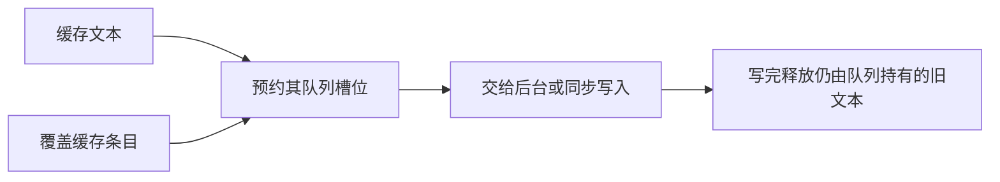

# 生成缓存记录与写入队列自举

## Intent

让生成缓存的磁盘记录格式与校验由 RX/ZX 决定，并缩短同步发布和后台写入的内存占用。

## Data

从 `f67f3f54` 的 `function_sources.createJobs → cache.fetch / record / put → cache.storage` 追到生成缓存的包头、写入及释放。此前读路径先重新编码完整包头，再在 Zig 中比较。替换条目时，Zig 扫描待写队列判断旧文本是否仍被借用。

## Edges

沿用已有缓存格式、读取顺序和最大载荷限制。标记、摘要、记录长度和换行均逐字节验证。待写文本保持有效到对应工作线程完成，编译器归还生成结果时仍拥有独立内存。

## Answer

## 实现与边界

- 读路径使用 Source 布局检查物理文件长度，再读取固定宽度的包头。RX 依次检查格式标记、编译器摘要、任务键和载荷长度。读取端省去重新编码包头和第二块栈缓冲。包头宽度在 Zig 中直接读取 ZX 导出的编译期常量。
- 写入发布在变更缓存条目前预留队列空间。待写槽位和文本地址共同识别仍被队列借用的文本。替换时，槽位接管旧文本并在写入完成后释放。整块队列通过所有权转移交给后台写入或同步刷盘。
- 文件读取、线程调度、缓存索引、待写槽位和旧文本释放仍使用原生实现。包头生成沿用原有的结构化 Source 实现，初始 seed 保留旧读写实现。

## 验收

- 现有 Source 工具和初始 seed 分别生成并构建 763 入口的新引导器。候选引导器构建 16 分区安装版成功。
- 23 项模块生成测试和 4 项安装版运行检查通过，覆盖磁盘命中、损坏记录、记录错配、原生 ABI 和分配失败。
- 临时定向核验覆盖写队列内替换、跨后台写入替换、同步刷盘和五个版本重新读取。注入队列预留分配失败后，条目没有部分发布，重试成功，调试分配器核对无泄漏。
- 编辑并恢复既有运行夹具代码，每次先清空生成目录。缓存生成与禁用缓存重建逐字节一致。具名 barrel 库和 Store 库的 29 份发布文件与上一版逐字节一致。

## 性能

相邻两版均由 Source 引导，并执行 Source 分析及生成。使用 Zig 0.17.0、ReleaseSmall、16 分区、关闭常驻，对同一份 735 入口清单交替测三轮。11,770 份生成文件和 v17 缓存载荷逐字节一致。同目录无改动重跑保留快照和产物时间戳。

| 指标                   | 上一阶段中位数 | 当前阶段中位数 |
| ---------------------- | -------------: | -------------: |
| 冷生成墙钟             |        2.80 秒 |        2.79 秒 |
| 冷生成 CPU             |       12.54 秒 |       12.48 秒 |
| 冷生成单进程峰值 RSS   |       845.8 MB |       796.3 MB |
| 冷生成进程树采样峰值   |       758.9 MB |       759.7 MB |
| 磁盘缓存墙钟           |        2.20 秒 |        2.17 秒 |
| 磁盘缓存 CPU           |        8.64 秒 |        8.57 秒 |
| 磁盘缓存单进程峰值 RSS |       799.8 MB |       799.7 MB |
| 无改动重跑墙钟         |        0.03 秒 |        0.03 秒 |

固定 721 入口 Source 引导器和当前工具用同一份 735 入口清单与 `0e7ff384` 冻结源码。沿用上一阶段的私有内存导入更名和工具链配置。冷生成墙钟 2.86 → 2.83 秒，CPU 12.54 → 12.44 秒，单进程峰值 RSS 957.0 → 823.1 MB，进程树采样峰值 883.7 → 766.2 MB。磁盘缓存墙钟 2.22 → 2.20 秒，CPU 8.56 → 8.55 秒。跨固定基线的差异仍为同样 22 个文件。计时覆盖引导生成和缓存复用，完整冷安装构建未做配对测量。
