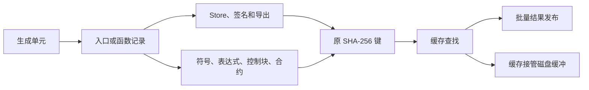
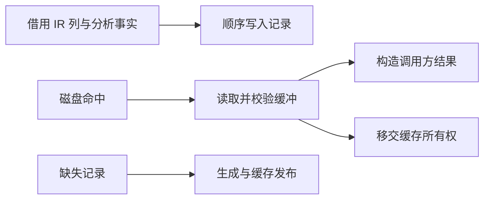

# 生成缓存记录组装自举

## Intent

收口编译器的生成缓存键，入口与函数的顶层记录和本体均按 RX/ZX 编排。沿缓存查询到结果发布的路径消除磁盘命中后的重复复制。

## Data

从 ed4dc9a9 的 Batch.identify、function_sources.createJobs 和 Cache.get 追踪。上一阶段已迁移本体遍历，入口和函数仍由 Zig 写入 Store、签名、导出和布局字段。磁盘读取已分配源缓冲，登记仍复制一次，再由发布阶段构造独立结果。

## Edges

延用 v88 的字段次序和类型键，覆盖 native 可空签名、常量的浮点位型和空导出列表。跨线程的磁盘缓冲使用线程安全分配器，缓存与结果各有清晰的生命周期。保留兼容 seed 与非默认分析布局。

## Answer

## 实现与边界

- 入口与函数 RX 各自表达 v88 的记录顺序，复用本体、合约、端口与 Store 字段写入。类型包和函数记录使用同一套原生签名读取及可空编码。常量导出由 ZX 写入，宿主只把原生 tagged union 分段借用为现有字面量描述符，字符串缓冲保持借用。
- 正式分析布局下，旧通用 Zig IR 序列化退出缓存键路径。初始 seed 保留旧序列化，关闭生成版后端分析时保留旧续期布局的写入。宿主提供 SHA-256 writer 和 ABI 列适配，并按生成单元选取 RX 入口。
- 磁盘缓存单条与批量查询都把已验证源缓冲交给缓存容器。并行读取使用线程安全分配器，未登记成功的结果由调用方释放。结果仍有独立的发布缓冲，允许先销毁缓存或在同一批次替换命中项。

## 功能验收

- 上一版和候选分别使用同一份 5 入口定向清单，68 份产物与 65 条生成及所有权缓存记录逐一一致。上一代 Source 工具构建新版 772 个正式入口，候选又生成并构建了 16 分区安装版。
- 29 项生成缓存与合约回归、4 项安装版运行检查通过。具名导出、Store、41 项常量导出和带负整数常量的四类库保留相同的 41 份发布文件与 27 条缓存记录，热重建全部命中。具名导出改名时重生成 1 个单元并复用 10 个，与禁用缓存的结果一致。恢复后全部命中。
- 同一份 734 入口清单中，候选和上一版的 11,738 份产物与 5,339 条缓存记录全部一致。两侧 v17 所有权快照摘要均为 `a6c65e11793600005fb9f21de54c9930071699db5ad5f3ac246e9a9d9b6e4bb2`。无改动重跑保留产物与快照时间戳。
- 本阶段 ZX/RX 新增 388 行、删除 53 行、净增 335 行。Zig 新增 146 行、删除 131 行、净增 15 行。

## 性能

两版均由 Source 生成并运行 Source 分析及生成。使用 Zig 0.17.0、ReleaseSmall、16 分区并关闭常驻，按相邻工具交替三轮的中位数记录。

| 指标                   | 上一阶段 | 当前阶段 |
| ---------------------- | -------: | -------: |
| 冷生成墙钟             |  2.87 秒 |  2.84 秒 |
| 冷生成 CPU             | 12.52 秒 | 12.51 秒 |
| 冷生成单进程峰值 RSS   | 805.9 MB | 846.9 MB |
| 冷生成进程树采样峰值   | 759.9 MB | 760.9 MB |
| 磁盘缓存墙钟           |  2.20 秒 |  2.20 秒 |
| 磁盘缓存 CPU           |  8.56 秒 |  8.56 秒 |
| 磁盘缓存单进程峰值 RSS | 803.3 MB | 777.4 MB |
| 磁盘缓存进程树采样峰值 | 761.6 MB | 776.0 MB |
| 无改动重跑墙钟         |  0.03 秒 |  0.03 秒 |

因前三轮的单进程冷峰值差异，另外只对冷生成交替测四轮，提高进程树采样频率。单进程峰值中位数为 817.9 → 809.5 MB，进程树采样峰值为 770.6 → 772.3 MB。单进程指标在两轮对照中的变化方向相反。热缓存三轮单进程峰值分别落在 802.1–803.5 MB 与 777.2–777.5 MB。

固定 721 入口 Source 引导器与候选使用同一份 735 入口清单、`0e7ff384` 冻结输入与旧私有内存导入。冷生成墙钟 2.87 → 2.81 秒，CPU 12.55 → 12.48 秒，单进程峰值 RSS 964.4 → 794.6 MB，进程树峰值 884.9 → 766.1 MB。磁盘缓存墙钟 2.24 → 2.19 秒，CPU 8.60 → 8.52 秒，单进程峰值 934.1 → 773.5 MB。前一阶段记录的 21 份 Zig 输出差异及两端所有权快照摘要保持一致。绝对路径影响文件清单。安装构建用于功能验收，计时范围为引导生成和缓存复用。
