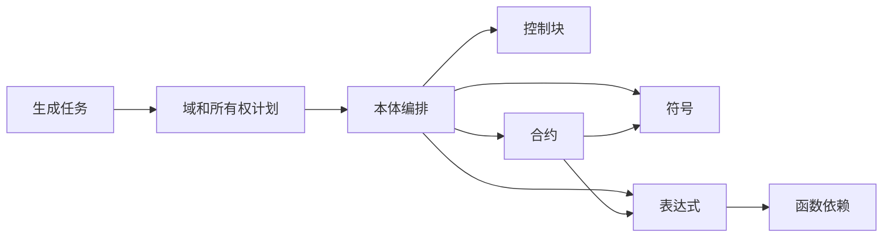
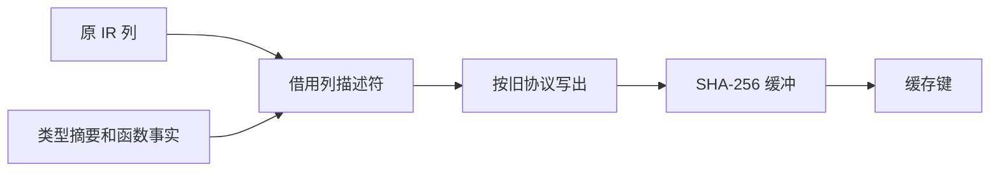

# 生成缓存键本体自举

## Intent

让正式编译器直接编码入口、函数和合约的 IR 本体，退出 Zig 对符号、表达式及控制流的逐行还原。缓存键继续反映精确的生成依赖。

## Data

从 c2c6098f 的 Batch.identify 到 fingerprint.finish，入口和常规函数仍经 write 访问 FunctionTable.at、ExpressionTable.at、ContractTable.at、SymbolTable.at 和递归的 Block.at。与这些读取器、列模型和写入顺序共同核对。循环、Task、并行和控制流结构中有不同的可空值与集合布局。

## Edges

沿用 v88 的类型名和状态摘要、函数依赖、数值宽度、空状态、布局及排除位置规则。直接借用 core 现有列和分析结果。保留旧 Zig seed 的编码和通用哈希 writer，以实际调用路径核对退出现用的实现。

## Answer

## 实现与边界

- 正式入口与函数路径直接借用符号、表达式、控制和合约列。函数缓存键从签名列取外部声明与端口，完整 Function 行与逐个 ExpressionRow、StatementRow、Symbol、Contract 的还原退出了这条路径。
- 表达式除调用目标身份外的载荷、递归块及并行、解构和选择的编码，由生成缓存与唯一性分析内容哈希共用。两套协议保留各自的标签、类型身份和函数依赖编码。唯一性内容哈希改用同一类缓冲 writer，复用 SHA-256 后端。
- 入口及函数记录的顶层标量与 Store、导出和常量导出仍由 Zig 按原顺序写入。宿主保留类型和事实的 ABI 描述符组装、空合约快路径及哈希资源。旧本体遍历通过编译期分支保留给初始 seed。
- 共用实现合并了唯一性哈希的载荷处理与相关辅助文件。源码统计按完整 Git 差异计算，重命名不会计为整份新增。

## 功能验收

- 上一阶段 Source 工具和候选在三个改动入口上生成的 52 份文件一致，48 条生成缓存记录和一份所有权缓存快照逐项一致。上一阶段工具构建新版的 772 个正式入口，候选工具生成并构建 16 分区安装版。
- 29 项模块生成与合约回归、4 项安装版运行检查均通过。具名导出库及 Store 库保留相同的发布文件及 23 条缓存记录。更名后生成 1 个单元、复用 10 个，产物与无缓存生成一致，恢复原名后 11 个单元全部命中。
- 相邻工具在同一完整核验清单的 11,738 份产物、5,339 个缓存键及载荷哈希全部一致，v17 所有权缓存快照摘要均为 `a6c65e11793600005fb9f21de54c9930071699db5ad5f3ac246e9a9d9b6e4bb2`。无改动重跑保留输入快照和产物时间戳。
- 本次删除 21 个旧文件，另有 7 个文件在 Git 中识别为重命名。ZX/RX 新增 1,362 行、删除 1,018 行、净增 344 行。Zig 新增 139 行、删除 46 行、净增 93 行。

## 性能

相邻工具都由 Source 生成，并运行 Source 分析及生成。使用 Zig 0.17.0、ReleaseSmall、16 分区，关闭常驻，对同一份 734 入口清单交替运行三轮。下表为中位数。

| 指标                   | 上一阶段 | 当前阶段 |
| ---------------------- | -------: | -------: |
| 冷生成墙钟             |  2.81 秒 |  2.78 秒 |
| 冷生成 CPU             | 12.48 秒 | 12.38 秒 |
| 冷生成单进程峰值 RSS   | 841.3 MB | 841.8 MB |
| 冷生成进程树采样峰值   | 760.3 MB | 759.7 MB |
| 磁盘缓存墙钟           |  2.18 秒 |  2.17 秒 |
| 磁盘缓存 CPU           |  8.49 秒 |  8.52 秒 |
| 磁盘缓存单进程峰值 RSS | 802.1 MB | 801.9 MB |
| 无改动重跑墙钟         |  0.03 秒 |  0.03 秒 |

固定 721 入口 Source 工具与候选使用同一份 735 入口清单、`0e7ff384` 冻结源码和同一旧私有内存导入。冷生成墙钟 2.86 → 2.82 秒，CPU 12.51 → 12.52 秒，单进程峰值 RSS 975.3 → 810.6 MB，进程树采样峰值 895.9 → 757.6 MB。磁盘缓存墙钟 2.21 → 2.19 秒，CPU 8.57 → 8.51 秒。此前的 21 份 Zig 产物差异及两侧的所有权缓存摘要均相同，文件清单仍随该轮冻结源码的绝对路径变化。完整安装构建用于功能验收，本表计时覆盖引导生成与缓存复用。
