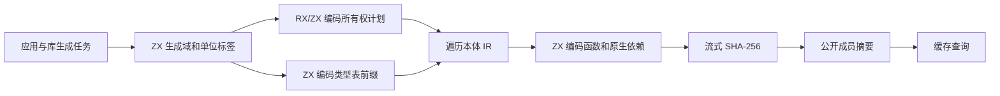

# 生成缓存键语义自举

## Intent

由 RX/ZX 定义生成缓存键中与编译器规则相关的内容，覆盖单位身份、所有权计划、函数与原生依赖、类型名称和公开成员。保持现行键的二进制字节流和增量失效范围。

## Data

从 `7773e794` 的应用和库发射入口追踪 `function_sources.Search → Batch.identify → fingerprint → cache.fetch`。Zig 当前混合了 IR 通用遍历、针对发射行为的依赖规则、长度前缀和哈希批处理。直接比较缓存记录键，才能发现仅检查生成文本看不到的变化。

## Edges

保留字段顺序、整数宽度、名义类型 ID 的映射、函数之间的相对位置、原生模块引用、可空错误列表，以及所有权表的实际字节表示。源码位置仍沿用现行排除规则。哈希、缓存存储和尚未拥有 ZX 类型表示的 IR 通用遍历由宿主处理。

## Answer

## 实现与边界

- 单位标签和版本、所有权计划的前缀与续期行、函数和原生依赖、类型名与状态类型键、具名公开成员由 Source 编码。函数依赖直接借用 Store 列和已有分析事实。所有权计划的原生字节列继续按原字节发出。
- Zig 与 Source 写入同一块 4 KiB 缓冲的 SHA-256 writer。Source 同步借用列、字节键和名称，不为编码创建临时堆缓冲。公开成员继续沿用本机字宽和端序的长度编码。
- 旧 IR 对象、控制流、类型表和表达式的通用遍历仍由 Zig 执行，其中 TypeId 的查表和一部分顶层单位的选择也留在宿主。Source 接管的是已经单独提取的缓存编码规则。初始 seed 仍有对应的旧编码路径。

## 功能验收

- 六个生成入口的 1,132 字节与旧编码逐字节相同。在空容量分配器中覆盖四种单位、续期行、带 Store 的依赖、错误列表的三种状态、原生身份和命名空间、类型前缀、公开成员的 32/64 位和两种端序。
- 新工具与上一代 Source 工具在窄清单中生成的 32 个缓存键和载荷哈希一致。上一代 Source 工具、初始 seed 各自生成并构建 771 入口。新 Source 工具生成的 16 分区安装版通过构建。
- 两版安装工具的具名导出库与 Store 库合计 29 份发布文件、23 个持久缓存记录逐一相同。具名成员更名后重新生成 1 个单位、复用 10 个，产物与禁用缓存构建一致。恢复成员名后 11 个单位全部命中，恢复原发布文本。
- 23 项模块生成测试与 4 项安装版运行检查通过，涉及值版资格变更、缓存替换和分配失败重试、磁盘记录损坏、记录错配和原生对象 ABI。

## 性能

相邻两版均由 Source 生成，并运行 Source 分析与生成。使用 Zig 0.17.0、ReleaseSmall、16 分区，关闭常驻，对当前源码和同一份 734 入口清单交替测三轮。11,760 个生成文件、5,351 个缓存记录的键和载荷哈希，以及 v17 缓存载荷均一致。无改动重跑保留输入快照和产物时间戳。

| 指标                   | 上一阶段中位数 | 当前阶段中位数 |
| ---------------------- | -------------: | -------------: |
| 冷生成墙钟             |        2.82 秒 |        2.80 秒 |
| 冷生成 CPU             |       12.49 秒 |       12.51 秒 |
| 冷生成单进程峰值 RSS   |       849.4 MB |       804.4 MB |
| 冷生成进程树采样峰值   |       761.0 MB |       767.0 MB |
| 磁盘缓存墙钟           |        2.18 秒 |        2.18 秒 |
| 磁盘缓存 CPU           |        8.48 秒 |        8.55 秒 |
| 磁盘缓存单进程峰值 RSS |       803.0 MB |       801.4 MB |
| 无改动重跑墙钟         |        0.03 秒 |        0.03 秒 |

沿用固定 721 入口 Source 引导器、735 入口清单、`0e7ff384` 冻结源码和同一旧私有内存导入。冷生成墙钟 2.85 → 2.81 秒，CPU 12.52 → 12.51 秒，单进程峰值 RSS 921.6 → 839.4 MB，进程树采样峰值 885.0 → 756.8 MB。磁盘缓存墙钟 2.21 → 2.19 秒，CPU 8.55 → 8.53 秒。11,758 份产物中 11,736 份一致，其余仍为先前记录的 22 份。计时覆盖引导生成与缓存复用，完整冷安装构建只做了功能验收。
