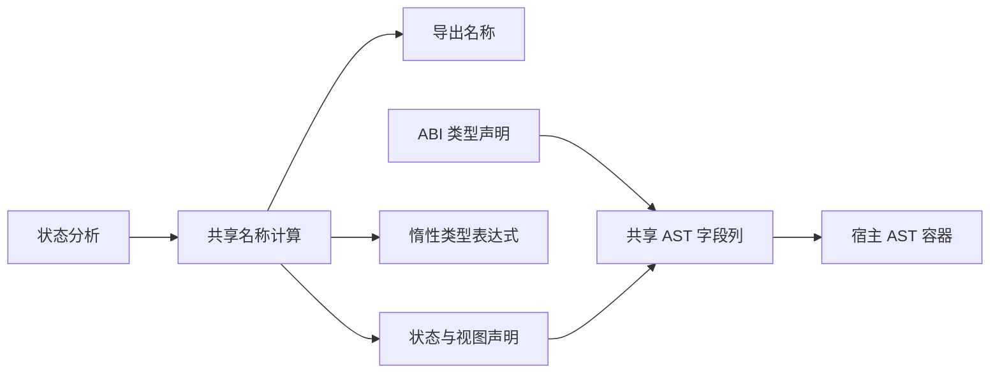

# 类型声明与摘要共享自举

## Intent

贯通 genz 正式路径的 ABI 声明、状态和视图类型声明、导出命名以及惰性类型构造。让 Source 使用相同的摘要表示和 AST 字段契约，移除类型声明中宿主预填充及逐项转换的工作。

## Data

`33497a25` 的 ABI 导出名和状态类型声明入口各自为每个固定宽度的类型摘要生成切片描述符。惰性类型构造已有连续摘要输入，却逐字节生成新数组。两种类型声明从 Source 返回字段对象，宿主逐行将其转为现有 AST 字段列。状态和视图表先复制 ABI 表，随后逐项覆盖。

## Edges

保留类型名哈希输入、字段顺序和节点 ID。摘要借用状态分析持有的字节。保留初始 seed 行为。惰性查询继续在 AST 导入成功后发布结果，宿主保留 AST 容器和跨调用的缓存寿命管理。

## Answer

沿最近已验证的 Source 引导器构建候选。收口运行覆盖 ABI 类型、状态借用和列表的现有回归，比对相同清单的生成文件与缓存，并与上一阶段及固定基线比较冷生成、磁盘缓存和无改动重跑。

## 实现

- Source 中的 ABI 导出名、状态类型计划和惰性名称构造使用同一个定长摘要视图。宿主传入现有摘要字节，摘要读取省掉整表描述符分配和逐字节复制。仅持有一个摘要的所有权辅助函数仍直接传入该摘要。
- ABI 和状态声明共用 AST 字段列模型和导入入口。构造顺序保持原样，字段名继续借用类型表或持久 AST allocator 所拥有的存储。ABI ID 表按列写回，状态和视图 ID 表直接接管在 AST allocator 中生成的列。
- ABI 构造和惰性计划共用类型跨度规则。为每类类型产生的表达式数决定其值的位置，具名和借用类型的布局引用保持原来的位置。Zig 宿主仍负责 AST 容器导入与惰性查询的写回。

本阶段 ZX/RX 新增 141 行、删除 124 行、净增 17 行。Zig 新增 15 行、删除 31 行、净减 16 行。

## 功能验收

- 6 个定向生成入口及其 103 个模块通过。上一阶段 Source 工具构建候选的 771 个正式入口。
- `test-nominal-origins`、`test-array-pop`、`test-iterate-calls` 和 `test-value-return` 共 269 项回归全部通过，覆盖名义类型来源、列表元素与借用、源库及归档库返回值和 CLI 库迁移再发布。
- 相同的 734 入口清单生成的 11,748 个文件和 5,343 条生成缓存记录逐一一致。两个工具生成的 v17 所有权缓存摘要均为 `9ab4c69bcc3b6c4f2c647bda8f3613744572a9b39f5f5c3da9b84a3f35218ca2`。无改动重跑保留输入快照和产物时间戳。

## 性能

相邻工具与固定基线工具均由 Source 生成并执行 Source 分析和生成。使用 Zig 0.17.0、ReleaseSmall、16 分区并关闭常驻。相邻工具使用相同的 734 入口清单，每组交替测三轮。以下为中位数。

| 指标                   | 上一阶段 | 当前阶段 |
| ---------------------- | -------: | -------: |
| 冷生成墙钟             |  2.79 秒 |  2.81 秒 |
| 冷生成 CPU             | 12.47 秒 | 12.49 秒 |
| 冷生成单进程峰值 RSS   | 812.5 MB | 814.3 MB |
| 冷生成进程树采样峰值   | 771.4 MB | 771.6 MB |
| 磁盘缓存墙钟           |  2.18 秒 |  2.18 秒 |
| 磁盘缓存 CPU           |  8.51 秒 |  8.51 秒 |
| 磁盘缓存单进程峰值 RSS | 782.0 MB | 780.4 MB |
| 无改动重跑墙钟         |  0.03 秒 |  0.03 秒 |

固定 Source 引导器与候选使用 735 入口清单和 `0e7ff384` 冻结源码。冷生成墙钟 2.77 → 2.76 秒，CPU 12.34 → 12.33 秒，单进程峰值 RSS 921.8 → 851.0 MB，进程树采样峰值 887.6 → 761.5 MB。磁盘缓存墙钟 2.18 → 2.15 秒，CPU 8.41 → 8.39 秒。21 份既有 Zig 差异的文件名和两侧摘要均保持，清单记录受冻结路径位置影响。计时覆盖引导生成和缓存复用。
