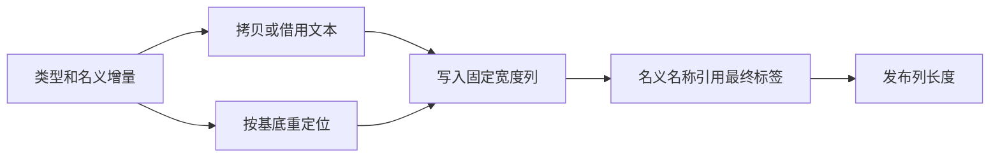

# 类型表与名义绑定发布自举

## Intent

收口统一库加载、源码类型合并、表达式分析和语义缓存共用的类型表发布。复用同一套 Source 写入流程，把类型表复制和增量发布直接写入各自的最终列。

## Data

`analysis/type_table.zig` 的整表准备先由 Source 返回独立列和一个临时表描述，再由宿主接管数组。`merging/commit.zig` 已经借用增量目标的最终列尾部，由 RX 组织文本、重定位和名义名称发布。源码联结的类型压缩还由 Zig 扫描保留前缀的负载边界。

## Edges

整表准备的列容器需要独立，借用模式只共享已有文本。增量保留文本所有权和目标表前缀，只有背景列长度非零时才需要重定位。分配失败时回收已取得所有权的文本，目标列长度在所有写入成功后发布。

## Answer

以既有类型合并与压缩、名义绑定、独立联结和库加载回归验收。用相同输入比较 Source 生成产物、缓存及 CPU、墙钟和峰值 RSS。

## 实现与边界

- `type_table.storage` 和 `type_table.columns` 现在按最终列长保留容量，接入既有的 RX 类型发布。拥有文本的路径直接把字符串写入最终列，借用文本的路径批量写入引用。移除了返回临时堆表描述符的生成入口。
- 增量发布仍允许文本和列容器使用不同的 allocator。目标没有负载偏移时直接批量复制 `first` 列。需要偏移时调用 ZX 的重定位规则，然后绑定最终标签。成功后发布列长度，部分失败时释放已复制的文本。
- `Types.compact` 的 Source 路径由 ZX 算出保留行相应的元组、对象和名称负载边界。返回三个长度，宿主按长度截取并复用原列。种子引导仍用原有前缀实现。
- Zig 继续提供容量预留、可写切片和列长度提交。下一段需要迁移函数体发布的联结状态。

## 验收

- 定向生成覆盖类型发布、文本列、压缩边界和缓存类型恢复。候选 Source 引导器的 22 个构建步骤通过。
- 类型合并、名义来源、独立重联结、原生库发布、语义缓存及跨进程持久化缓存通过。补齐首列为空的输入边界后，用重新生成的引导器复验类型合并与持久化缓存，123 项 Zig 测试和 5 项 CLI 检查通过。
- 相邻 Source 工具在同一 736 入口清单上生成的 11,790 个文件逐字节一致，5,363 条 Source 生成缓存记录的键和负载一致。所有权缓存摘要为 `f9a3ad8a2f6c60f97bc1ac5b3374caa249698791c6de473f3c0d8ef5335b562f`。

## 性能

测量工具均由各自的上一阶段 Source 工具生成，运行 Source 分析和生成。Zig 0.17.0、ReleaseSmall、16 分区，关闭常驻。相邻阶段使用同一清单交替测三轮，取中位数。

| 指标                     | 上一阶段 | 当前阶段 |
| ------------------------ | -------: | -------: |
| 冷生成墙钟               |  2.81 秒 |  2.81 秒 |
| 冷生成 CPU               | 12.48 秒 | 12.52 秒 |
| 冷生成进程树采样峰值 RSS | 764.3 MB | 787.9 MB |
| 冷生成单进程峰值 RSS     | 812.5 MB | 860.1 MB |
| 磁盘缓存墙钟             |  2.19 秒 |  2.19 秒 |
| 磁盘缓存 CPU             |  8.54 秒 |  8.51 秒 |
| 磁盘缓存单进程峰值 RSS   | 776.9 MB | 780.6 MB |

同一清单独立交替复测五轮冷生成。单进程峰值 RSS 中位数为 850.4 → 850.2 MB，分布为 825.7–872.6 MB 和 832.6–866.1 MB。首轮中位数上升未稳定复现。

固定基线和候选使用 `0e7ff384` 的冻结源码与相同 735 入口清单。冷生成墙钟 2.87 → 2.79 秒，CPU 12.55 → 12.45 秒，单进程峰值 RSS 926.5 → 805.3 MB，进程树采样峰值 RSS 886.2 → 756.9 MB。21 份既有 Zig 差异的双侧摘要与上一阶段相符，文件清单随冻结路径变化。

相邻 CLI 对同一份既有原生库关闭语义缓存发布，交替测六轮。20 个发布文件逐字节一致。两版墙钟和 CPU 中位数均为 0.01 秒，单进程峰值 RSS 中位数均约 12.6 MB。该计时覆盖库发布，不含后续应用编译。
