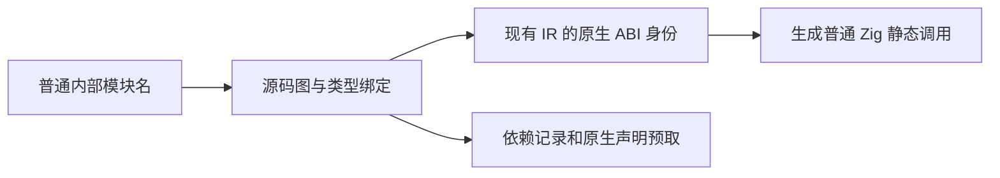

# 自举内部内存模块

## Intent

让自举源码以普通内部模块名 `memory` 使用原生表格的借用适配。将接口声明与实现收在 core 的同一目录。应用继续使用普通 ZX 值，借用范围由编译器确定。

## Data

`3c406c1c` 的自举清单把内存声明注册为 `zig:compiler_memory`。ZX 源码的导入名、原生能力查询名、IR 的外部模块身份和 Zig 的构建依赖名在这一入口叠在一起。调用点使用该声明借用宿主仍持有的列、缓冲和视图。

## Edges

引导阶段仍需将原生句柄交给静态 Zig 实现。应用项目的标准库、原生接口注册及同名普通包解析保持各自的现有规则。需要保持声明绑定、名义类型与 ABI 校验、增量原生接口预取和字节视图的借用行为。

## Answer

## 实现与边界

- 312 个 ZX 文件使用 `memory`。声明 `index.d.zx` 与实现 `root.zig` 同处 core 的 `memory` 目录。构建清单中的 `memory` 项省略外部 specifier，Zig 构建也以 `memory` 静态链接。
- 引导器将内部绑定和具备显式 specifier 的接口分开传入项目分析。源码图、类型分析和缓存预取共用内部名称查询。IR 中继续使用既有 Zig 原生 ABI 身份格式，名义类型与后端调用沿用原来的校验和生成。
- 普通 CLI 项目及其序列化配置没有这个内部模块列表。后续对应的数据表由 ZX 直接持有时，逐个消除对宿主借用适配的依赖。

## 产物和性能

初始 seed 构建新版引导器成功，新引导器再生成并构建第二代。两代构建均覆盖正式的 762 个入口。第二代引导器生成的 16 分区安装版构建通过。

安装版拒绝普通项目直接导入 `memory`、`std:memory`、`zig:memory` 或旧的 `zig:compiler_memory`。8 项生命周期回归通过，直接操作和经过只读视图的路径均分配一次、共 80 字节。7 项语义缓存回归及原生模块增量执行检查通过。

相邻两版工具均由 Source 生成，并运行 Source 分析与生成。使用 Zig 0.17.0、ReleaseSmall、16 分区，关闭常驻，以相同的 734 个入口交替测量三轮。上一版源码使用旧的带前缀导入，测量时统一两边的静态模块名 `memory`。两边源码目录分别固定。产物对照时进一步统一声明的物理路径，排除文件名哈希随路径变化产生的差异。11,763 份生成文件和 v17 缓存载荷均逐字节一致。无改动重跑保持输入快照和产物时间戳。

| 指标                 | 上一阶段中位数 | 当前阶段中位数 |
| -------------------- | -------------: | -------------: |
| 冷生成墙钟           |        2.87 秒 |        2.87 秒 |
| 冷生成 CPU           |       12.47 秒 |       12.43 秒 |
| 冷生成单进程峰值 RSS |       800.5 MB |       821.1 MB |
| 冷生成进程树采样峰值 |       771.4 MB |       762.1 MB |
| 磁盘缓存墙钟         |        2.21 秒 |        2.18 秒 |
| 磁盘缓存 CPU         |        8.59 秒 |        8.51 秒 |
| 无改动重跑墙钟       |        0.03 秒 |        0.03 秒 |

保留固定 721 入口 Source 引导器与 `0e7ff384` 冻结源码。使用同一份历史 735 入口清单，按既有基线对冻结源码统一采用旧私有导入。冷生成墙钟 2.85 → 2.78 秒，CPU 12.46 → 12.42 秒，单进程峰值 RSS 921.2 → 794.4 MB，进程树采样峰值 885.5 → 756.8 MB。磁盘缓存墙钟 2.23 → 2.19 秒，CPU 8.58 → 8.52 秒。11,758 份产物中 11,736 份一致，其余仍是之前记录的 22 份。计时范围为引导生成与缓存复用。
