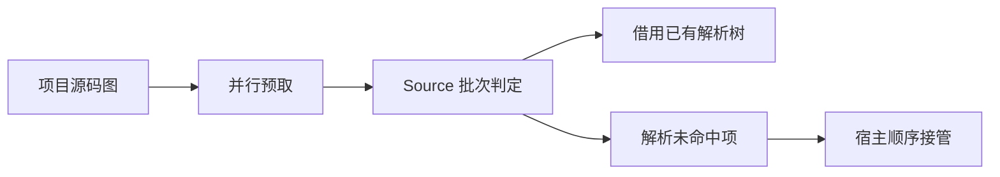

# 解析缓存批量预取自举

## Intent

沿项目源码扫描、解析缓存、缓存索引、解析器及语义缓存的调用闭包推进自举。把预取批次的路径查询及内容复用判定迁入 Source，保持命中时借用已有解析树。

## Data

`970d6914` 中 `prefetchRegistered` 由项目源码图调用。`prefetchInto` 为每个请求从 Zig 调用路径索引和内容判定，再解析未命中项。普通单次查询使用 Source 内容判定。解析缓存条目在索引扩容时仍保持地址，项目图借用该地址直到下一次缓存写入。

## Edges

保留冷解析、内容相等、摘要相等、失败解析和原生格式升级的语义。预取期间只借用索引与解析结果元数据。未命中项继续由工作线程解析，全部工作线程返回后由宿主按输入顺序接管，保留重复路径及分配失败边界。

## Answer

收口时使用最近的 Source 引导器构建候选，验证解析缓存、增量项目与语义缓存。在相同清单核对冷生成与缓存复用的产物、耗时和峰值内存。

## 实现与边界

- Source 按批查找路径索引并判定内容是否改变。普通查询与批量预取复用相同的文本和摘要判定，命中时借用已有解析结果。单次查询保留原生格式升级分支。
- 缓存条目保存对已有解析文本的可选借用，解析失败时只比较摘要。内部 memory 模块在稳定条目地址上提供受限列视图。预取借用路径、源码、缓存文本和摘要，每个工作线程用固定的栈缓冲接收未命中摘要。此路径没有新增解析源码副本。
- 宿主仍负责分配批次、解析未命中项及按请求顺序接管结果。保留初始 seed 逐项查询。顺序接管继续按当前索引重新查找，以支持预取期间观察同一快照并在接管时保留重复路径语义。

本阶段 ZX/RX 新增 135 行、删除 39 行，净增 96 行。Zig 新增 151 行、删除 18 行，净增 133 行，包括只读列视图、工作线程的批次输入输出以及 seed 回退。

## 验收

- 2 个定向入口覆盖 8 个 Source 模块。上一阶段 Source 工具生成了候选的 772 个正式入口，候选引导器成功链接。
- 解析缓存、模块记录和语义缓存的 31 项回归全部通过，覆盖失效、分配失败、诊断保留、依赖变化和增量复用。
- 同一份 735 入口清单生成的 11,761 个文件和 5,349 条生成缓存记录逐一一致。v17 所有权缓存摘要均为 `202d4b31d6b1a525fa985f4a5e4db88340e03a5c8040cbe2a3c0688c905f116b`。无改动重跑保留输入快照和生成时间戳。
- 两版各自在同一常驻进程中先生成一次，再用三份内容等价、字节不同的清单触发项目图重建。三次热请求都重新分析 5,115 个模块并复用 5,348 份生成单元，最终 11,761 份文件一致。

## 性能

两个相邻工具均由 Source 生成并执行 Source 分析和生成。Zig 0.17.0、ReleaseSmall、16 分区。下表为每组交替三轮的中位数，单进程峰值由系统计时记录，进程树峰值为采样值。表中的冷生成与磁盘缓存关闭常驻。

| 指标                   | 上一阶段 | 当前阶段 |
| ---------------------- | -------: | -------: |
| 冷生成墙钟             |  2.81 秒 |  2.81 秒 |
| 冷生成 CPU             | 12.52 秒 | 12.50 秒 |
| 冷生成单进程峰值 RSS   | 811.7 MB | 807.5 MB |
| 冷生成进程树采样峰值   | 761.8 MB | 755.6 MB |
| 磁盘缓存墙钟           |  2.20 秒 |  2.20 秒 |
| 磁盘缓存 CPU           |  8.55 秒 |  8.51 秒 |
| 磁盘缓存单进程峰值 RSS | 776.1 MB | 775.9 MB |
| 无改动重跑墙钟         |  0.03 秒 |  0.03 秒 |

常驻的三次热请求中，墙钟中位数 1.424 → 1.418 秒，服务进程 CPU 4.69 → 4.67 秒，分析 1,036 → 1,029 毫秒。

固定 Source 工具与候选使用 735 入口清单和 `0e7ff384` 冻结源码。冷生成墙钟 2.86 → 2.84 秒，CPU 12.53 → 12.49 秒，单进程峰值 RSS 921.3 → 798.0 MB，进程树采样峰值 885.3 → 757.2 MB。磁盘缓存墙钟 2.24 → 2.19 秒，CPU 8.57 → 8.53 秒。21 份既有 Zig 差异的两侧摘要均保持，文件清单随冻结路径变化。计时覆盖引导生成和缓存复用。
