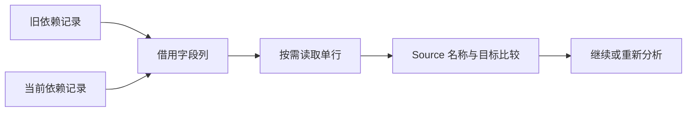

# 语义缓存依赖预检自举

## Intent

贯通项目导入记录、模块产物生成、缓存编码、预检及联结。使 Source 从实际依赖记录读取标识、绑定名称和目标信息，退出宿主的批次投影和调度。

## Data

`ee10b443` 仍在预检时逐批重建旧、新两组依赖记录，展开目标联合体并补全可选身份和原名。已有 Source 比较规则随后消费这些临时记录。

## Edges

保留源模块、库制品、原生接口、旧式接口和内建目标的区别。磁盘目标保留既有带标签格式。缓存预检维持数量、结构、逐项依赖、控制树的检查顺序。路径和名称借用当前记录，Source 未通过预检时继续走正常分析。

## Answer

核对源模块和已归档依赖的同输入行为，运行语义缓存、编码、联结和原生持久化回归。对照相同输入的生成文件、缓存记录、冷生成和磁盘命中性能。

## 实现与边界

- 内存中的依赖目标使用统一的类别、路径、实例和成员字段。在缓存编解码边界转换为原有的带标签目标。项目导入、模块提取和联结采用同一个内存表示。
- RX 一次完成预检的数量、模块与签名结构、依赖、控制树检查。Source 直接借用旧、新依赖列，在比较时补全身份与原名，并只读取目标类别实际使用的字段。Zig 的批次投影和逐批调度退出该路径。
- 模块产物提取复用依赖头的借用视图。原生根选择和本地原生依赖计划直接消费目标类别与注册身份，去掉宿主分配的类别数组和身份数组。联结图的边收集和缓存事务的最终写回仍由宿主执行。

本阶段 ZX/RX 新增 197 行、删除 129 行，净增 68 行。生产 Zig 新增 194 行、删除 145 行，净增 49 行，包含内存记录、兼容编解码和借用视图。已有测试的字段访问随内存表示调整。

## 验收

- 4 个定向入口覆盖 119 个模块。上一阶段 Source 工具生成候选的 773 个正式入口，候选引导器成功链接。
- 9 组回归完成。语义缓存、模块记录、名义类型、导入路径、持久化缓存及原生运行通过。另修正了库签名路径中仍读取旧目标表示的位置，复验的缓存编码、模块产物和联结边界共 114 项全部通过。CLI 共通过 20 项集成检查。
- 同一份 736 入口清单生成的 11,784 个文件和 5,358 条生成缓存记录逐一一致。v17 所有权缓存摘要均为 `be997f62ffad191be6f6e2c1ab76ffbd6c0f5e326be9743659801d68c61dbef3`。无改动重跑保持输入快照和生成时间戳。

## 性能

两版工具由 Source 生成，并采用 Source 分析和生成。Zig 0.17.0、ReleaseSmall、16 分区并关闭常驻。相邻工具使用同一清单交替跑三轮，下表为中位数。

| 指标                   | 上一阶段 | 当前阶段 |
| ---------------------- | -------: | -------: |
| 冷生成墙钟             |  2.80 秒 |  2.79 秒 |
| 冷生成 CPU             | 12.57 秒 | 12.50 秒 |
| 冷生成单进程峰值 RSS   | 857.5 MB | 851.8 MB |
| 冷生成进程树采样峰值   | 774.5 MB | 764.1 MB |
| 磁盘缓存墙钟           |  2.19 秒 |  2.18 秒 |
| 磁盘缓存 CPU           |  8.61 秒 |  8.59 秒 |
| 磁盘缓存单进程峰值 RSS | 776.5 MB | 775.9 MB |
| 无改动重跑墙钟         |  0.03 秒 |  0.03 秒 |

固定 Source 工具与候选使用同一份 735 入口清单及 `0e7ff384` 冻结源码。冷生成墙钟 2.86 → 2.80 秒，CPU 12.52 → 12.50 秒，单进程峰值 RSS 970.4 → 806.6 MB，进程树采样峰值 894.5 → 760.6 MB。磁盘缓存墙钟 2.23 → 2.19 秒，CPU 8.58 → 8.54 秒。21 份既有 Zig 差异的双侧摘要一致，文件清单随冻结路径变化。该组计时覆盖引导生成与缓存复用。

CLI 对照使用由 Source 生成的相邻两阶段工具。同路径运行既有 `std:querystring` 原生依赖用例和 `call_cached.zx` 源码依赖用例。两版分别填充磁盘缓存后交替运行七轮，生成文件和两组 v7 JSON 负载逐字节一致。原生用例每轮读取并复用一个原生条目和一个源码条目，热请求墙钟中位数 4.285 → 4.246 毫秒，CPU 4.489 → 4.464 毫秒。源码用例每轮复用两个源码条目，墙钟 8.273 → 8.167 毫秒，CPU 8.191 → 8.142 毫秒。
