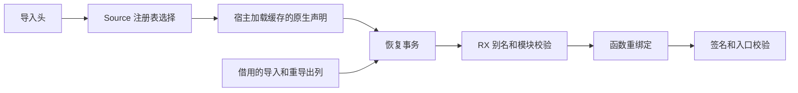
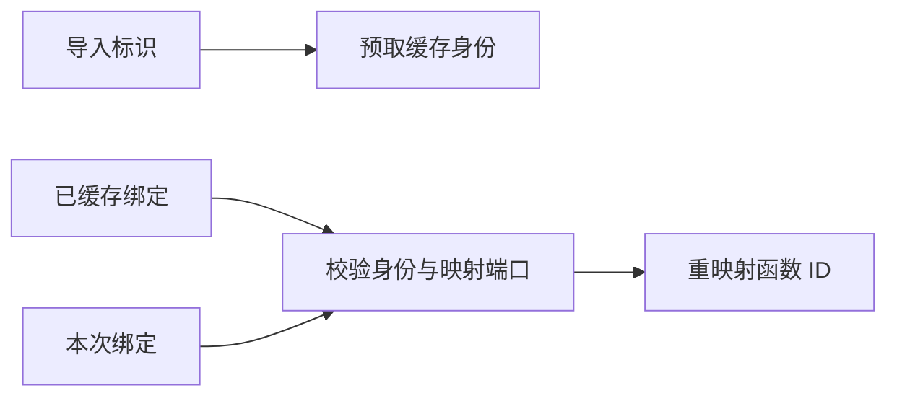

# 语义缓存导入恢复自举

## Intent

沿 CLI 缓存预取、项目导入绑定、语义恢复事务与库链接的调用闭包推进自举。把原生缓存依赖选择和语义缓存的导入重绑定从宿主批次循环迁入 Source。

## Data

`b34408b6` 中，CLI 缓存预取使用 Source 筛选可查询的原生导入，再由 Zig 逐项查注册表。语义缓存恢复用 `imports.Batch` 重建绑定记录和指针数组，宿主依次调度批次，Source 逐行校验及写入函数映射。

## Edges

保持标准注册表优先于项目注册表，保留每批原生与内部模块的访问顺序。保持取证前置、两类函数绑定的顺序以及签名和入口验证。绑定借用已有对象字段，缓存格式与失效语义保持一致。宿主负责磁盘访问、表分配与事务回滚。

## Answer

使用同一 Source 清单对照冷生成和磁盘缓存，并验收语义缓存、依赖诊断和已安装 CLI 的持久化缓存。

## 实现与边界

- 缓存预取借用标准、项目和内部模块的注册表列。Source 按既有批次访问顺序选择缓存身份，在固定容量的缓冲区写出引用，Zig 按顺序执行磁盘读取。没有候选时跳过查询。
- 普通导入和重导出共享绑定列视图。恢复入口一次进入 RX，依次验证别名、原生模块、绑定、签名和入口。读取单行时只借用字符串及函数和类型 ID，宿主的绑定记录投影和分页调度退出该路径。
- 保持语义缓存记录格式。函数映射仍写入事务的临时表，任一验证失败沿原有事务回退。依赖边预检的批次投影、磁盘字节读取和最终程序发布仍有 Zig 实现。

本阶段 ZX/RX 新增 196 行、删除 30 行，净增 166 行。Zig 新增 164 行、删除 72 行，净增 92 行。新增 Zig 包含借用视图、固定缓冲接线和初始 seed 的独立路径。

## 验收

- 4 个定向入口覆盖 67 个模块。上一阶段 Source 工具生成候选的 773 个正式入口，候选引导器成功链接。
- 语义缓存的 7 项 Zig 回归、5 项跨进程缓存检查及 1 项原生 ABI 执行检查全部通过。其中包括正文变化、记录损坏与错配、禁用缓存、原生类型声明重排，以及缓存程序实际执行。
- 同一份 736 入口清单生成的 11,775 个文件和 5,355 条生成缓存记录逐一一致。v17 所有权缓存摘要均为 `1294460dc4c00b22e7a9df3ce992b9dffdaa99d4544ae911d1afc18e378ee666`。无改动重跑保持输入快照和产物时间戳。

## 性能

工具由 Source 生成，并采用 Source 分析和生成。Zig 0.17.0、ReleaseSmall、16 分区并关闭常驻。相邻工具在相同清单上交替三轮，下表为中位数。

| 指标                   | 上一阶段 | 当前阶段 |
| ---------------------- | -------: | -------: |
| 冷生成墙钟             |  2.84 秒 |  2.88 秒 |
| 冷生成 CPU             | 12.51 秒 | 12.51 秒 |
| 冷生成单进程峰值 RSS   | 799.5 MB | 801.1 MB |
| 冷生成进程树采样峰值   | 760.4 MB | 760.5 MB |
| 磁盘缓存墙钟           |  2.20 秒 |  2.20 秒 |
| 磁盘缓存 CPU           |  8.59 秒 |  8.54 秒 |
| 磁盘缓存单进程峰值 RSS | 776.7 MB | 776.6 MB |
| 无改动重跑墙钟         |  0.03 秒 |  0.03 秒 |

固定 Source 工具与候选使用同一份 735 入口清单及 `0e7ff384` 冻结源码。冷生成墙钟 2.87 → 2.80 秒，CPU 12.52 → 12.46 秒，单进程峰值 RSS 949.6 → 795.4 MB，进程树采样峰值 885.1 → 758.5 MB。磁盘缓存墙钟 2.24 → 2.20 秒，CPU 8.56 → 8.49 秒。21 份既有 Zig 差异的两侧摘要保持一致，文件清单随冻结路径变化。

用同一个既有 `std:querystring` 用例对照候选 CLI 与上一份已构建的 CLI，后者来自项目接口路由阶段。两版先分别填充磁盘缓存，再用同一路径交替运行七轮。每次都从磁盘读取并复用一个源码条目及一个原生条目，生成的程序和 ABI 文件逐字节一致。热请求墙钟中位数 3.896 → 3.865 毫秒，CPU 4.030 → 4.028 毫秒。
