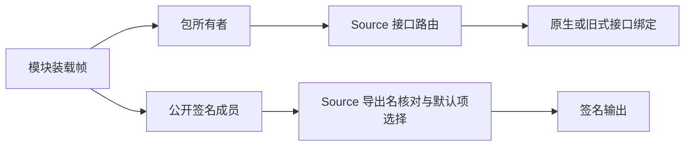
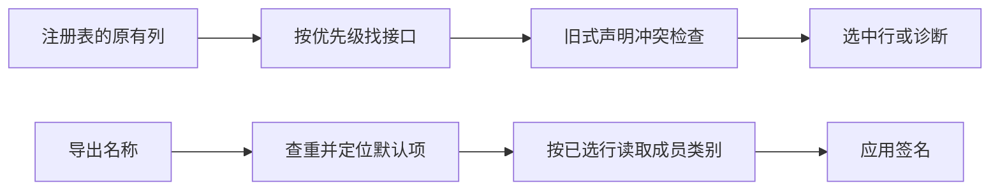

# 项目依赖路由与签名发布自举

## Intent

沿 ZX 项目加载、包与接口注册表、导入绑定及公开签名的调用闭包推进自举。把接口选择与签名默认导出选择交给正式 RX/ZX 入口，复用当前模块的包所有者。

## Data

`23aafceb` 中 `Project.loadFrames` 驱动解析与依赖栈。规划核对的调用闭包包括项目装载、解析缓存、目标注册表、原生和旧式接口、导入绑定及导出发布。`Project.loadInput` 调用 `Interface.route`，由宿主先查原生接口，再查旧式签名是否冲突，最后调用一个只接收布尔结论的 RX 入口。内部模块单独用 Zig 扫描。签名发布的 `signatureFacts` 预扫默认名称，随后 Source 重扫导出名以去重并找到同一个成员。

## Edges

保持标准与项目注册表的优先级、冲突诊断顺序、包路径隔离、依赖访问顺序、导出名称及类型事实。注册表与成员属于既有宿主存储，Source 通过列视图借用。依赖栈、路径 I/O、解析和最终写回仍经宿主执行。保留初始 seed 路径。

## Answer

使用现有引导器出候选。收口时核对模块记录、原生接口、公开导出和库联结回归，并用相同 Source 输入比较生成代码、缓存和 CPU、墙钟、峰值内存。

## 实现与边界

- RX 调用已有的标准与项目接口查询，继续检查旧式签名冲突、导入形状和缺失注册，再返回精确行号或诊断类别。内部模块复用 Source 注册表选择。宿主在装载帧中保留已解析的包所有者，供该模块的后续导入复用。
- Source 扫描匹配的旧式成员，复用通用名称索引和绑定规则生成有效成员前缀。宿主按原顺序解析并写入前缀，为后续的重名或默认项冲突保留原有错误顺序。该路径的成员筛选和哈希查重退出正式 Zig 路径，原始 seed 仍保留对应逻辑。
- 签名成员使用明确的类别。Source 在一次名称查重中确定默认项，只读取选中行的类别，宿主应用端口、Store 或延迟 RX 路径。签名成员合并、正文分析、依赖栈和缓存持久化继续由宿主驱动。

本阶段 ZX/RX 新增 199 行、删除 39 行，净增 160 行。Zig 新增 156 行、删除 99 行，净增 57 行，其中包括签名行表示、列借用和保留 seed 的适配。

## 验收

- 5 个定向生成入口覆盖 41 个模块。上一阶段 Source 工具成功生成并构建候选的 771 个正式入口。
- 7 组回归的 139 个构建步骤及 295 项 Zig 测试全部通过，覆盖原生声明、名义类型、模块记录、统一库链接、语义缓存、RX 推导和导入路径。另有 14 项导入路径集成检查通过。
- 同一份 734 入口清单生成的 11,750 个文件和 5,344 条缓存记录逐一一致。v17 所有权缓存摘要均为 `7222a48fb17fcb150a479bf8a652afaebd4d2bab97ee51dec86d0c9b57e56b9a`。无改动重跑保留输入快照和生成时间戳。

## 性能

使用由 Source 生成的引导器运行 Source 分析与生成。Zig 0.17.0、ReleaseSmall、16 分区并关闭常驻。各组交替跑三轮，表中为中位数。

| 指标                   | 上一阶段 | 当前阶段 |
| ---------------------- | -------: | -------: |
| 冷生成墙钟             |  2.78 秒 |  2.77 秒 |
| 冷生成 CPU             | 12.48 秒 | 12.40 秒 |
| 冷生成单进程峰值 RSS   | 800.6 MB | 846.3 MB |
| 冷生成进程树采样峰值   | 760.0 MB | 767.1 MB |
| 磁盘缓存墙钟           |  2.18 秒 |  2.17 秒 |
| 磁盘缓存 CPU           |  8.52 秒 |  8.52 秒 |
| 磁盘缓存单进程峰值 RSS | 775.6 MB | 775.8 MB |
| 无改动重跑墙钟         |  0.03 秒 |  0.03 秒 |

固定 Source 引导器与候选使用同一份 735 入口清单及 `0e7ff384` 冻结源码。冷生成墙钟 2.85 → 3.35 秒，CPU 12.47 → 12.39 秒，单进程峰值 RSS 969.0 → 837.5 MB，进程树采样峰值 884.9 → 759.2 MB。磁盘缓存墙钟 2.21 → 2.20 秒，CPU 8.60 → 8.53 秒。固定对照中的 21 份既有 Zig 差异沿用原文件名和双侧摘要。文件清单受冻结路径变化影响。相邻对照的单进程峰值增加 45.7 MB，热缓存峰值接近，固定输入下候选冷生成的两类峰值均下降。上述计时覆盖引导生成与缓存复用。
