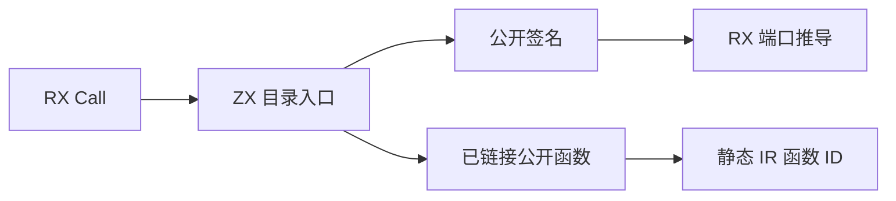
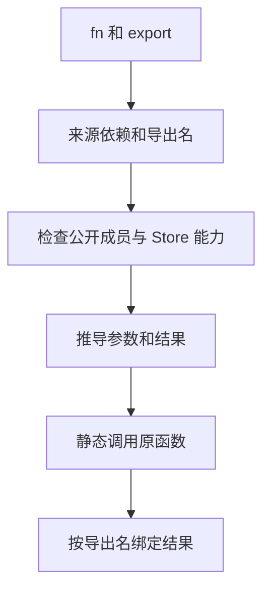

# RX 命名函数直接调用

## Intent · 去除逐函数转发

RX 可直接调用 ZX 入口的命名公开函数。分析、正文链接和生成使用已登记的函数标识，目录只负责聚合导出。先替换项目推导、约束求解和混合编译中一整组透明转发，再将 ZX 内部使用的类型表和控制表操作直接接到 core。

## Data · 调用路径

`fn` 沿用相对路径和目录入口规则，`export` 选择公开函数。准备阶段校验签名并使用该函数的输入输出类型参与约束求解；正文链接复用既有函数 ID 及其所有权和错误信息。命名结果使用导出名作为 `$ctx` 键。

## Edges · 支持边界

显式调用可选择 ZX 源文件的公开命名函数，包括同一接口通过 barrel 公布的原生函数。缺失函数、类型导出和无有效普通调用签名的导出返回源位置诊断。Store 事务仍走显式授权的调用路径。现有 `Module.fn` 与 `Call.module` 继续使用各自原有的入口契约。

## Answer · 集中验收

- 同一候选通过 RX 推导、并行推导、项目 CLI 和 ZX 导入回归，共 254 项 Zig 测试、23 项具名 CLI 测试。实际命名调用两步计算得 8，缺失导出和类型导出均在调用处失败。
- 初始 seed 生成通过 29 步。候选重新生成 767 个入口，和构建候选时的分区产物逐字节一致，共 12,981 个文件。30 个逐函数包装和 3 个 ZX 转交文件退出源码路径，另外移除了 3 个仅作为包装别名的输入文件。候选生成的函数文件由 4,977 降至 4,944。
- 固定 735 项语料，Zig 0.17.0、ReleaseSmall、16 分区。两侧均由 Source 构建并运行 Source 分析与生成。三轮交替的冷生成墙钟为 2.61 → 2.58 秒，CPU 为 12.33 → 12.29 秒，进程树峰值为 721.0 → 719.7 MB，单进程峰值为 741.5 → 774.3 MB。热生成为 2.01 → 1.99 秒。冷墙钟、CPU、进程树和单进程峰值均低于固定基线的 2.85 秒、12.58 秒、893.0 MB 和 939.7 MB。11,758 个固定语料生成文件及所有权 memo 逐字节一致。
