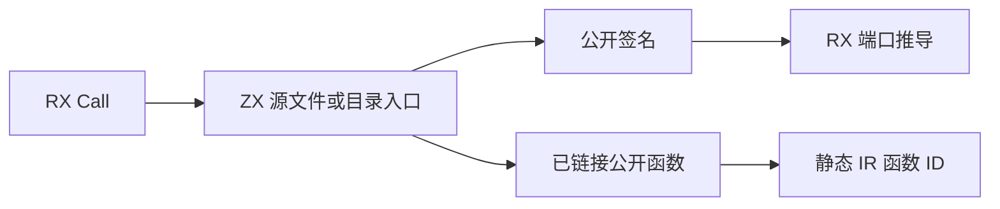
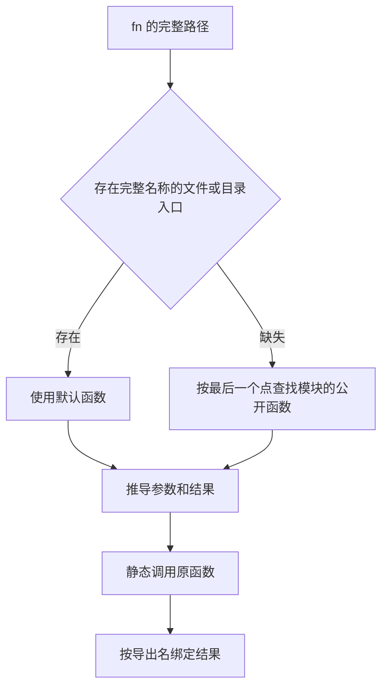

# RX 命名函数直接调用

## Intent · 去除逐函数转发

RX 可直接调用 ZX 入口的命名公开函数。分析、正文链接和生成使用已登记的函数标识，目录只负责聚合导出。先替换项目推导、约束求解和混合编译中一整组透明转发，再将 ZX 内部使用的类型表和控制表操作直接接到 core。

## Data · 调用路径

`fn="operations.normalize"` 先匹配完整文件名及其目录入口，未命中时在 `operations.zx` 或 `operations/index.zx` 选择公开函数。准备阶段校验签名并使用该函数的输入输出类型参与约束求解；正文链接复用既有函数 ID 及其所有权和错误信息。命名结果使用导出名作为 `$ctx` 键。

## Edges · 支持边界

显式调用可选择 ZX 源文件的公开命名函数，包括同一接口通过 barrel 公布的原生函数。缺失函数、类型导出和无有效普通调用签名的导出返回源位置诊断。Store 事务仍走显式授权的调用路径。`Module.fn` 的单函数简写同样支持点号。显式 `.zx` 选择文件；文件已命中而缺少默认函数时，诊断指向该调用。

## Answer · 集中验收

### 首次接入命名导出（`ed0ac7977`）

- 同一候选通过 RX 推导、并行推导、项目 CLI 和 ZX 导入回归，共 254 项 Zig 测试、23 项具名 CLI 测试。实际命名调用两步计算得 8，缺失导出和类型导出均在调用处失败。
- 初始 seed 生成通过 29 步。候选重新生成 767 个入口，和构建候选时的分区产物逐字节一致，共 12,981 个文件。30 个逐函数包装和 3 个 ZX 转交文件退出源码路径，另外移除了 3 个仅作为包装别名的输入文件。候选生成的函数文件由 4,977 降至 4,944。
- 固定 735 项语料，Zig 0.17.0、ReleaseSmall、16 分区。两侧均由 Source 构建并运行 Source 分析与生成。三轮交替的冷生成墙钟为 2.61 → 2.58 秒，CPU 为 12.33 → 12.29 秒，进程树峰值为 721.0 → 719.7 MB，单进程峰值为 741.5 → 774.3 MB。热生成为 2.01 → 1.99 秒。冷墙钟、CPU、进程树和单进程峰值均低于固定基线的 2.85 秒、12.58 秒、893.0 MB 和 939.7 MB。11,758 个固定语料生成文件及所有权 memo 逐字节一致。

### 统一为点号调用并移除准备阶段的转发

- 项目推导与混合编译的 30 处旧写法全部迁移。模块准备与调用准备再改造 10 处，删除 10 个原样转发函数和 1 个输入别名文件。正式引导清单有 768 个入口，生成函数文件由上一阶段的 4,944 个降至 4,935 个。
- CLI 检查从项目依赖图按目标文件收集调用。此前每检查一个 ZX 文件都遍历所有 RX 调用并查询磁盘，现有解析结果可用于签名检查和诊断。
- 同一 `operations.normalize` 表达式在输入 3 后再经过翻倍，命中模块目录、模块文件和完整文件名分别得到 8、12、20。完整文件缺少默认函数时报错，删除后恢复命名调用。另核对了同名目录入口、显式后缀、单函数简写、类型或缺失成员的诊断、旧属性拒绝及顺序调用的格式化。
- RX 语法和依赖图通过 39 项，推导与并行通过 243 项，CLI、磁盘项目及编译库通过 51 项。按新语法对齐旧断言后，带点文件的最后一段分别出现在普通、并行及 Store 调用的正确作用域。使用候选 Source 引导器再生成，12,966 个文件（含输出清单）与构建候选时逐字节一致。
- 固定 735 入口三轮交替，使用上一阶段和本阶段的 Source 引导器运行 Source 分析与生成。冷生成墙钟中位数均为 2.59 秒，CPU 12.27 → 12.31 秒，进程树峰值 720.6 → 720.5 MB，单进程峰值 806.5 → 744.9 MB。热生成墙钟 1.98 → 1.99 秒。冷生成四项均低于固定基线；11,758 个固定语料产物和所有权 memo 逐字节一致。
