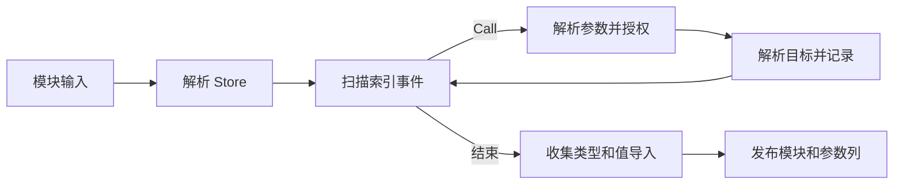
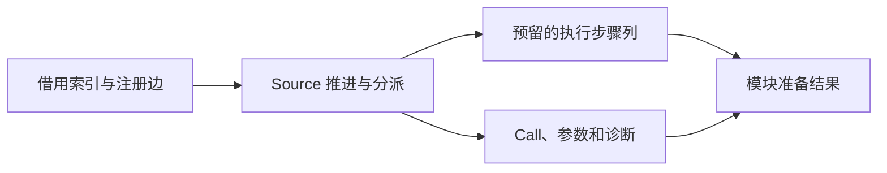

# RX 模块准备与 Call 绑定自举

## Intent

迁移正式 RX 项目的模块准备、索引事件扫描和 Call 绑定。保持首条诊断、参数发布、作用域及跨模块类型的既有契约。

## Data

`prepare.loadSignatures` 为每个模块解析 Store、准备执行计划、导入类型并发布结果。索引解析已经借用同一组事件和事实列，现有 Source 按优先级计算布局。Call 按参数解析、Store 授权、引用解析和登记的顺序执行。

## Edges

Source 负责迭代和阶段分派。宿主继续提供 AST、Store 作用域、已编译库解析、诊断和预留列的实际读写。输入列及已解析参数继续沿用原生命周期。初始 seed 与缺少索引的语法路径使用原有布局能力，保留相同的顺序。

## Answer

### 阶段一致性

- 用上一阶段的 Source 引导器构建新工具，分区构建通过 25 个步骤。新工具重生成 764 个入口，排除输入戳后，12,909 个生成产物逐字节一致。
- 初始 seed 生成正式解析器的 29 个步骤全部通过。
- 生成的模块循环、Call 绑定和索引步进使用栈上标量与借用列。宿主预留与发布载荷的分配仍沿用原来的分配器。

### 运行回归

ReleaseSmall 下，RX 运行、类型推导、并行推导和 Task 输出共 1,154 项 Zig 测试通过。Task 输出、磁盘项目和 Store 路径三组 CLI 通过 57 项具名测试。合计覆盖跨模块 Call、已编译库调用、显式 Store 授权、参数类型和原有诊断。

### 固定语料性能

固定 735 个入口，Zig 0.17.0、ReleaseSmall、16 分区，关闭常驻。前后工具均为 Source 引导产物，执行 Source 分析和生成。交替三轮取中位数，11,758 个文件和所有权 memo 逐字节一致。

| 场景                 | 相邻对照 |   本阶段 | 固定基线 |
| -------------------- | -------: | -------: | -------: |
| 冷生成墙钟           |   2.59 s |   2.59 s |   2.85 s |
| 冷生成 CPU           |  12.31 s |  12.29 s |  12.58 s |
| 冷生成采样进程树峰值 | 720.6 MB | 718.5 MB | 893.0 MB |
| 冷生成单进程峰值     | 814.4 MB | 804.9 MB | 939.7 MB |
| 热生成墙钟           |   2.00 s |   1.99 s |   2.25 s |
| 热生成 CPU           |   8.30 s |   8.26 s |   8.61 s |
| 未变输入墙钟         |   0.03 s |   0.03 s |   0.04 s |

这些数据覆盖引导生成。完整冷构建和单独的 Call 绑定耗时采用另外的核验口径。
