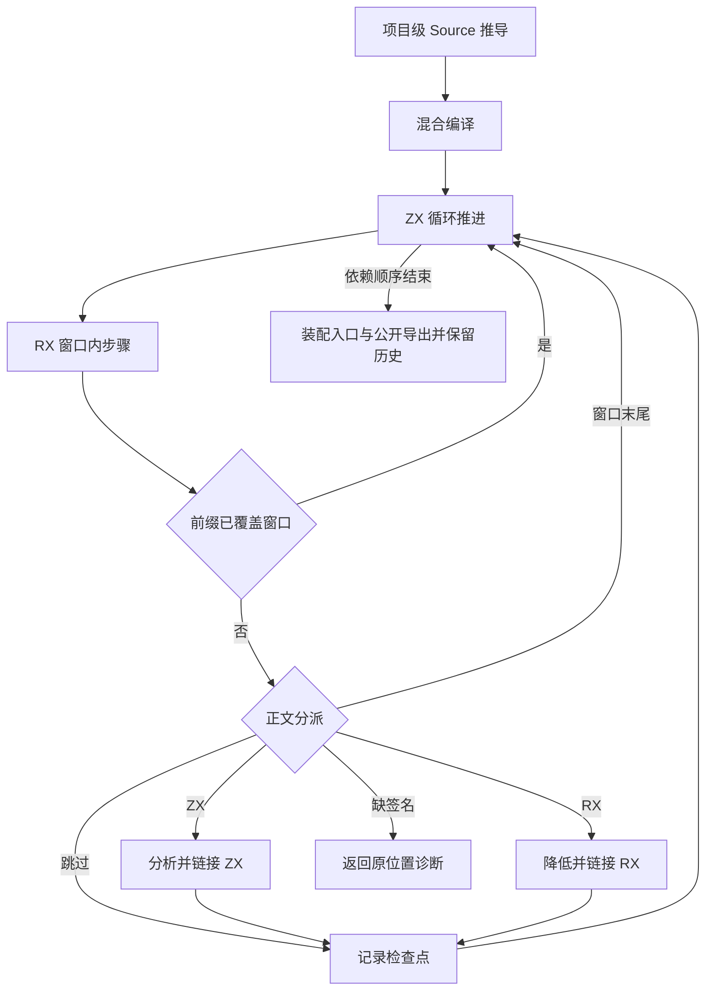
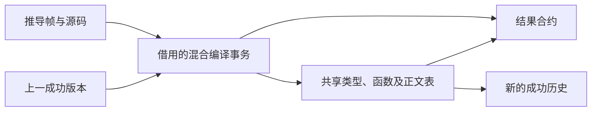

# RX 混合编译与发布自举

## Intent · 交付目标

从 `project.infer` 进入混合编译后，让 Source 驱动正文窗口、历史前缀复用、RX/ZX 正文选择、检查点及结果发布。这些步骤共享同一个依赖顺序和函数表，一批迁移并复核。

## Data · 迁移边界

原先由 `mixed.zig` 展开 Source 返回的步骤枚举，再由宿主决定循环、跳过条件、正文分支和发布顺序。`mixed/compile/run.rx` 现在直接编排正文和发布，`walk.zx` 推进依赖游标，`step.rx` 表达准备窗口、复用、判定下一正文、链接和记录的顺序。

## Edges · 借用、错误与剩余实现

Source 接收一个仅在本次编译内有效的借用句柄。旧历史、类型表和函数表维持原生命周期。并行预分析可用时优先使用其产物。重新分析或链接失败保留原诊断与内存错误，历史只在入口和公开导出均完成后更新。

宿主仍拥有预分析任务池、表的存储与可变借用、正文分析和降低细节，以及历史快照的物理还原。初始 seed 沿用共享操作。最终自举审计仍需覆盖这些传递依赖。

## Answer · 验收

- 以上一阶段 Source 引导器构建的候选通过 25 个步骤。重新生成 767 个入口，排除输入身份戳后，13,052 个文件逐字节一致。初始 seed 生成验证通过 29 个步骤。
- RX 推导、并行推导和磁盘项目回归通过 243 项 Zig 测试及 9 项具名 CLI 测试。
- 常驻工具通过 ZX 正文编辑、RX 编辑、失败依赖、恢复和无变更检查。四个成功生成状态各有 42 个 Zig 文件，与同输入的空缓存生成逐字节一致。
- 生成的混合编译协调代码未新增分配。计时覆盖固定清单的编译器生成路径，完整应用冷构建属于另一条测量路径。

固定 735 个入口，Zig 0.17.0、ReleaseSmall、16 分区。两侧均为 Source 构建的引导器，运行 Source 分析与生成，关闭常驻。三轮交替取中位数，同语料的 11,758 个生成文件和所有权 memo 一致。

| 指标             | 上一阶段 |   本阶段 | 固定基线 |
| ---------------- | -------: | -------: | -------: |
| 冷生成墙钟       |   2.63 s |   2.62 s |   2.85 s |
| 冷生成 CPU       |  12.30 s |  12.33 s |  12.58 s |
| 冷生成进程树峰值 | 721.6 MB | 718.1 MB | 893.0 MB |
| 冷生成单进程峰值 | 745.9 MB | 764.1 MB | 939.7 MB |
| 热缓存墙钟       |   2.02 s |   2.02 s |   2.25 s |
| 热缓存 CPU       |   8.25 s |   8.33 s |   8.61 s |
| 无变更墙钟       |   0.04 s |   0.04 s |   0.04 s |

冷生成单进程峰值较上阶段增加 18.2 MB，进程树峰值下降 3.5 MB。这组对照覆盖本次调度改动的生成路径。并行预分析与正文表更新仍受现有宿主生命周期管理，阶段产物一致性只验证当前路径的行为。

## 增量编译的签名与公开导出复用

### Intent · 本批目标

并行准备和顺序恢复使用同一条 Source 规则判断 RX 签名是否仍然有效。重新分析模块后，由 RX/ZX 完成链接结果的比较，决定依赖它的模块能否沿用历史结果。

### Data · 正式调用链

`mixed/schedule/preview.zx` 和 `mixed/history/prefix/scan.zx` 共用 `probe.zx`。一次编译在栈上借用历史记录和当前记录的列描述符。源摘要、依赖、检查点均合格后，共享同一签名表及行号的 RX 直接复用；来自不同存储的签名逐项校验输入输出类型、绑定名与类型、Task 类型。并行准备直接取得待分析的位置。

`mixed/history/link.rx` 依次比较端口、公开导出和 Store 初始化器，然后检查命名函数与常量的数量。数量相等且存储不同时，两个 ZX 循环按行比较。命名函数与缓存恢复共用绑定列读取，常量借用原来的字面量列，浮点保持按位比较。退出了两个 Zig 逐行循环和两个独立的生成入口。

### Edges · 借用与剩余职责

列描述符只在当前混合编译调用内有效，直接引用原表。签名和常量的比较没有逐行分配。Store 共享同一存储且行号对齐时可以复用；其他 Store 仍交由宿主做节点结构比较。原生任务池、表的物理还原和初始 seed 路径继续保留。本批验收覆盖编译器生成和常驻增量分析，未重新测量完整应用的 Zig/LLVM 冷构建。

### Answer · 核验结果

- 上一阶段 Source 引导器构建候选通过 25 步，初始 seed 路径通过 29 步。候选使用 Source 分析与生成再次处理 766 个入口，排除输入身份戳后，12,973 个文件与上一阶段引导器生成的本批源码产物逐字节一致。
- 250 项 Zig 测试及 14 项 CLI 测试通过，覆盖 RX 普通与并行推导、磁盘项目、语义缓存及持久缓存恢复。
- 常驻编译实际的 IR 校验入口，首轮分析 379 个模块。一次 ZX 正文编辑复用 376 个，随后编辑 RX 复用 377 个。依赖缺失按预期失败，恢复后复用 376 个。四个成功状态各有 709 个 Zig 文件与相同输入的冷生成逐字节一致，恢复产物与初始产物相同。
- 在同一入口对两个 Source 构建的工具做三轮交替测量。ZX 正文编辑中位数为 56.97 → 57.32 毫秒，RX 编辑为 54.10 → 54.20 毫秒。RX 编辑完成后常驻进程的 RSS 为 275.5 → 276.2 MB，这是请求结束时的采样。

固定的 735 入口清单使用 ReleaseSmall、16 分区和非驻留生成器。两侧都由 Source 构建并运行 Source 分析与生成。三轮交替取中位数，11,758 个生成产物及所有权 memo 一致。内存均为十进制 MB。

| 指标                     | 上一阶段同机对照 |     本批 | 固定基线 |
| ------------------------ | ---------------: | -------: | -------: |
| 冷生成墙钟               |           2.60 s |   2.63 s |   2.85 s |
| 冷生成 CPU               |          12.30 s |  12.32 s |  12.58 s |
| 冷生成进程树峰值（采样） |         719.5 MB | 718.7 MB | 893.0 MB |
| 冷生成单进程峰值         |         784.5 MB | 755.8 MB | 939.7 MB |
| 热缓存墙钟               |           2.01 s |   2.02 s |   2.25 s |
| 热缓存 CPU               |           8.31 s |   8.29 s |   8.61 s |
| 无变更墙钟               |           0.04 s |   0.04 s |   0.04 s |

本批冷生成墙钟增加 0.03 秒、CPU 增加 0.02 秒，进程树峰值下降 0.7 MB。相对固定基线，冷生成墙钟少 0.22 秒、CPU 少 0.26 秒。单进程峰值及进程树采样峰值分别下降 183.9 MB 与 174.3 MB。
