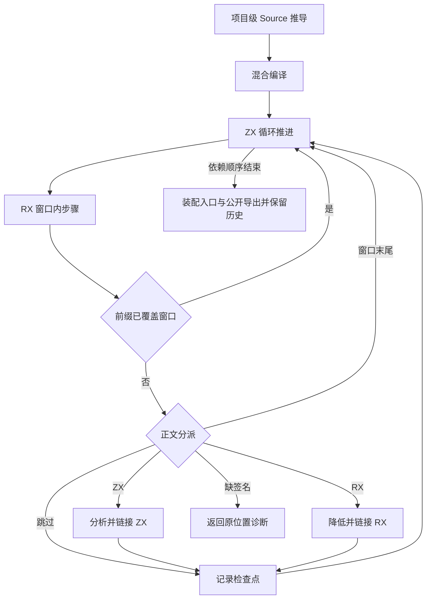
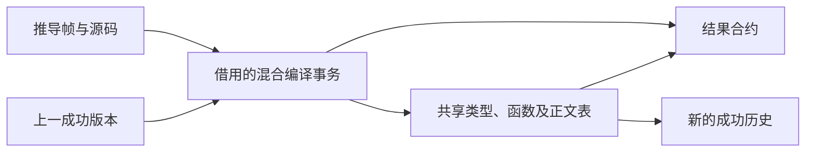

# RX 混合编译与发布自举

## Intent · 交付目标

从 `project.infer` 进入混合编译后，让 Source 驱动正文窗口、历史前缀复用、RX/ZX 正文选择、检查点及结果发布。这些步骤共享同一个依赖顺序和函数表，一批迁移并复核。

## Data · 迁移边界

原先由 `mixed.zig` 展开 Source 返回的步骤枚举，再由宿主决定循环、跳过条件、正文分支和发布顺序。`mixed/compile/run.rx` 现在直接编排正文和发布，`walk.zx` 推进依赖游标，`step.rx` 表达准备窗口、复用、判定下一正文、链接和记录的顺序。

## Edges · 借用、错误与剩余实现

Source 接收一个仅在本次编译内有效的借用句柄。旧历史、类型表和函数表维持原生命周期。并行预分析可用时优先使用其产物。重新分析或链接失败保留原诊断与内存错误，历史只在入口和公开导出均完成后更新。

宿主仍拥有预分析任务池、表的存储与可变借用、正文分析和降低细节，以及历史快照的物理还原。初始 seed 沿用共享操作。最终自举审计仍需覆盖这些传递依赖。

## Answer · 验收

- 以上一阶段 Source 引导器构建的候选通过 25 个步骤。重新生成 767 个入口，排除输入身份戳后，13,052 个文件逐字节一致。初始 seed 生成验证通过 29 个步骤。
- RX 推导、并行推导和磁盘项目回归通过 243 项 Zig 测试及 9 项具名 CLI 测试。
- 常驻工具通过 ZX 正文编辑、RX 编辑、失败依赖、恢复和无变更检查。四个成功生成状态各有 42 个 Zig 文件，与同输入的空缓存生成逐字节一致。
- 生成的混合编译协调代码未新增分配。计时覆盖固定清单的编译器生成路径，完整应用冷构建属于另一条测量路径。

固定 735 个入口，Zig 0.17.0、ReleaseSmall、16 分区。两侧均为 Source 构建的引导器，运行 Source 分析与生成，关闭常驻。三轮交替取中位数，同语料的 11,758 个生成文件和所有权 memo 一致。

| 指标             | 上一阶段 |   本阶段 | 固定基线 |
| ---------------- | -------: | -------: | -------: |
| 冷生成墙钟       |   2.63 s |   2.62 s |   2.85 s |
| 冷生成 CPU       |  12.30 s |  12.33 s |  12.58 s |
| 冷生成进程树峰值 | 721.6 MB | 718.1 MB | 893.0 MB |
| 冷生成单进程峰值 | 745.9 MB | 764.1 MB | 939.7 MB |
| 热缓存墙钟       |   2.02 s |   2.02 s |   2.25 s |
| 热缓存 CPU       |   8.25 s |   8.33 s |   8.61 s |
| 无变更墙钟       |   0.04 s |   0.04 s |   0.04 s |

冷生成单进程峰值较上阶段增加 18.2 MB，进程树峰值下降 3.5 MB。这组对照覆盖本次调度改动的生成路径。并行预分析与正文表更新仍受现有宿主生命周期管理，阶段产物一致性只验证当前路径的行为。
