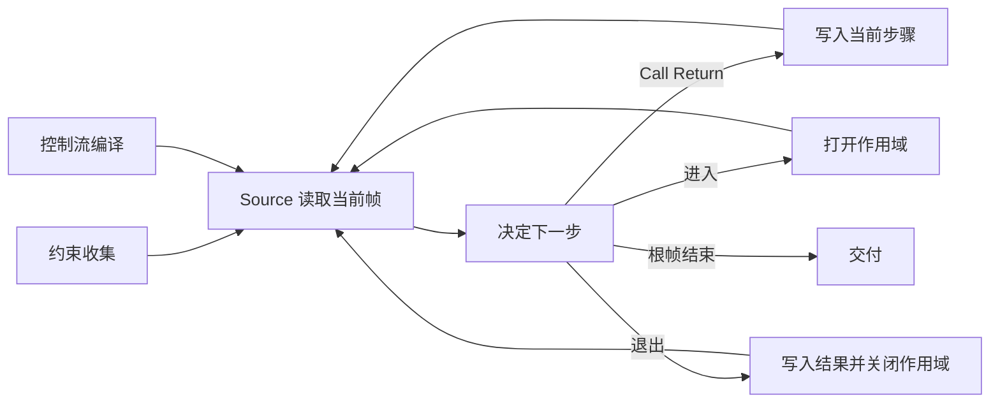
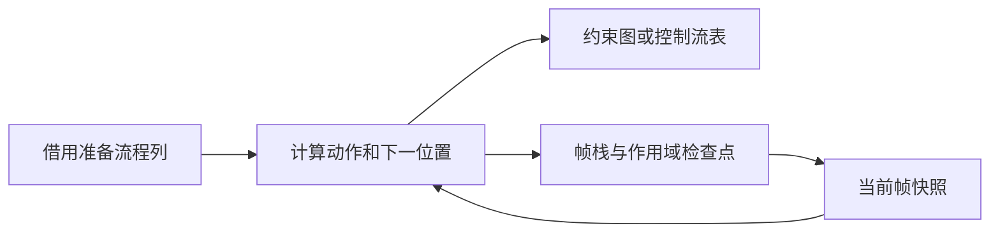

# RX 约束与控制流帧自举

## Intent

迁移 RX 模块的约束收集和控制流编译两条正式帧路径。两条调用链共用 Source 的帧推进、连续 Call 分组、进入和退出作用域分派。

## Data

约束收集从 `constraints.collect` 进入 `Walker.inferModule`，控制流编译从 `Compiler.root` 进入帧遍历。原先两条 Zig 循环从同一套规则取得事件，再各自调度 Call、Return、Task、Parallel、Selection 和 Case。两条路径共用准备阶段的步骤列，各自保留不同的物理帧载荷及结果容器。

## Edges

借用同一份准备流数据。保留每条路径的四个内联帧和溢出分配器，不复制约束图或流程列。帧位置和范围使用两个栈上槽显式传入 Source。宿主依旧执行表达式分析、约束发布、编译表写入和帧资源释放。一次动作只操作对应的栈顶帧，扩容后通过栈索引重新借用。保留此前 seed 的兼容路径。

## Answer

### 正确性验收

- Task 输出预检通过 36 项 Zig 测试和 32 项 CLI 夹具，覆盖顺序、并行、嵌套、选择分支和诊断。
- 最终帧与释放实现通过 RX 运行、类型推导、并行推导、浮点及磁盘项目入口，合计 1,118 项 Zig 测试和 9 项项目 CLI 测试。
- 上一阶段 Source 引导器构建本阶段工具，分区构建通过 25 个步骤。新工具重生成 763 个入口，排除输入戳后，12,824 个生成文件逐字节一致。
- 初始 seed 构建并生成正式解析器的 29 个步骤通过。两条兼容遍历复用同一 seed 循环及原有宿主操作。
- 从生成代码检查共享驱动，事件和快照是标量及切片描述符，驱动自身无堆分配。连续 Call 仍整段处理，帧释放直接在栈顶原存储上执行。

### 固定语料性能

固定 735 个入口，Zig 0.17.0、ReleaseSmall、16 分区，关闭常驻。两侧工具均由 Source 引导器构建并运行 Source 分析和生成。交替三轮取中位数。11,758 个生成产物和所有权 memo 逐字节一致。

| 场景                 | 相邻对照 |   本阶段 | 固定基线 |
| -------------------- | -------: | -------: | -------: |
| 冷生成墙钟           |   2.63 s |   2.65 s |   2.85 s |
| 冷生成 CPU           |  12.35 s |  12.34 s |  12.58 s |
| 冷生成采样进程树峰值 | 718.8 MB | 720.5 MB | 893.0 MB |
| 冷生成单进程峰值     | 782.6 MB | 762.1 MB | 939.7 MB |
| 热生成墙钟           |   2.07 s |   2.03 s |   2.25 s |
| 热生成 CPU           |   8.39 s |   8.34 s |   8.61 s |
| 未变输入墙钟         |   0.03 s |   0.03 s |   0.04 s |

冷生成较相邻对照增加 0.02 秒和约 1.8 MB 的进程树峰值，仍低于固定基线。这组数据衡量引导生成，独立的约束与编译帧耗时和完整冷构建沿用各自的核验口径。
