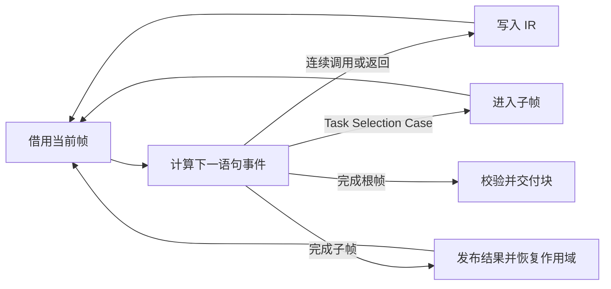
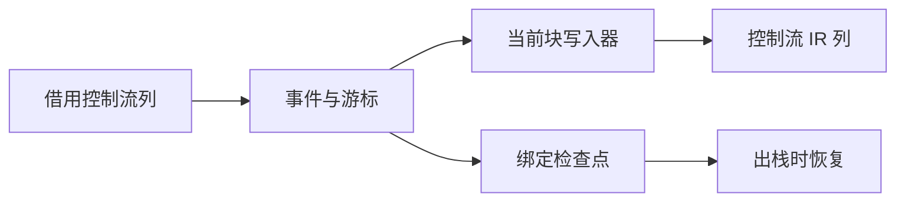

# RX 语句帧降低自举

## Intent

从正式 RX 语句降低入口移出帧遍历与动作分派。覆盖连续 Call、Parallel、Return、Task，以及 Selection 和 Case 的出入栈、发布与绑定恢复。

## Data

`Statements.lower` 借用已有的流列和写入布局。Source 读取当前帧并调用已有的步进规则，RX 将事件分派给线性写入、进入作用域或关闭作用域。关闭 Task 时，ZX 依次驱动输出求值、写入、恢复绑定和发布外层绑定。关闭 Case 时先完成并发布分支正文，再恢复该 Case 的绑定并出栈。

## Edges

沿用四个内联帧、写入器索引和溢出分配器。栈扩容后按现有索引重新借用写入器。每步通过五个栈上标量槽读取帧快照和驱动状态。控制流列始终借用原存储，生成的快照和事件按值传递。完整降低沿用已有结果分配器、IR 写入规则和失败清理。

静态内部 ABI 暂承载借用物理帧、内联表达式、实际 IR 容器操作和栈内存管理。相邻 Call 仍按既有连续区间进入一个批量写入操作。初始 seed 保留兼容推进实现。

ReleaseSmall 的顺序 Task 复现显示，通过原生句柄写入另一个 Source 输入结构体，会让优化后的调用继续使用初始帧位置。当前每步显式消费原生快照、动作传入原位置，宿主从现有栈重新借用当前帧和写入器。帧顶缓存与事件分配器随旧接线移除。

## Answer

### 正确性验收

- ReleaseSmall 的 RX 运行、Task 输出、类型推导、并行推导、浮点和磁盘项目入口均通过。Zig 测试共 1,154 项，CLI 测试共 41 项。
- 用上一阶段 Source 生成本阶段引导器，再用本阶段引导器重生成 763 个入口。排除输入戳后，12,751 个产物逐字节一致。
- 非分区生成产物中，RX 步进直接消费帧、事件和动作的值版本。沿语句帧驱动追查生成函数，未出现分配调用。驱动使用空分配器，四个内联帧及其原有溢出分配器由宿主保留。

### 固定语料性能

固定 735 入口，Zig 0.17.0、ReleaseSmall、16 分区，关闭常驻。两侧工具均由 Source 生成，并执行 Source 分析和生成路径。三轮交替取中位数，11,758 个生成文件和所有权 memo 一致。

| 场景                 | 相邻对照 |   本阶段 | 固定基线 |
| -------------------- | -------: | -------: | -------: |
| 冷生成墙钟           |   2.64 s |   2.61 s |   2.85 s |
| 冷生成 CPU           |  12.35 s |  12.39 s |  12.58 s |
| 冷生成采样进程树峰值 | 718.8 MB | 719.6 MB | 893.0 MB |
| 冷生成单进程峰值     | 749.6 MB | 771.3 MB | 939.7 MB |
| 热生成墙钟           |   2.00 s |   2.01 s |   2.25 s |
| 热生成 CPU           |   8.31 s |   8.35 s |   8.61 s |
| 未变输入墙钟         |   0.04 s |   0.04 s |   0.04 s |

冷生成单进程峰值较相邻对照增加 21.8 MB，较固定基线低 168.4 MB。采样进程树峰值较相邻对照增加约 0.9 MB。此对照衡量引导生成，完整冷构建仍沿用之前的实测口径。
