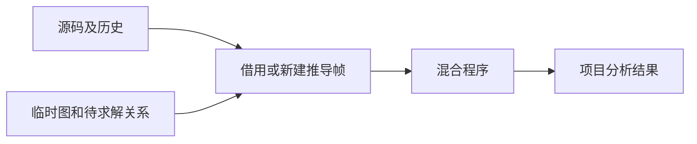

# RX 项目推导与历史复用自举

## Intent

将 RX 项目的依赖发现、签名分析与复用、Store 注册、约束求解、混合编译和结果发布接成正式 Source 调用链。

## Data

原实现从 `project.infer` 进入 `inferIn`，在宿主决定是否复用完整推导帧，或收集依赖并重新推导签名、Store 和 RX 约束。约束节点、待求解关系和输出类型使用不同生命周期的分配器。

## Edges

继续借用原模块、图、签名和历史快照。Source 只传递栈上句柄与阶段结果。待求解区在求解结束后释放，解析预取和路径索引在相同的最后使用点释放。诊断使用原位置和映射规则。宿主继续持有缓存、资源、AST 及图和程序表，seed 使用相同物理操作。

## Answer

### 阶段与历史回归

- 以上一阶段 Source 工具构建新引导器，分区构建通过 25 步。新引导器重生成 767 个入口，排除记录输入身份的戳文件后，13,004 个输出逐字节一致。
- 常驻生成器使用现有 lint RX 入口验证原版、ZX 仅正文编辑、RX 编辑、坏依赖、还原和无改动。仅正文编辑实际命中推导帧复用，坏依赖返回失败，还原后复用产物。四个成功生成状态的各 42 个 Zig 文件分别与空缓存构建一致。
- ReleaseSmall 下通过 1,118 项 Zig 回归与 25 项具名项目和 Store CLI 回归，覆盖 RX 运行、类型推导、并行推导、磁盘项目和 Store 路径。
- 初始 seed 生成解析器的 29 个步骤全部通过。新 Source 阶段只传借用句柄和布尔决策，生成代码无新增分配。

### 固定语料性能

固定 735 个入口，Zig 0.17.0、ReleaseSmall、16 分区，关闭常驻。两侧均由 Source 引导器构建并运行 Source 分析与生成。三轮交替取中位数，11,758 个生成文件和所有权 memo 逐字节一致。

| 场景                 | 相邻对照 |   本阶段 | 固定基线 |
| -------------------- | -------: | -------: | -------: |
| 冷生成墙钟           |   2.62 s |   2.61 s |   2.85 s |
| 冷生成 CPU           |  12.31 s |  12.31 s |  12.58 s |
| 冷生成采样进程树峰值 | 719.1 MB | 719.7 MB | 893.0 MB |
| 冷生成单进程峰值     | 753.9 MB | 745.3 MB | 939.7 MB |
| 热生成墙钟           |   2.05 s |   2.02 s |   2.25 s |
| 热生成 CPU           |   8.35 s |   8.26 s |   8.61 s |
| 未变输入墙钟         |   0.03 s |   0.04 s |   0.04 s |

本组性能数据覆盖引导生成。常驻编辑实验验证缓存正确性与恢复结果。完整冷构建沿用单独的验收口径。
