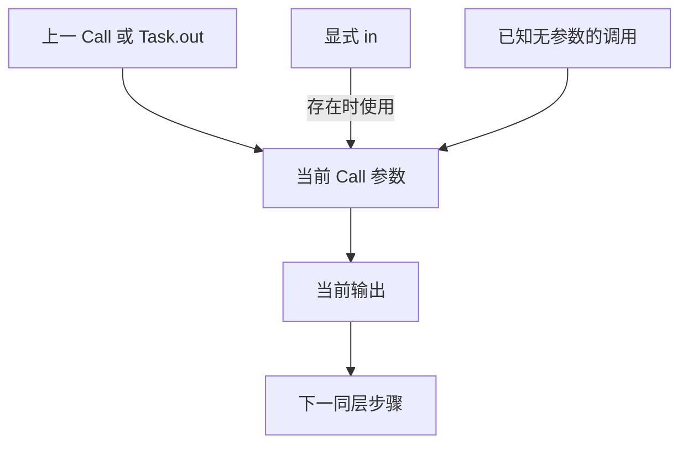

# RX 顺序调用默认输入

## Intent · 表达相邻步骤的数据流

顺序编排中，有输入的 Call 省略 `in` 时接收同一层紧邻步骤的输出。格式化省略与默认输入相同的显式写法。两种写法使用相同的类型约束、函数调用和所有权降低。

## Data · 输入来源与编译链

解析支持顺序调用省略参数，准备阶段在建立好的顺序范围内补全对上一输出的引用。推导和降低共用已解析的引用。

## Edges · 作用域

相邻顺序中的 Call 结果和显式 Task.out 是默认来源。进入分支、Task 及并行内部顺序时，各自从空的前置输出开始。显式参数仍可按原作用域读取既有名字。已知无参数的目标保留其空输入约定。格式化保留字段访问、运算及跨步骤引用。

## Answer · 验收

- 普通 Call、命名 Call 和 Task.out 三类显式及省略写法，各自生成的 Zig 逐字节一致。首步与并行兄弟越界均被拒绝。
- CLI 格式化自动省略上一输出的直接引用，重复执行得到相同文本。运算、跨步骤和并行兄弟引用仍保留，格式化前后的 lint 行为符合预期。生成应用输入 3，输出 8。
- RX 文本、推导、并行推导、磁盘项目和编译库回归通过 365 项 Zig 测试和 26 项具名 CLI 测试。编译器 RX 语法与依赖图另通过 39 项测试，初始 seed 生成通过 29 步。
- 固定 735 个入口，Zig 0.17.0、ReleaseSmall、16 分区。两侧均由 Source 引导器构建，运行 Source 分析和生成。三轮交替的冷生成墙钟持平于 2.59 秒，CPU 为 12.34 → 12.28 秒，进程树峰值约 721 MB，单进程峰值为 759.0 → 792.2 MB。固定基线的冷墙钟、CPU、进程树和单进程峰值分别为 2.85 秒、12.58 秒、893.0 MB 和 939.7 MB。11,758 个生成文件和所有权 memo 一致。
