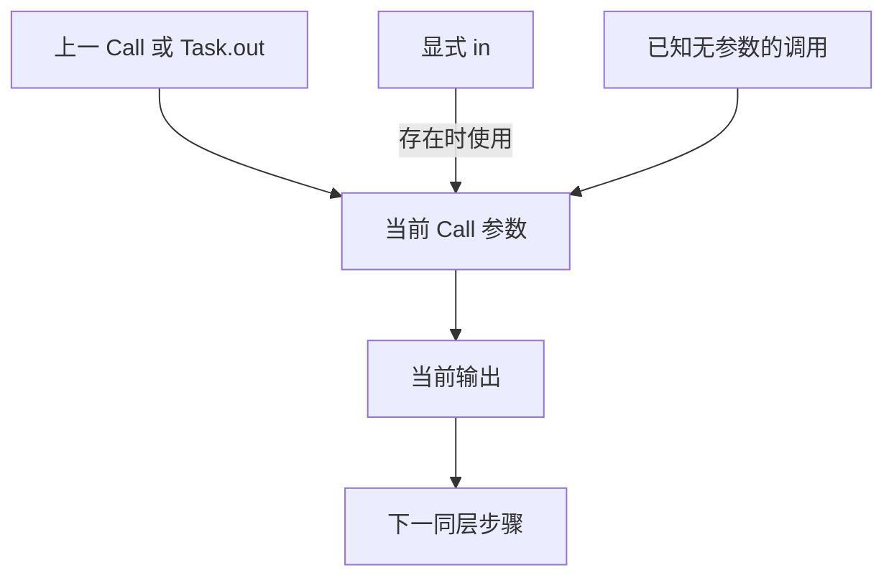

# RX 顺序调用默认输入

## Intent · 表达相邻步骤的数据流

顺序编排中，有输入的 Call 省略 `in` 时接收同一层紧邻步骤的输出。格式化省略与默认输入相同的显式写法。两种写法使用相同的类型约束、函数调用和所有权降低。

## Data · 输入来源与编译链

解析支持顺序调用省略参数。Source 在建立顺序块索引时标记紧邻的可用输出。准备阶段登记当前 Call 时直接绑定这个引用，推导和降低共用解析结果。

## Edges · 作用域

相邻顺序中的 Call 结果和显式 Task.out 是默认来源。进入分支、Task 及并行内部顺序时，各自从空的前置输出开始。显式参数仍可按原作用域读取既有名字。已知无参数的目标保留其空输入约定。格式化保留字段访问、运算及跨步骤引用。

## Answer · 验收

- 普通 Call、命名 Call 和 Task.out 三类显式及省略写法，各自生成的 Zig 逐字节一致。首步与并行兄弟越界均被拒绝。
- CLI 格式化自动省略上一输出的直接引用，重复执行得到相同文本。运算、跨步骤和并行兄弟引用仍保留，格式化前后的 lint 行为符合预期。生成应用输入 3，输出 8。
- RX 文本、推导、并行推导、磁盘项目和编译库回归通过 365 项 Zig 测试和 26 项具名 CLI 测试。编译器 RX 语法与依赖图另通过 39 项测试，初始 seed 生成通过 29 步。
- 固定 735 个入口，Zig 0.17.0、ReleaseSmall、16 分区。两侧均由 Source 引导器构建，运行 Source 分析和生成。三轮交替的冷生成墙钟持平于 2.59 秒，CPU 为 12.34 → 12.28 秒，进程树峰值约 721 MB，单进程峰值为 759.0 → 792.2 MB。固定基线的冷墙钟、CPU、进程树和单进程峰值分别为 2.85 秒、12.58 秒、893.0 MB 和 939.7 MB。11,758 个生成文件和所有权 memo 一致。

### 全仓对齐

扫描 Git 纳入管理的 1,447 个 RX 文件。930 个包内文件全部使用正式的 `zxc fmt` 格式化，覆盖编译器、genz、core、lint、网站示例和测试输入。共省略 632 处同层紧邻输出引用，其中 genz 占 548 处。日期归档中的示例另省略 22 处。保留模块输入、字段选择、跨步骤引用和并行兄弟的显式输入。仅有历史排版差异的归档保持原样，两个超过 XML 深度上限的历史压力输入继续用于复现原诊断。

此前根目录的格式化脚本会跳过 RX。现在 `pnpm format:rx`、`pnpm format:rx --check` 和包内 RX 的提交钩子均调用语言格式化器。全量复查 930 个包内文件，格式化差异为零。926 个包内文件通过 `zxc lint`，另四个拒绝用例保留了各自的预期诊断。

同一 Source 引导器使用格式化后的源码重新生成 766 个入口，12,973 个输出文件与改写前逐字节一致，比较时排除输入身份戳。52 项格式化 CLI 用例、1 项格式化前后运行结果对照及 6 项属性拒绝用例通过。

11 月 18 日用最新 CLI 对全部 1,448 个受 Git 管理的 RX 文件复查。931 个包内文件均已格式化，其中 927 个通过 lint，4 个是属性拒绝用例。另有 457 份归档源码补做排版，逐文件核对引用字符串及非空白 token，前后相同。所有可解析 RX 文件中，格式化器还能省略的 `Call.in` 为零。

`pnpm format:rx --check` 和提交钩子现在也覆盖归档源码。1,434 个普通文件二次格式化差异为零。另有 14 个输入由 `.gitattributes` 标明保留原文，含成对的格式化前后样本，以及由脚本生成的固定字节性能与深度测试输入。517 个归档文件中，195 个通过当前 lint，308 个普通历史样例保留了旧语法或文件类别诊断，其余 14 个是上述原文样本。

### 11 月 18 日 · 自举顺序输入绑定

原有实现只要遇到一处省略输入，就在模块准备结束后递归重走整份执行计划，并为沿途的调用求结果名。现在由 ZX 在既有顺序扫描中向后一个 Call 标明前面有 Call 或带 out 的 Task，使用原有 32 位事实列中的一位。RX 准备流程读取这项信息，在登记调用时从已有步骤表取得前一行。显式参数以已发布的参数槽为准，只有实际消费前一输出时才读取名称。分支、任务和并行兄弟各自保持原来的边界。初始 seed 也在已有顺序遍历中绑定。额外整图遍历和模块级省略标记已删除。

准备、步骤表、参数记录和推导约束的相关范围在父提交中为 22 个 Zig 文件、3,156 行。本次迁出其中的顺序输入遍历。参数 AST 存储、端口和输入属性读取、合成引用的表达式解析仍在 Zig。

- 最终候选通过 365 项 Zig 回归和 26 项 CLI 检查，覆盖显式跨步骤引用、Store、所有权和编译库输入。普通调用、命名调用和 Task.out 的显式与省略写法分别生成相同 Zig。首步和并行兄弟越界仍给出原有诊断。
- 上一阶段的 Source 工具构建本阶段工具通过 25 步。候选再生成 770 个入口，排除输入身份戳后 12,994 个文件逐字节一致。初始 seed 的解析器生成通过 29 步。
- 从已省略输入的格式化提交中选取 40 个编译器与 genz 的实际入口，关闭驻留，前后版本交替运行三轮。3,343 个产物一致。冷生成墙钟中位数 1.01 → 1.03 秒，CPU 5.24 → 5.32 秒，单进程峰值 475.3 → 465.3 MB。
- 固定 735 个入口，两个工具均由 Source 构建，启用 Source 分析及生成，使用 ReleaseSmall 和 16 分区。三轮交替冷生成墙钟 2.62 → 2.59 秒，CPU 12.30 → 12.33 秒，进程树采样峰值 721.5 → 718.8 MB，单进程峰值 809.2 → 744.6 MB。较固定基线，墙钟低 0.26 秒、CPU 低 0.25 秒、树峰值低 174.2 MB。热生成墙钟均为 2.01 秒，11,758 个固定产物及所有权 memo 一致。该组计时只覆盖生成器。
