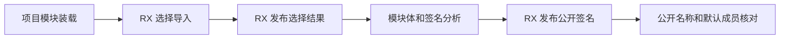
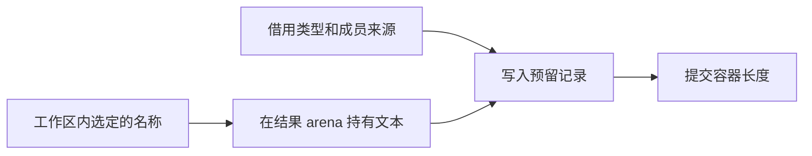
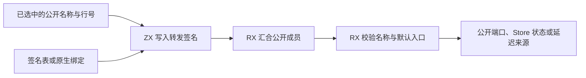

# ZX 项目导入与公开签名发布自举

## Intent

沿正式项目分析和签名分析入口，把已选定的导入、转发成员和公开签名发布成最终表。保留项目依赖遍历顺序、缓存输入、公开名称规则与字段所有权。

## Data

起点为 `84d099ea`。`Project.loadFrames` 依次处理模块依赖，`Project.loadInput` 在目标装载后执行 `binding.select`。查找和选择已由 RX/ZX 编译执行，`binding.publishTypes` 与 `binding.publishFunctions` 仍在 Zig 逐项复制名称、写入类型、常量和函数。签名路径的 `bindSignature` 会把转发的签名保存进工作区，`publishSignature` 再将本地声明、转发签名和原生绑定排入公开成员表。

## Edges

继续使用现有顺序和错误优先级。底层容量由当前容器的所有者预留，RX/ZX 借用目标切片并原位发布，在最终 arena 中拥有需要跨工作区保留的文本。非文本常量使用原标量表示。本地签名、转发签名和原生绑定按既有顺序排列。初始引导仍保留其必要实现。

## Answer

首先贯通公开签名和导入发布，再用一个批次验证签名分析、模块分析、原生声明、联结与缓存入口。源码装载的依赖栈、项目 arena 与缓存恢复事务继续另行核对。

正式 Source 路径中，`binding.publish` 预留原容器的尾部，RX 依次调用类型、常量和函数发布。ZX 拥有名称和字符串常量，复用已稳定的函数签名和类型编号。每一段只推进已写完记录的长度，分配失败时保留可用的前缀。签名模式复用同一类型和常量发布逻辑，代码体模式同时发布函数绑定。

公开成员发布的 RX 分支依次处理本地声明、已有转发和原生绑定。转发成员批量复制记录描述符，共享原有文本。原生绑定从借用的函数表读取输入、输出与 Store 状态，写入最终成员切片。容量、Zig 原始布局的借用以及最终诊断呈现仍在宿主内。`bindSignature` 选中后登记转发成员的循环和公开名验证的调用仍由 Zig 协调。

局部引导清单的三个入口均已生成。上一阶段 Source 工具生成候选，再由候选生成第二代，两次引导构建均通过 22 个步骤，二进制 SHA-256 相同，均为 `48a9baf9fa26777f2bebe731be6f8f1cb79f7afa2a556d2238d6d5e34493e085`。

### 验收

原生声明、原生联结、语义缓存、类型合并、库联结、库导入、运行联结、模块产物及原生生成九组通过。共有 225 个构建步骤和 348 项 Zig 回归，另有七组 Node 测试通过。

各自使用 Source 自编译工具与 Source 分析、生成后端，在 Zig 0.17.0、ReleaseSmall、16 分区的同一配置下交替运行三次。进程树 RSS 为采样峰值，单进程 RSS 取 `/usr/bin/time` 的结果。表内 RSS 按十进制 MB 记录。完整冷构建墙钟未在本批重新测量。

| 冷生成             | 墙钟 / 秒 | CPU / 秒 | 进程树 RSS / MB | 单进程 RSS / MB |
| ------------------ | --------: | -------: | --------------: | --------------: |
| 733 入口，上阶段   |      2.95 |    12.78 |           785.2 |           882.3 |
| 733 入口，本阶段   |      2.91 |    12.82 |           783.7 |           831.0 |
| 735 入口，冻结基线 |      2.87 |    12.56 |           894.7 |           925.9 |
| 735 入口，本阶段   |      2.84 |    12.55 |           756.9 |           793.1 |

733 入口冷生成的 12,019 个文件逐字节一致，排除了输入戳。5,450 个源码缓存键和负载一致，唯一性缓存负载也一致。热生成墙钟从 2.27 秒降到 2.25 秒，未修改重跑均为 0.03 秒。冻结输入同历史基线的 135 处文件差异与上一批的路径及两侧哈希一致。两个联结执行样例的输出哈希一致，运行墙钟中位数均略降。

### 转发签名与默认公开入口

从 `30602d76` 的 `Project.bindSignature` 和 `public_exports.select` 开始。迁移范围包括被选中转发签名的发布、原生绑定到签名的转换、默认公开入口及重复名的结果提取。结构体布局、尾部容量、初始引导分支和诊断格式仍由宿主管理。

已有签名按行复制记录描述符，在最终 arena 持有更名后的文本。原生绑定通过同一个 ZX 转换函数生产公开签名，沿用端口、内建绑定和 Store 字段的处理。普通函数导入也复用命名成员与默认成员的读取逻辑。

公开名称校验沿类型、常量、函数三段扫描，返回首个冲突的位置和名称。RX 根据模式选择入口函数或转发签名，保留本地函数优先、默认转发的端口和 Store 状态、延迟目标及本来就有的内建绑定行为。宿主提交这些字段，并用现有诊断格式呈现冲突。

模块记录、语义缓存、联结边界、原生声明、库联结、库导入、联结执行与原生生成八组通过。共 158 个构建步骤、142 项 Zig 回归与七组 Node 测试通过。使用上一阶段的 Source 自编译工具生成候选，再由候选生成第二代，两次均通过 22 个构建步骤，二进制 SHA-256 均为 `f5f3bce20c8c6ed42380a7dcf1c08abf460f53d7f467a4ccf4ee699b63872321`。

沿用 Zig 0.17.0、ReleaseSmall、16 分区及各自的 Source 自编译工具和 Source 后端，报告三次交替测量的中位数。完整冷构建未重测。

| 冷生成             | 墙钟 / 秒 | CPU / 秒 | 进程树 RSS / MB | 单进程 RSS / MB |
| ------------------ | --------: | -------: | --------------: | --------------: |
| 734 入口，上阶段   |      2.93 |    12.76 |           786.2 |           868.0 |
| 734 入口，本阶段   |      2.94 |    12.75 |           786.9 |           886.3 |
| 735 入口，冻结基线 |      2.90 |    12.51 |           896.8 |           962.1 |
| 735 入口，本阶段   |      2.84 |    12.55 |           764.8 |           854.7 |

734 入口排除输入戳后，12,029 个生成文件逐字节一致，5,454 个源码缓存键及负载与唯一性缓存负载一致。热生成墙钟从 2.27 秒到 2.28 秒，未修改重跑均为 0.03 秒。冻结输入已有的 135 项差异在路径和两侧哈希上与上一批一致。两组联结输出哈希一致，墙钟分别增加约 0.01 毫秒和 0.05 毫秒。
