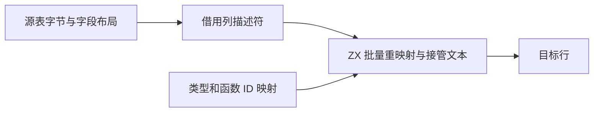

# 产物导入与成员表发布自举

## Intent

沿正式产物提取路径，将依赖记录、函数导入与公开成员的逐行发布迁入 ZX。

## Data

联结依赖图和发布最终 Program 的实现已经落在 RX。正式提取入口 `artifact/prepared/root.zig` 调用 RX 生成类型、签名、原生模块及函数体。提取随后由 Zig 逐条构造函数绑定和依赖记录的请求，逐条调用已生成的复制逻辑并写回原生行。

## Edges

每批直接借用源行的列视图，并将新拥有的文本和重映射 ID 写入最终的目标字段。函数绑定的命名空间、三项端口与 intrinsic 各自沿用现有表示。依赖的本地源路径随产物接管，其他目标沿用原记录语义。依赖表一次保留原记录的标量和描述符，由 ZX 接管需要独立存储的字段。所有表保持原有产物布局。

当前宿主仍分配目标行、装配产物并提交可增长的联结状态。新增的底层操作只负责按列写入字符串列表描述符，类型合并和函数表增长仍待迁移。

## Answer

核验产物提取和所有权、联结错误边界、缓存复用及独立库导入，使用相同夹具对照实际提取和重联结的耗时及生成结果。

由上一阶段 Source 引导器生成第一代，再由第一代生成第二代。两次构建各通过 22 步，二进制的 SHA-256 均为 `6a6c25ed2d64f933995594d05a0a41fcd2099aa2267b627780424772ef5d6d45`。

产物提取、联结、语义缓存及库导入组通过 180 项 Zig 测试与 6 项独立导入。另通过 36 项别名运行测试，覆盖六种源模块顺序和源码、独立库两条消费路径。

在相同的 ReleaseSmall 配置下交替运行相邻两版工具，按照既有两组夹具从源码分析、产物提取、重联结到输出 Zig。普通函数场景墙钟中位数为 4.09 → 4.05 毫秒，CPU 为 3.07 → 3.04 毫秒，单进程峰值均为 6.41 MB。Store 场景为 3.80 → 3.73 毫秒，CPU 为 2.61 → 2.61 毫秒，单进程峰值为 6.39 → 6.37 MB。每组新旧产物的哈希一致。

Zig 0.17.0、ReleaseSmall、16 分区、关闭常驻服务。相邻两版 Source 自编译工具在同一 729 项输入下交替各执行三轮。11,915 个生成文件、5,413 项源码缓存记录和所有权备忘录都一致。

| 对照            | 冷生成墙钟     | 冷生成 CPU       | 采样进程树峰值 RSS | 单进程峰值 RSS   |
| --------------- | -------------- | ---------------- | ------------------ | ---------------- |
| 上阶段 → 候选   | 2.84 → 2.85 秒 | 12.67 → 12.68 秒 | 774.2 → 773.8 MB   | 835.0 → 827.9 MB |
| 固定基线 → 候选 | 2.84 → 2.83 秒 | 12.50 → 12.52 秒 | 888.5 → 759.2 MB   | 963.5 → 839.4 MB |

相邻热生成墙钟为 2.23 → 2.22 秒，CPU 为 8.71 → 8.69 秒，无变化路径均为 0.03 秒。固定基线沿用 `0e7ff384` 的冻结语料及历史内存接口名的规范化处理。134 个既有 Zig 差异的文件名和双侧内容哈希与上阶段一致，另有一处路径相关的生成清单差异。本阶段测量生成、提取与重联结，未重测完整冷构建。
